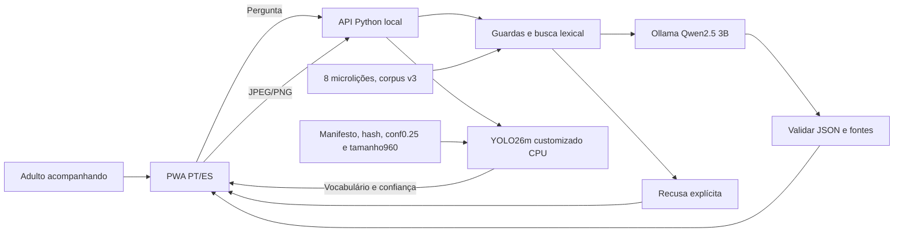

# PRD — GenAI e Computer Vision

Versão 4, 17/11/2026. Branch feat/genai-vision. Esta versão descreve o estado atual; experimentos anteriores estão no histórico e nos relatórios. Fonte oficial: desafio FIAP CitizenTech, páginas 24, 29–31 e 44. Pesos e pendências em ENTREGA_CHECKLIST.md.

## Problema e escopo

O Acolhe apoia acolhimento linguístico PT/ES e orientações educativas de mobilidade, com acompanhamento adulto. GenAI responde com conteúdo atribuído ou recusa. Vision reconhece objetos de uma fotografia selecionada e mostra nomes nos dois idiomas. Não identifica pessoas, não grava uploads nem interpreta semáforo como autorização de travessia. Funcionamento e métricas locais não certificam segurança, eficácia pedagógica ou conformidade jurídica integral.

## Jornadas

1. Abrir Ollama e executar scripts/iniciar-demo.ps1; acessar a porta indicada.
2. Em Caminho seguro, perguntar em PT/ES e conferir resposta, fonte e avisos. Sem informação, receber recusa explícita.
3. Em Para educadores → Objetos que ensinam, selecionar JPEG/PNG de até 8 MiB e reconhecer nomes PT/ES, caixas e confiança. Não há câmera automática.
4. Gravar demonstrações reais com entregas/TESTAR_AMANHA.md ou COMO_USAR_E_GRAVAR.md, incluindo limitações.

## Arquitetura atual

UI usa RAG. Baseline e agente retrieve/refuse são comparadores com rastros, não três botões do produto. Avisos fixos são separados da geração. Sem modelo, retrieval_only é identificado como recuperação; falhas não geram texto fictício. Vision pronto significa checkpoint carregável, não meta de qualidade validada.

## Requisitos e critérios de aceite

| ID | Requisito | Evidência atual |
|---|---|---|
| G01 | Tarefa e gabarito com negativas | dev20, históricos C12 e novo D16 congelado antes dos ajustes |
| G02 | Fonte/licença por trecho | Oito documentos bilíngues, corpus v3 e snapshot em genai/base |
| G03 | Recall de busca e limiar | Recall@1/@3 de 16/16 no desenvolvimento; limiar 2,0 reavaliado |
| G04 | Geração, JSON, fontes e recusa | Modelo local real integrado, guardas compartilhadas e rastros |
| G05 | Especialização comparada | Agente real versus RAG e baseline; alternativa prevista ao LoRA |
| G06 | Placar, erros e reprodução | Relatórios, notebooks e respostas brutas; revisão humana pendente |
| V01 | Dados aprovados e rastreáveis | Base inicial 91/27/23; expansão aprovada 117/38/13, sem os 23 testes antigos |
| V02 | Treino e fine-tuning comparados | Três nanos: nove épocas cada; M91: cinco; continuação117: sete, sem promoção |
| V03 | Escolha pela validação | Receitas e emenda de objetivo divulgadas; escolha congelada antes da regressão |
| V04 | Inferência coerente | M em 960 / confiança 0,25, hash e classes conferidos pela API |
| V05 | Meta local de qualidade | Precisão e recall pelo menos 70%; observada no teste básico reservado13; não no23complexo |
| V06 | Entrega | PDF com resumo 250 / objetivo 50 palavras; vídeos e Teams pendentes |

## GenAI: implementado e limites

Qwen2.5:3b-instruct, 3,09 bilhões de parâmetros, Q4_K_M e aproximadamente 1,9 GB de pesos, dentro do teto de 4B pedido. Modelo instalado, execução local com GPU verificada em rodadas registradas. Contexto 2048, saída 256, temperatura 0 e seed 42. CPU alternativa. Licença Qwen Research.

Protocolo atual v6, corpus v3. No D16, congelado antes dos ajustes, a revisão técnica exploratória do agente contou 7/16 respostas corretas sem contexto e 14/16 em RAG e agente. Não é julgamento humano cego nem eficácia pedagógica. Duas falhas de recuperação permanecem. Os placares v4 e C12 são históricos, não a versão ativa. Não houve LoRA ou treinamento dos pesos pela equipe; foi seguida a alternativa de especialização por agente da rubrica. Detalhes em entregas/GENAI_RELATORIO.md e genai/model_manifest.json.

## Vision: dados, seleção e resultados

Uniram-se conjuntos previamente aprovados, preservando splits e deduplicando cinco IDs com pixels e rótulos iguais. São 91 fotos de treino com 613 objetos, 27 de validação com 247 e 23 de teste com 66. Os sete testes antigos não entraram no treino. Reconstrução offline conferida, fingerprint abb33444…. Triagem por hash perceptual sem pares no limite usado não prova independência entre cenas.

Três comparadores nano usaram a mesma base e receita: continuação do checkpoint antigo, continuação do recente e controle oficial. Cada um concluiu nove épocas, com taxa AdamW explícita e parada antecipada. Uma fase adicional adaptou YOLO26m após referência de capacidade na validação. Concluiu cinco épocas, de um máximo de 12, com checkpoint escolhido na primeira. Receitas diferentes impedem atribuir o ganho apenas ao tamanho do modelo.

O critério inicial de F1 foi emendado após os resultados de desenvolvimento para priorizar equilíbrio entre precisão e recall. A emenda foi registrada antes de abrir a regressão das 23 fotos; não pertence ao pré-registro original. Perfil escolhido: confiança 0,25 e resolução de inferência 960, com treino em 640. Pesos anteriores preservados.

| Comparação | Precisão | Recall | F1 |
|---|---:|---:|---:|
| Nano anterior, validação 27 |63,5%|46,6%|0,5374|
| M atual, mesma validação 27 |70,3%|67,2%|0,6874|
| Nano anterior, regressão exposta 23 |60,7%|51,5%|0,5574|
| M atual, mesma regressão 23 |68,3%|62,1%|0,6508|

Macrorecall da validação passou de 43,9% para 63,1%. Na regressão atual houve 41 acertos, 19 falsos positivos e 25 objetos perdidos; macrorecall 65,5%. Algumas classes regrediram apesar do ganho agregado. Todos os erros e valores por classe estão preservados. quality_validated=false. A origem COCO e as exposições anteriores impedem alegar teste independente.

HTTP real: ônibus e três utensílios reconhecidos, sem armazenamento. Mediana de aproximadamente 0,955 segundo em cinco repetições locais da foto do ônibus; não é benchmark geral. O checkpoint tem cerca de 22 milhões de parâmetros e 44 MB de pesos. Serviço utiliza CPU e mantém as mesmas 12 classes da interface.

## Próximos passos e limites

- Revisão da equipe e pedagógica; vídeos, links e envio no Teams.
- Próximo lote com objetos mais visíveis: 50 fotos propostas, 26 treino / 11 validação / 13 teste reservado da próxima rodada. Foi aprovado e usado no experimento117, sem promoção de novos pesos. A coleta parou por HTTP 429, e as metas iniciais de quantidade não foram alcançadas.
- Agrupar cenas relacionadas e reservar avaliação nova; não usar as 23 fotos para escolher novos parâmetros. COCO pode ter participado do pré-treino, logo mesmo novos IDs não comprovam independência de toda a origem dos pesos.
- Priorizar diversidade e clareza dos objetos em vez de simplesmente aumentar épocas. Não prometer sistema sem erros.

## Evidências e uso

- entregas/VISION_FINETUNING.md: pesquisa, comparação, fontes, diagramas e emenda.
- vision/reports/finetune91-decision.json e ft91-medium-regression23.json: decisão e dados reais.
- docs/evidencias/finetune91-http.json: configuração e chamadas reais.
- output/pdf/ACOLHE_VISION.pdf: relatório de entrega atualizado.
- entregas/TESTAR_AMANHA.md: frases e fotos locais de ensaio.

## Resultado final da expansão aprovada

O lote50 foi aprovado e compôs117treino/38validação/13teste, sem qualquer imagem dos23antigos. A adaptação117completou7épocas, mas o perfil equilibrado teveP71,5/R71,5 na validação, contraP72,7/R71,5 doM91; nenhum candidato passou a regra de promoção. O modelo ativo permanece treinado nas91fotos originais.

A decisão foi congelada antes do teste13. Uma avaliação única registrou52TP21FP20FN: precisão71,2%,recall72,2%,F10,7172; meta observada nesse pequeno conjunto básico. Macrorecall86,0%;12/13imagens tiveram ao menos um alvo primário correto, indicador suplementar que NÃO substituiP/Rglobais. Não é ganho causado pelo treino117 e não comprova generalização; fonteCOCO pode sobrepor pré-treino. As23complexas continuam com68,3%P/62,1%R, sem nova avaliação.

Não há aprovação de fotos pendente desta rodada. Restam revisão da equipe, vídeos, links reais e envio acadêmico. Perfil/erros/fontes completos em entregas/VISION_FINETUNING.md, vision/reports/finetune117-summary.json e ft117-reserved13.json. quality_validated=false permanece correto.
