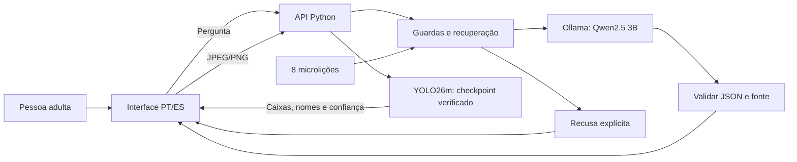
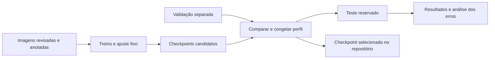

# Acolhe - requisitos de GenAI e Vision

## Objetivo e público

Apoiar atividades supervisionadas de acolhimento linguístico em português e espanhol. O assistente responde a dúvidas de vocabulário e mobilidade educativa; o detector associa objetos de fotografias a nomes nos dois idiomas. A pessoa adulta conduz a atividade e interpreta os resultados.

## Fluxos de uso

1. Instalar as dependências, abrir Ollama e iniciar o Acolhe pelo script da demonstração.
2. Em Caminho seguro, fazer uma pergunta em PT/ES e consultar resposta, fonte e aviso.
3. Em Para educadores, selecionar uma foto e reconhecer os objetos, com caixas, nomes e confiança.

## Requisitos funcionais

| ID | Requisito | Implementação |
|---|---|---|
| G01 | Responder em PT/ES com fonte | Qwen2.5 3B e oito microlições bilíngues |
| G02 | Recusar informação ausente ou fora de escopo | Guardas de entrada e limiar de recuperação |
| G03 | Validar a resposta estruturada | JSON, limite de tamanho e IDs de fonte |
| G04 | Comparar estratégias de geração | Baseline, RAG e agente no mesmo conjunto D16 |
| V01 | Receber uma imagem selecionada pela pessoa adulta | JPEG/PNG, até 8 MiB; sem câmera automática |
| V02 | Identificar objetos e apresentar vocabulário | YOLO26m customizado, 12 classes, nomes PT/ES |
| V03 | Utilizar o checkpoint avaliado | Hash, classes e perfil de inferência verificados |
| V04 | Permitir teste após clonar | Checkpoint, manifesto e três imagens creditadas incluídos |

## Arquitetura

## Treinamento e avaliação de Vision

O modelo retido foi treinado com 91 fotos; a continuação com 117 não melhorou a mesma validação. A meta local de precisão e recall de pelo menos 70% foi observada no teste básico reservado de 13 fotos. O conjunto anterior de 23 fotos teve desempenho inferior. Método, comparações e limitações estão no relatório Vision.

## Requisitos de operação

- Execução local; primeira instalação com internet para dependências e a LLM. Não é necessário treinar para testar a entrega.
- Qwen abaixo de 4B, com digest conferido; Vision em CPU, imagem 960 e confiança 0,25.
- Uploads e perguntas do assistente não são persistidos pelo serviço. As sessões de atividades do MVP usam SQLite e são pseudônimas.
- O aplicativo não identifica rostos nem determina se uma travessia é segura. Uso com crianças exige supervisão e avaliação pedagógica.

## Evidências e estado da entrega

O ensaio da distribuição verificou o checkpoint idêntico em um clone novo, três fotos e respostas PT/ES com recusa. Passaram 124 testes Python e 14 Node; esses testes verificam implementação, não qualidade pedagógica. Os relatórios GenAI e Vision apresentam os resultados dos modelos. A equipe informou em 19/11/2026 que concluiu a revisão humana dos resultados de GenAI, preservando o placar técnico e os JSONs históricos, sem nova avaliação independente. A revisão pedagógica do corpus é uma etapa distinta. Os vídeos estão vinculados nos relatórios; o envio acadêmico permanece pendente.
