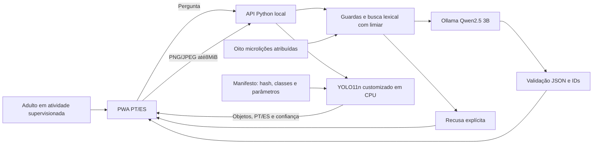
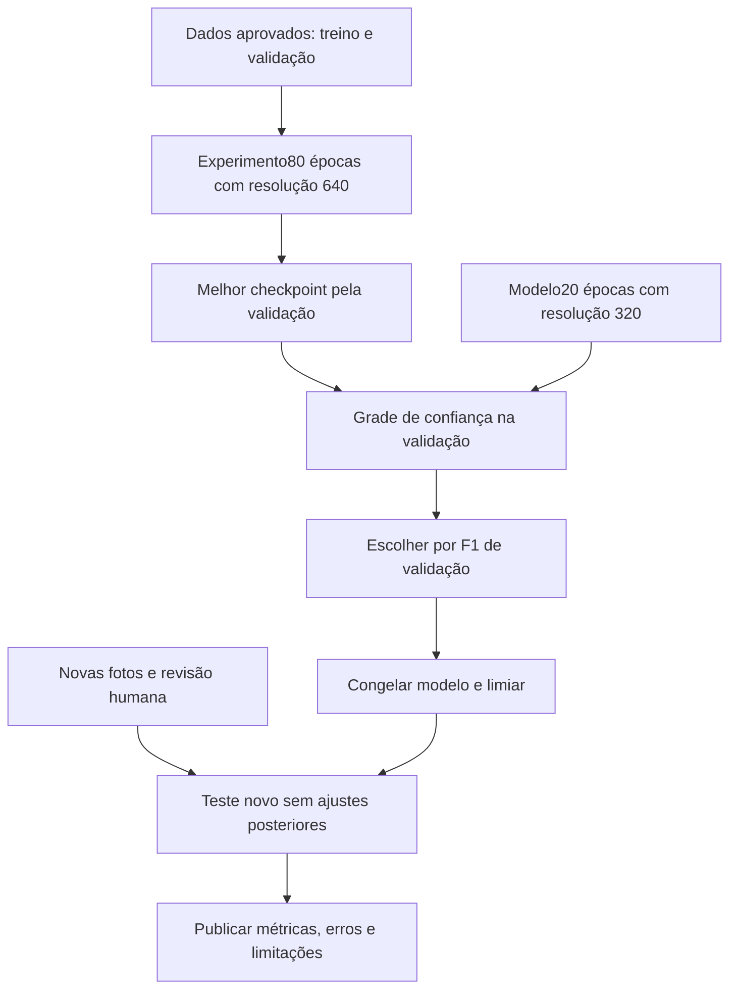

# PRD — GenAI e Computer Vision

Versão 3, revisão de 17/11/2026, branch feat/genai-vision. Este documento substitui o planejamento inicial; versões anteriores permanecem no histórico Git. Fonte de requisitos: desafio FIAP CitizenTech, páginas 24,29–31 e44; matriz ponderada em ENTREGA_CHECKLIST.md.

## Problema, usuários e escopo

Acolhe apoia acolhimento linguístico PT/ES e orientações educativas de mobilidade no trajeto escolar. Um adulto acompanha a atividade. GenAI responde consultando conteúdo atribuído; Vision apresenta vocabulário a partir de objetos em fotos selecionadas. O protótipo usa adultos/dados fictícios, sem interpretar semáforos como permissão de travessia ou tomar decisões de segurança.

## Jornadas e demonstração

1. Iniciar Ollama e scripts/iniciar-demo.ps1; abrir o endereço indicado no terminal.
2. Em Caminho seguro, perguntar, conferir resposta/fonte/aviso e alternar PT/ES. Uma pergunta sem informação na base deve receber recusa.
3. Em Para educadores → Objetos que ensinam, selecionar PNG/JPEG e reconhecer objetos; ler nome PT/ES e confiança.
4. Consultar os resultados, erros e limitações nos relatórios antes de gravar. Guia operacional e roteiro curto: entregas/COMO_USAR_E_GRAVAR.md.

## Arquitetura atual

O aplicativo usa RAG. Baseline e agente retrieve/refuse são variantes de avaliação, com rastros reais; não se apresentam como três modos selecionáveis na UI. Aviso fixo de travessia aparece separado da resposta LLM. Falhas não são substituídas por saídas fictícias. Uploads não são gravados.

## Requisitos e critérios verificáveis

| ID | Requisito | Aceite/evidência |
|---|---|---|
| G01 | Domínio, gabarito e casos sem resposta | Mobilidade educativa; dev20 e holdoutC12 rotulados |
| G02 | Base em trechos atribuídos | Oito documentos bilíngues, IDs, fonte/licença e snapshot em genai/base/ |
| G03 | Recuperação mensurável | Recall@1/@3 e limiar2.0 justificado em desenvolvimento; não confundir com acerto da resposta |
| G04 | Geração fundamentada integrada | JSON, fonte e recusa na API/UI; erros semânticos preservados e revisão humana pendente |
| G05 | Especialização comparada | Agente real versus RAG simples e baseline com o mesmo Qwen3B; LoRA não é obrigatório |
| G06 | Placar e cinco erros | Resultados por caso, análise técnica identificada e propostas; sem pontuações humanas inventadas |
| V01 | Dados reais e revisão | Inventário individual, hashes, aprovação humana e splits sem duplicatas binárias |
| V02 | Treino customizado rastreável | YOLO11n; ambiente, pesos/hash, configuração e avaliação reais |
| V03 | Melhorar recall sem esconder falsos positivos | Selecionar configuração/limiar pela validação; divulgar precisão, recall e resultados por classe |
| V04 | Inferência coerente com avaliação | Confidence/imgsz no manifesto, validação de limites, teste HTTP real |
| V05 | Relatório e demonstração | PDF com resumo250/objetivo50 palavras; vídeo real com URL pública |

## Estado comprovado

GenAI final: Qwen2.5:3b-instruct, Q4_K_M,3,09B, aproximadamente1,9GB de pesos, licença Qwen Research. GPU verificada no Ollama; contexto2048, saída256, temperatura0, seed 42. CPU continua disponível. Desenvolvimento: recall de busca16/16; revisão técnica de respostas baseline/RAG/agente5/20,16/20,16/20. HoldoutC12:4/12,8/12,9/12. São julgamentos exploratórios do agente, não avaliação humana cega.

Vision inicial:40 fotos aprovadas,25/8/7,97/48/42 objetos,20 épocasCPU com resolução 320. Recall nativo médio0,2943; no limiar do aplicativo0,5 foram4/42 objetos encontrados, com1 falso positivo. As duas métricas usam agregações/pontos de operação diferentes.

## Rodada de melhoria de Vision

- Experimento fixado antes dos resultados:80 épocas, resolução 640, batch 2, workers 0, seed 42, mesmas fotos aprovadas; preservar checkpoint20 épocas.
- Calibrar limiar em grade somente na validação, maximizando F1 micro; desempatar por precisão e depois confiança maior.
- Comparar candidatos pela validação antes de escolher o modelo ativo. Publicar contagens TP/FP/FN, métricas por classe e parâmetros efetivos.
- Teste de23 fotos aprovado e avaliado, sem IDs/bytes do lote original. Não foi usado no treino ou seleção. Resultados abaixo; após examiná-lo, futuras versões precisam de outro teste final.
- Metas locais: recall≥70%, precisão≥70%, nenhuma classe abaixo de60% de recall. São metas propostas para o protótipo, não números da rubrica nem resultado já alcançado. Amostras pequenas não validam produção.

O manifesto final e vision/reports/ identificam a versão ativa e os resultados executados. Maior resolução/mais épocas podem melhorar ou piorar; a escolha depende da validação. O novo teste tem pouca cobertura de ônibus e não substitui expansão equilibrada do treino.

## Entrega e dependências restantes

Relatórios e código publicados na branch; fotografias e pesos continuam locais. Novo clone reconstrói os dados e treina. Vídeos ainda precisam ser gravados, revisados e publicados; exibição pública de fotos exige revisão específica. Conferir nomes/RMs, conteúdo pedagógico e links, depois enviar em cada Teams até19/11 às23h55 conforme o horário do ambiente. Não há previsão de nota nem certificação de segurança/LGPD.

## Resultado da rodada executada

80 épocas com resolução 640 concluídas. O candidato foi promovido por F1micro de validação0,3488 versus0,3056 do modelo inicial calibrado. Versão ativa: confiança 0,10, resolução 640; checkpoint5935a4aa…. Teste histórico: recall nativo54,65%, mAP50 de 62,12%; no limiar da aplicação,22TP/21FP/20FN, recall52,38%, precisão51,16%. Baseline original no limiar0,5:4TP/1FP/38FN. Comparação justa com baseline também calibrado0,1:11TP/17FP/31FN. Meta de 70%/70% ainda não atingida. Novo teste de23 fotos aprovado e avaliado sem ajuste posterior; nenhuma imagem nova entrou no treino. Evidências em vision/reports/improvement-20261116.json e calibration-improved-640-80.json.

## Teste novo e meta revisada

Meta principal revisada pelo usuário: recall≥70% e precisão≥70%; o piso de60% por classe permanece um diagnóstico adicional, não uma exigência da rubrica. Teste novo aprovado de23 fotos/66 objetos, executado com configuração congelada no commitccdd7d7: baseline calibrado30TP/19FP/36FN (recall45,5%, precisão61,2%); versão ativa35TP/37FP/31FN (recall53,0%, precisão48,6%). O recall subiu, mas precisão e F1 caíram. Não se trocou modelo/limiar com base no teste; não se declara meta cumprida. Evidência: vision/reports/independent23-frozen.json. As imagens foram autorizadas somente para teste local. Para novos ajustes, ampliar treino e reservar outro teste, mantendo este como histórico congelado.

## Validação de bases leves

ComparaçãoCPU real de YOLO11n,YOLOv8n eYOLO26n pré-treinados nas8 fotos de validação, com remapeamento por nome para12 classes. YOLO26n teve o maior F1devalidação0,4667, contra0,3636/0,4286 das outras bases. São referências genéricas, não treino customizado. Experimento customizadoYOLO26n80épocas640 iniciado com treino25/val8 aprovados, sem usar teste23 na seleção. RF-DETRNano foi pesquisado, não executado; licençaApache2.0, footprintmaior. Decisão detalhada, licenças e fontes em docs/MODELOS_VISION.md.

## Dados da próxima rodada

Priorizar fotos de objetos próximos que representem a interação educativa prevista: diferentes exemplares, fundos e iluminações, com caixas completas e revisão de direitos/privacidade. Manter cenas difíceis separadas para diagnóstico. Não remover silenciosamente exemplos difíceis do teste atual nem apresentar um subconjunto escolhido após os resultados como prova de70%. A expansão ainda não foi treinada; as23 fotos aprovadas são exclusivamente teste.
