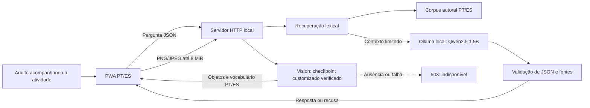
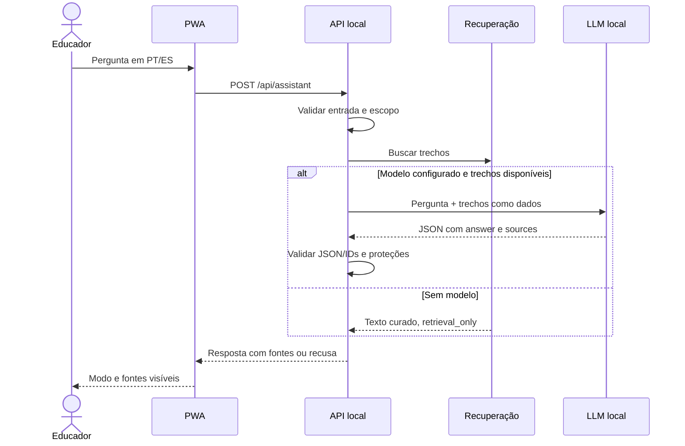
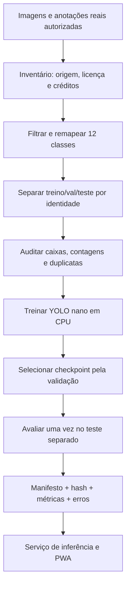

> **Atualização de fechamento:** este documento preserva o planejamento e os registros iniciais. O estado atual e a rubrica oficial estão em docs/ENTREGA_CHECKLIST.md; resultados finais estão em docs/entregas/GENAI_RELATORIO.md e VISION_RELATORIO.md. GenAI final é Qwen2.5 3B com comparação real dev20/holdoutC12 em GPU; Vision treinou20 épocas em CPU sobre40 fotos aprovadas e tem PDF final. Referências abaixo a1.5B, rubrica ausente ou treino pendente são históricas e foram superadas. Revisão humana, vídeos e Teams permanecem pendentes.

# PRD — GenAI e Computer Vision

Data: 16/11/2026. Branch: `feat/genai-vision`. Base: `4a2d00f`.

## Problema e objetivo

Acolhe ensina vocabulário português/espanhol e orientações educativas de mobilidade a crianças de 6–10 anos acompanhadas por um adulto. A base entrega a PWA, mas o tutor usa recuperação sem geração por padrão e a visão não tem dados nem checkpoint. O objetivo desta branch é entregar fluxos reproduzíveis de GenAI leve e visão customizada, com integração e evidências que distingam implementação, execução e qualidade.

O escopo vem do código e documentação disponíveis, não de uma rubrica oficial fornecida nesta conversa. Requisitos de treinamento obrigatório, quantidade de imagens e vídeos devem ser conferidos com os enunciados antes da entrega.

## Usuários e jornadas

- Adulto/educador faz pergunta em PT/ES, recebe resposta curta com fontes ou recusa explícita.
- Adulto seleciona uma fotografia de objetos, solicita reconhecimento e lê o vocabulário PT/ES. A aplicação não liga a câmera nem guarda a fotografia.
- Aluno responsável executa avaliações e reúne notebooks, métricas, erros e demonstração sem declarar resultados que não executou.

## Arquitetura de produto

## GenAI: requisitos e decisões

| ID | Requisito | Critério de aceite |
|---|---|---|
| G01 | Reutilizar corpus/recuperação existentes | Sem modelo, resposta identificada como `retrieval_only` |
| G02 | Modelo local pequeno em CPU | Qwen2.5 1.5B Instruct quantizado, contexto/saída limitados; configuração e diagnóstico reproduzíveis |
| G03 | Geração ancorada | Fontes restritas aos IDs recuperados, JSON validado e falha explícita |
| G04 | Comparar baseline, RAG e agente | Mesmas perguntas PT/ES, modelo, configuração e corpus; guardar latências, respostas e erros |
| G05 | Avaliação honesta | Métricas automáticas separadas de revisão humana; registrar erros reais, nunca preenchidos artificialmente |
| G06 | Integrar com PWA existente | `/api/assistant` mantém contrato e identifica modo/modelo |

Modelo escolhido após teste: [`qwen2.5:1.5b-instruct`](https://ollama.com/library/qwen2.5:1.5b-instruct), 1,54 bilhão de parâmetros, Q4_K_M e download de aproximadamente 986 MB. A tentativa inicial com 0.5B (398 MB) falhou em conteúdo e formato; seus relatórios foram preservados para justificar a escolha. No smoke, 1.5B respondeu substantivamente à pergunta de mochila em PT, que 0.5B apenas repetia, e à travessia em ES, com cerca de seis segundos por resposta em CPU. Essa escolha se aplica ao RAG do produto; o experimento de quatro casos ainda mostrou fontes omitidas no RAG experimental e recusas indevidas do agente. Não há superioridade geral nem aprovação de qualidade. Família com PT/ES, licença Apache 2.0 nessa variante. Usar CPU, contexto 2048 e resposta curta; qualidade precisa ser medida. O runtime Ollama ocupa espaço adicional. Não há necessidade de fine-tuning para este primeiro incremento; RAG com oito microlições é a base de comparação.

## Vision: requisitos e decisões

| ID | Requisito | Critério de aceite |
|---|---|---|
| V01 | Preparar dataset real para as 12 classes | Inventário de procedência/licença e caixas YOLO válidas |
| V02 | Evitar vazamento entre splits | Separação determinística antes de augmentation; auditoria de IDs e hashes |
| V03 | Treinar com orçamento pequeno | Reutilizar YOLO11n, CPU, batch/imgsz/epochs configuráveis; smoke test não equivale a qualidade |
| V04 | Avaliar em teste separado | Métricas reais agregadas e por classe, matriz e catálogo de erros |
| V05 | Verificar artefato | Checkpoint, hash, manifesto e ordem das classes antes de inferência |
| V06 | Integrar inferência na PWA | Upload explícito PNG/JPEG, limite 8 MiB, resposta PT/ES, 503 sem modelo |
| V07 | Limitar função educativa | Não inferir identidade, cor do sinal ou decisão de travessia; não persistir imagem |

Preservar YOLO11n evita introduzir outra stack de visão. Dados reais e revisão de direitos são pré-requisitos: os exemplos versionados não são um dataset. A auditoria automatiza consistência e rastreabilidade, mas não substitui revisão humana da imagem e da licença. Pesos COCO prontos não serão apresentados como treino customizado. Consulte também a [licença Ultralytics](https://www.ultralytics.com/license).

## Plano de execução e dependências

1. **Conhecer a base:** clonar, criar branch e executar suíte original; gerar grafo de código/documentação, HTML, relatório e vault Obsidian.
2. **GenAI:** perfil leve e diagnóstico → comparação reproduzível → execução real se runtime disponível → revisão humana bilíngue.
3. **Vision:** preparação e auditoria do dataset → treino configurável → avaliação/artefatos; em paralelo, integrar HTTP/PWA e testar indisponibilidade/contrato com stubs identificados.
4. **Integrar e verificar:** suíte Python/Node, teste HTTP, evidências e atualização do grafo após as mudanças.
5. **Fechar entrega:** executar treino real com dados revisados, revisar erros/modelo e gravar vídeos. Estes itens dependem das evidências, não apenas do código.

Os detalhes operacionais e checklists por matéria estão em [GenAI](../genai/PLAN.md) e [Vision](../vision/PLAN.md). O estado final de execução fica em [registro da branch](VALIDACAO_GENAI_VISION.md).

## Fora do escopo desta branch

Alterar Big Data, BI, RPA, robótica, infraestrutura/deploy ou as regras de sessões. Não coletar dados de crianças, publicar pesos/datasets privados, treinar um modelo de linguagem do zero, habilitar serviços cloud ou declarar qualidade pedagógica sem revisão.

## Riscos e critérios de conclusão

Mesmo um modelo 1.5B pode gerar português/espanhol ruim ou citações sem suporte textual; a validação de IDs não mede factualidade. Treino CPU pode ser demorado; reduzir imagem/batch serve para execução inicial, com impacto de qualidade medido no teste. O código só está concluído quando os testes passam; a entrega acadêmica só está comprovada quando existem resultados reais, análise de erros e os itens exigidos na rubrica.
