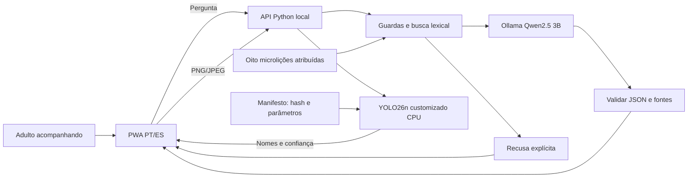
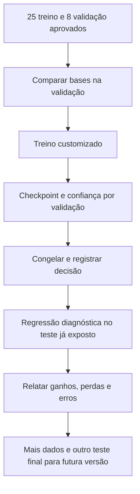

# PRD — GenAI e Computer Vision

Versão3,17/11/2026. Branch feat/genai-vision. Substitui o planejamento inicial; histórico preservado no Git. Requisitos oficiais: desafioFIAP CitizenTech, páginas24,29–31 e 44. Critérios ponderados e pendências em ENTREGA_CHECKLIST.md.

## Problema, pessoas e escopo

Acolhe apoia acolhimento PT/ES e orientações educativas de mobilidade. Um adulto acompanha a atividade. GenAI responde com conteúdo atribuído ou recusa; Vision nomeia objetos selecionados em fotos. A demonstração usa adultos/dados fictícios, sem identificar pessoas ou decidir travessias. Implementação/testes não certificam segurança, eficácia pedagógica ou conformidade integral com LGPD.

## Jornadas

1. Iniciar Ollama e scripts/iniciar-demo.ps1; abrir o endereço indicado.
2. Caminho seguro: perguntar em PT/ES e conferir resposta, modo, fonte e aviso. Pergunta sem informação recebe recusa.
3. Para educadores → Objetos que ensinam: selecionar PNG/JPEG≤8 MiB, reconhecer e ler nomesPT/ES/confiança. Sem câmera automática ou gravação do upload.
4. Gravar demonstrações reais com entregas/COMO_USAR_E_GRAVAR.md; mostrar resultados e erros, sem prometer perfeição.

## Arquitetura atual

UI usa RAG; baseline e agente retrieve/refuse são variantes comparativas com rastros, não três botões da interface. O aviso fixo de travessia é política curada separada da geração. Sem modelo, texto recuperado é identificado como retrieval_only; falhas não viram geração fictícia.

## Requisitos e aceite

| ID | Requisito | Evidência / estado |
|---|---|---|
| G01 | Tarefa em mobilidade e gabarito com negativas | dev20 e holdoutC12, respostas/fontes/recusas esperadas |
| G02 | Trechos com fonte/licença | Oito documentos bilíngues e snapshot em genai/base/ |
| G03 | Busca medida e limiar justificado | Recall@1/@3=16/16 no desenvolvimento; limiar2.0; não mede correção da resposta |
| G04 | Geração integrada fundamentada | JSON/fonte/recusa em API/UI; falhas semânticas preservadas |
| G05 | Especialização comparada | Agente real versus RAG/baseline, mesmo modelo; LoRA não é obrigatório |
| G06 | Placar, cinco erros e reprodução | Relatório, JSONs, notebooks com outputs e README; revisão humana pendente |
| V01 | Dados reais e revisão vinculada | Imagens/caixas/licenças/hashes/splits auditados; nenhuma aprovação inventada |
| V02 | Treino customizado | YOLO26n 80 épocas640, CPU, batch 2, workers 0, seed 42 |
| V03 | Escolha sem usar teste | Checkpoint/limiar por validação; F1 micro de 0,4675 contra 0,3488 do YOLO11n 80 |
| V04 | Produto coerente com avaliação | Manifesto validado; confiança 0,15/resolução 640; HTTP real sem guardar foto |
| V05 | Meta de qualidade | Recall≥70% e precisão ≥ 70% no limiar efetivo; ainda não atingida |
| V06 | Relatório e demonstração | PDF250/50 palavras; vídeo ainda pendente |

## GenAI comprovado e limites

Qwen2.5:3b-instruct,3,09B, Q4_K_M,~1,9GB de pesos, dentro do limite4B solicitado. LicençaQwenResearch. GPU verificada no Ollama; contexto2048, saída256, temperatura 0, seed 42. CPU alternativa. A revisão técnica exploratória contou5/20,16/20,16/20 acertos no desenvolvimento e 4/12,8/12,9/12 no holdoutC, para baseline/RAG/agente. Não é avaliação humana cega. Persistem erros de idioma, intenção, omissão e recusa; não afirmar que tudo está correto. Relatório: entregas/GENAI_RELATORIO.md.

## Vision: dados, decisão e resultados

Lote inicial40 aprovado:25 treino/8val/7 teste. O usuário aprovou depois23 fotos distintas para teste local, sem treino/publicação. Conjunto final56:25 treino/8val/23 teste,97/48/66 objetos; pixels/caixas/splits de treino e validação inalterados. Sem sobreposição binária/IDs; similaridade perceptual não auditada.

Bases leves YOLO11n, YOLOv8n, YOLO26n executadas em CPU nas 8 de validação. YOLO26n foi o melhor nessa referência e depois treinado de fato. RF-DETRNano foi pesquisado, não executado. Fontes/licenças e medições: MODELOS_VISION.md. A troca de base não foi tratada como solução garantida para poucos dados.

| Modelo / conjunto 23 | Precisão operacional | Recall operacional | F1 micro |
|---|---:|---:|---:|
| YOLO11n 20, primeira rodada | 61,2% | 45,5% | 0,522 |
| YOLO11n 80, primeira rodada | 48,6% | 53,0% | 0,507 |
| YOLO26n 80, regressão posterior | 60,7% | 51,5% | 0,557 |

Confianças0,10/0,10/0,15, respectivamente, escolhidas pela validação. IoU≥0,5, correspondência1para1 e classe correta. A avaliação inicial23 foi congelada paraYOLO11n; após examiná-la, o resultadoYOLO26 é regressão em teste exposto, sem nova alegação de independência. Não houve ajuste após essa regressão. Pesos-baseCOCO também limitam alegações de independência de todo pré-treino. Não escolher a precisão nativa de outra agregação para declarar70% no aplicativo.

## Operação e próximos passos

Abrir/gravar: entregas/COMO_USAR_E_GRAVAR.md. Serviço local, fotos/pesos ignorados pelo Git; nova clone reconstrói dados e treina conforme vision/README.md. Versões anteriores preservadas. Modelo ativo: checkpoint 007a199a…, resolução 640, confiança 0,15, quality_validated=false.

Para perseguir70% nas duas métricas, ampliar treino com objetos próximos representativos da atividade educativa, variedades/fundos/luzes e caixas completas.100–200 objetos por classe é ponto de partida de engenharia, não exigência da FIAP. Não usar as 23 fotos de teste como treino; novos ajustes exigem outro teste reservado. Acompanhar cada classe sem impor um piso adicional como condição formal de aceite.

Faltam revisão da equipe/GenAI, gravação/publicação dos vídeos, URLs reais e envio no Teams de cada disciplina até19/11 às23h55 conforme o ambiente. Rever autorização/créditos antes de exibir fotos publicamente. Não há previsão de nota nem submissão automática.
