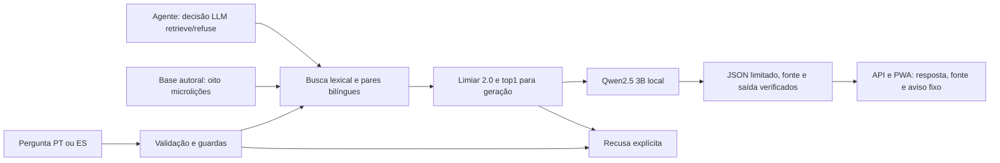

> GenAI atual: v6/corpus v3, Qwen2.5 3B local. D16: RAG/agente 14/16 na revisão técnica exploratória; revisão humana pendente. Placar e casos antigos abaixo são históricos nas respectivas versões. Detalhes atuais em RESULTADOS_NOTURNOS.md. Vision foi atualizado separadamente para YOLO26m; veja VISION_FINETUNING.md.

# Acolhe - Relatório Generative AI for Engineering

## Identificação e tarefa

Tomáz Versolato Carballo - RM551417; Rony Ken Nagai - RM551549; Aksel Viktor Caminha Rae - RM99011; Ian Xavier Kuraoka - RM98860.

Tarefa principal: orientar, em português/espanhol, mobilidade educativa no trajeto escolar e busca de ajuda com adulto responsável. Vocabulário bilíngue é apoio ao acolhimento. A rubrica admite energia, segurança ou mobilidade; não há aprovação prévia formal de professor no PDF. Adequação pedagógica e LGPD não são certificadas por esta implementação.

## Ficha técnica

Modelo final: qwen2.5:3b-instruct, 3,09B parâmetros, Q4_K_M, aproximadamente1,9GB de pesos, abaixo do teto4B autorizado. Licença Qwen Research (nãoApache): https://huggingface.co/Qwen/Qwen2.5-3B-Instruct/blob/main/LICENSE. Não são distribuídos pesos da LLM neste repositório. Ollama0.40.16, Python3.12.10, Windows, RX6750XT12GB. API somente127.0.0.1:11434.

Perfil medido: contexto2048, saída256 tokens, temperatura0, seed42, offload automático num_gpu=-1. /api/ps verificou2.085.963.693bytes emVRAM antes da comparação. O lote usou keep_alive=2m e descarregou ao terminar; o produto permite unload0. Latências abaixo são de execução aquecida, não incluem instalação/primeira carga e não são promessa para outros computadores.

## Pipeline de IA e documentos



A modalidade baseline recebe a mesma tarefa e guardas de entrada, sem documentos. RAG busca diretamente. O agente faz uma decisão real da LLM, chama retrieve com rastro e gera com a fonte; isso cumpre a alternativa agente, sem fingir LoRA ou treinamento de pesos da LLM. Recusas do host, do recuperador e do planejador estão diferenciadas nos registros.

## Base de conhecimento

| Fonte | Formato | Licença declarada | Trechos |
|---|---|---|---:|
| Conteúdo autoral Acolhe v3 PT/ES | JSON UTF-8, IDs e pares de tradução | CC-BY4.0; revisão pedagógica pendente | 8 |

Arquivo canônico: genai/data/corpus.json. SHA-256: 44bc667247041dd06cd73d0a186df121e60de0df4be0971993b43c5df1c477c8. Os oito IDs são crossing, lost, backpack, chair, bottle, bus, greeting, book. Fonte/versão/licença constam em cada trecho; a declaração autoral não é parecer pedagógico. O índice genai/base/ aponta para a fonte canônica.

## Busca e limiar

Recall@1 e recall@3 no desenvolvimento:16/16 =1,000. O limiar2,0 foi reavaliado no corpus v3 usando somente desenvolvimento. A busca usa IDF e bônus explícito de pares PT/ES. Geração recebe top1 para evitar mistura de microlições, enquanto recall@3 é medido separadamente. A justificativa, candidatos e hash atuais estão em genai/avaliacao/limiar.json; a grade do corpus v2 fica em limiar-corpus-v2.json. O resultado de desenvolvimento reflete ajustes feitos sobre erros desse próprio conjunto, portanto não é independente.

## Placar atual: protocolo v6 no D16

O D16 contém 16 casos autorais congelados antes dos ajustes da versão v6: dez positivos e seis negativos. A configuração foi escolhida pelo desenvolvimento antes da leitura dos resultados D16; nenhum ajuste foi feito após essa leitura. A correção semântica abaixo é revisão técnica exploratória do agente, com revisão humana pendente.

| Configuração | Respostas corretas / 16 | Contratos válidos / 16 | Fonte esperada / 10 positivos | Média s |
|---|---:|---:|---:|---:|
| Baseline sem contexto | 7 (43,8%) | 16 | N/A | 0,176 |
| RAG | 14 (87,5%) | 16 | 8 | 0,265 |
| Agente com recuperação | 14 (87,5%) | 16 | 8 | 0,433 |

RAG e agente recusaram os seis casos negativos. Persistem duas falhas de recuperação: d02 recupera ônibus em vez de ajuda a pessoa perdida; d08 recupera garrafa em vez de cadeira. O agente não superou RAG, que permanece na interface. Os tempos são médias da rodada registrada e não incluem a primeira carga do modelo. Não são garantia de desempenho em outras máquinas.

Evidências: genai/avaliacao/qwen3b-v6-D16-night.json, D16-revisao-tecnica.json e v6-frozen-before-D.json. As correções de erros e o contraste v4/v6 estão em [RESULTADOS_NOTURNOS.md](RESULTADOS_NOTURNOS.md). Os casos são pequenos e autorais; estes resultados não comprovam generalização nem eficácia pedagógica.

## Histórico v4: mesmo modelo no desenvolvimento e holdout C12

As tabelas e análises desta seção e da seção de erros abaixo pertencem à versão v4. O holdout C tem 12 perguntas manuais, oito positivas e quatro negativas, congeladas antes daquela inferência. Dentro daquela rodada não houve ajustes após observar C. A rodada GPU repetiu o protocolo então congelado já medido em CPU; não era uma nova amostra independente. A e B também são históricos. O resultado atual é o D16/v6 acima.

Contratos incluem respostas e recusas do host. IDs válidos são contados somente entre saídas geradas, não como prova de factualidade. Acerto/flags da revisão técnica abaixo são julgamentos exploratórios do agente após ler as saídas, não avaliação humana cega ou validação populacional. O gabarito exige o fato/ação principal, idioma correto, recusa pertinente e ausência de detalhe concreto não sustentado. Respostas parciais/tautológicas e omissões de segurança foram contadas como falhas.

| Conjunto | Configuração | Contratos válidos | Fontes válidas nas gerações | Recusa coincide com gabarito | Média s | Acertos da revisão técnica | Flags não sustentadas |
|---|---|---:|---:|---:|---:|---:|---:|
| Dev20 | baseline | 20/20 | N/A | 9/20 | 0.240 | 5/20 | 4/20 |
| Dev20 | rag | 20/20 | 16/16 | 20/20 | 0.348 | 16/20 | 1/20 |
| Dev20 | agent | 20/20 | 16/16 | 20/20 | 0.530 | 16/20 | 0/20 |
| HoldoutC12 | baseline | 12/12 | N/A | 8/12 | 0.205 | 4/12 | 2/12 |
| HoldoutC12 | rag | 12/12 | 9/9 | 11/12 | 0.318 | 8/12 | 2/12 |
| HoldoutC12 | agent | 12/12 | 8/8 | 12/12 | 0.505 | 9/12 | 1/12 |

Interpretação: RAG e agente corrigiram traduções e falsas recusas frequentes do baseline, mas não ficaram perfeitos. No desenvolvimento, a revisão técnica contou5/20 acertos no baseline e16/20 em RAG/agente. No holdout,4/12,8/12 e9/12. Flags de conteúdo não sustentado caíram de4 para1/0 no desenvolvimento; no holdout foram2/2/1. Portanto, não há redução uniforme de todas as falhas pelo RAG no conjunto novo; o agente acertou a recusa de tarifa ausente que o RAG tratou mal. As planilhas JSON trazem cada julgamento, gabarito, saída e justificativa para contestação/revisão humana. Não apresentar esses números como acurácia humana certificada.

Arquivos históricos v4: genai/avaliacao/qwen3b-v4-gpu-dev20.json e qwen3b-v4-gpu-holdout12.json. Revisão técnica: revisao_tecnica_v4.json; fichas .review.md humanas continuam sem pontuações inventadas. Não usar números das versões anteriores como se fossem da versão ativa v6.

## Histórico: erros reais, causa e correção proposta na v4

| Caso/versão | Evidência real | Diagnóstico | Correção e estado |
|---|---|---|---|
| 0.5B q01 RAG | answer: short text, source crossing | Copiou placeholder do prompt | Exemplo genérico removido; resposta efetiva observada no3Bv4 |
| 1.5B subset4 agente | Recusou quatro perguntas válidas | Roteamento pouco claro | Planejador explícito e ferramenta real; dev20GPUv4 roteou16 positivas |
| 3B versões iniciais q10 | Cuaderno traduzido incorretamente | Mistura de trechos e ambiguidade de tradução | Pares bilíngues estruturados e top1; v4 devolveu caderno |
| 3Bv4 Dev q14 RAG | silla, embora idioma PT | Fonte válida não garante idioma/tarefa correta | Falha preservada; testar instrução de idioma com novos casos, sem ajustar sobre C |
| 3Bv4 C05/C06 | ônibus; En el bus con mis padres | Redução indevida da pergunta de mobilidade a vocabulário | Separar intenção de tradução de orientação em próxima versão; novo holdout obrigatório |
| 3Bv4 C07 | Use a faixa e respeite o semáforo, sem responder sozinho | Omissão de proibição importante | Produto acrescenta aviso fixo identificado como política curada; saída original da comparação preservada |

Causas são hipóteses técnicas a partir dos registros, não explicações causalmente comprovadas. O erro C11 sobre tarifa também permanece no RAG e é recusado pelo agente. Não foram geradas cinco falhas artificiais para preencher relatório.

## Integração, segurança e limites

POST /api/assistant mantém answer/sources/mode/model. O notebook03 fez chamadas HTTP reais PT/ES e uma entrada adversarial, com outputs salvos por execução Python stdlib; o notebook02 lê o placar real e o notebook01 executa a avaliação da busca. Não se alega kernelJupyter ou fine-tuning não executados.

Guardas de entrada, recusa de detalhes ausentes, JSON com limite240 caracteres e IDs restritos reduzem risco; não garantem proteção universal contra injeção, alucinação, idioma incorreto ou omissão. Aviso de travessia é texto fixo visível, separado da resposta LLM. As perguntas fictícias da avaliação são gravadas; perguntas da UI não são armazenadas pelo serviço. Sessões do MVP são pseudônimas, não anonimização garantida. O protótipo usa adultos/dados de teste e não decide travessias.

## Reprodução e conclusão

Executar a partir da raiz com Ollama e o modelo baixado. PerfilGPU é explícito; verificar size_vram em /api/ps, pois num_gpu=-1 sozinho não comprova offload. CPU continua disponível com0. Os relatórios históricos de CPU não foram rebatizados comoGPU.

```powershell
ollama pull qwen2.5:3b-instruct
$env:ACOLHE_OLLAMA_MODEL="qwen2.5:3b-instruct"
$env:ACOLHE_OLLAMA_NUM_GPU="-1"
$env:ACOLHE_OLLAMA_KEEP_ALIVE="2m"
python -B -m genai.local
python -B -m genai.experiment --dataset genai/avaliacao/teste_dev.json
python -B -m genai.experiment --dataset genai/avaliacao/teste_independente_D.json
python -B -m app.server
```

A execução mostra ganho técnico de fundamentação e acerto local com contexto/agente sobre o mesmo modelo sem contexto, com limitações explícitas e revisão exploratória contestável. Não comprova eficácia pedagógica, generalização populacional nem conformidade jurídica integral. A melhoria do produto permanece sujeita à revisão humana, e os erros preservados orientam novas hipóteses.

## Links de entrega

- Repositório: https://github.com/Acolhe-Projeto/Acolhe---GS8
- Branch de entrega: https://github.com/Acolhe-Projeto/Acolhe---GS8/tree/feat/genai-vision
- Vídeo: PENDENTE de gravação/revisão/publicação pela equipe; não existe link fictício.
- Critérios oficiais e pendências finais: docs/ENTREGA_CHECKLIST.md.
