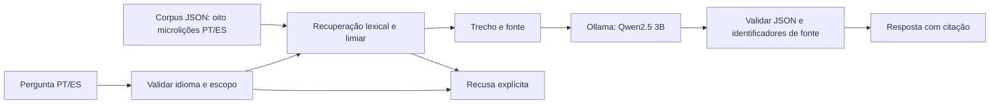

# Acolhe - Generative AI

## Proposta

O assistente do Acolhe responde em português e espanhol sobre vocabulário cotidiano e orientações educativas de mobilidade. As respostas usam uma base autoral de oito microlições e apresentam a fonte consultada. Quando a informação não está disponível, o sistema responde com uma recusa explícita. O uso previsto é acompanhado por uma pessoa adulta.

Equipe: Tomáz Versolato Carballo - RM 551417; Rony Ken Nagai - RM 551549; Aksel Viktor Caminha Rae - RM 99011; Ian Xavier Kuraoka - RM 98860.

## Modelo e implementação

| Item | Configuração |
|---|---|
| Modelo | Qwen2.5:3b-instruct, 3,09 bilhões de parâmetros |
| Quantização e tamanho | Q4_K_M; aproximadamente 1,9 GB de pesos |
| Execução | Ollama local; offload automático na GPU, com alternativa em CPU |
| Geração | Contexto 2048; até 256 tokens; temperatura 0; seed 42 |
| Licença do modelo | Qwen Research |
| Base | Oito microlições autorais PT/ES; corpus v3; CC BY 4.0 declarada pela equipe |

A entrada passa por validação de idioma e escopo. A busca lexical usa IDF e pares bilíngues, seleciona o trecho mais relevante e fornece seu conteúdo ao modelo. A resposta é recebida em JSON e validada quanto a formato, tamanho e identificadores de fonte. Avisos sobre acompanhamento adulto são políticas fixas do aplicativo, exibidas separadamente do texto gerado.

A especialização adotada foi a combinação de recuperação e agente, alternativa prevista no item 05 da rubrica. O agente usa a LLM para decidir entre consultar a base ou recusar, executa a consulta e gera a resposta com a fonte. Não houve LoRA ou ajuste dos pesos da LLM. A interface utiliza RAG, pois o agente não melhorou o resultado na avaliação final.

O corpus está em genai/data/corpus.json, com SHA-256 44bc667247041dd06cd73d0a186df121e60de0df4be0971993b43c5df1c477c8. O manifesto genai/model_manifest.json identifica o modelo e seu digest; a inicialização exige essa mesma versão.

### Pipeline de IA e documentos

O diagrama representa o RAG utilizado pela interface. Na comparação, o baseline não recebe documentos; o agente decide entre consultar a mesma base por ferramenta ou recusar. A [arquitetura integrada ao produto](../PRD_GENAI_VISION.md#arquitetura) inclui também o fluxo de Vision.

### Base de conhecimento

| Fonte / trecho | Formato | Licença declarada | Número de trechos |
|---|---|---|---:|
| Acolhe v3 — Travessia acompanhada (`crossing`) | JSON, PT/ES | CC BY 4.0 | 2 |
| Acolhe v3 — Pedir ajuda (`lost`) | JSON, PT/ES | CC BY 4.0 | 2 |
| Acolhe v3 — Mochila (`backpack`) | JSON, PT/ES | CC BY 4.0 | 2 |
| Acolhe v3 — Cadeira (`chair`) | JSON, PT/ES | CC BY 4.0 | 2 |
| Acolhe v3 — Garrafa (`bottle`) | JSON, PT/ES | CC BY 4.0 | 2 |
| Acolhe v3 — Ônibus acompanhado (`bus`) | JSON, PT/ES | CC BY 4.0 | 2 |
| Acolhe v3 — Cumprimentos (`greeting`) | JSON, PT/ES | CC BY 4.0 | 2 |
| Acolhe v3 — Livro e caderno (`book`) | JSON, PT/ES | CC BY 4.0 | 2 |
| **Total: oito microlições autorais** | **JSON** | **CC BY 4.0** | **16** |

Cada microlição possui um trecho em português e outro em espanhol; as vistas monolíngues de orientação não são novas fontes independentes. O [catálogo CSV](../../genai/base/fontes.csv) preserva os identificadores e a descrição histórica das fontes. A revisão pedagógica indicada nesses metadados é distinta da revisão humana dos resultados descrita abaixo.

## Método de avaliação

Foram comparadas três configurações do mesmo modelo: baseline sem documentos, RAG com recuperação direta e agente com recuperação por ferramenta. As guardas de entrada foram mantidas nas três configurações. O conjunto de desenvolvimento contém 20 casos, sendo 16 positivos. Nele, Recall@1 e Recall@3 da recuperação foram 16/16; o limiar escolhido foi 2,0. Essa métrica avalia a localização da fonte, não a correção da resposta gerada.

O conjunto final D16 contém dez perguntas positivas e seis negativas. Foi definido antes dos ajustes da versão v6; a configuração foi escolhida com desenvolvimento antes da leitura dos resultados D16. Não houve ajustes posteriores sobre esse conjunto. As perguntas são autorais e o placar registrado decorre de revisão técnica exploratória. Em 19/11/2026, a equipe informou que a revisão humana dos resultados foi concluída. Essa confirmação não constitui um novo placar independente; os JSONs históricos e seus resultados foram preservados.

## Resultados

| Configuração | Respostas corretas | Contratos JSON válidos | Fonte esperada nos 10 positivos | Tempo médio por caso |
|---|---:|---:|---:|---:|
| Baseline | 7/16 (43,8%) | 16/16 | Não se aplica | 0,176 s |
| RAG | 14/16 (87,5%) | 16/16 | 8/10 | 0,265 s |
| Agente | 14/16 (87,5%) | 16/16 | 8/10 | 0,433 s |

RAG e agente recusaram corretamente os seis casos negativos. O uso da base melhorou o placar em relação ao baseline. O agente teve o mesmo número de acertos do RAG e maior tempo médio, por isso a interface mantém RAG. Os tempos pertencem à execução registrada, com o modelo aquecido, e não incluem instalação ou primeira carga.

## Erros e ajustes

Os ajustes abaixo foram feitos com desenvolvimento. A verificação posterior usa o D16; os registros da versão anterior e da versão final estão preservados nos JSONs.

| Caso | Falha observada antes do ajuste | Alteração | Resultado no D16 |
|---|---|---|---|
| d01 | Orientação de travessia omitia o adulto | Contexto com orientação completa | Incluiu adulto e proibição de atravessar sozinho |
| d03 | Pergunta sobre embarque recebia apenas tradução | Separação entre tradução e orientação | Orientou espera longe da borda e embarque acompanhado |
| d04 | Introduzia um detalhe não sustentado sobre sentar | Apresentação monolíngue dos fatos | Resposta compatível com a fonte |
| d05 | Respondia cadeira quando se pedia silla | Idioma alvo explícito | Respondeu silla |
| d06 | Respondia botella quando se pedia garrafa | Idioma alvo explícito | Respondeu garrafa |
| d11 | Pergunta de preço recebia tradução de ônibus | Guarda de informação ausente no programa | Recusou a pergunta |

Duas falhas de recuperação continuam na versão final: d02 seleciona ônibus em vez de ajuda a pessoa perdida, e d08 seleciona garrafa em vez de cadeira. O ajuste do caso d11 pertence à lógica do aplicativo; não representa aprendizado dos pesos da LLM.

## Reprodução e evidências

A instalação e as frases de teste estão no README da raiz e em genai/README.md. O comando python -m genai.local --verify-release confere o digest instalado. Os notebooks contêm a avaliação da recuperação, a leitura do placar real e chamadas de integração HTTP.

- genai/avaliacao/qwen3b-v6-D16-night.json: respostas, fontes, tempos e rastros das três configurações.
- genai/avaliacao/D16-revisao-tecnica.json: casos considerados corretos e justificativas da revisão técnica.
- genai/avaliacao/v6-frozen-before-D.json: registro da configuração anterior à avaliação.
- genai/avaliacao/qwen3b-v6-final-dev20.json e limiar.json: desenvolvimento e seleção do limiar.
- genai/avaliacao/qwen3b-v4-D16-night.json: saídas anteriores usadas na análise dos erros.
- docs/evidencias/release-delivery-http.json: ensaio HTTP com perguntas PT/ES e recusa.

## Conclusão

A entrega implementa uma LLM local com recuperação, citações, recusa e comparação real com agente. O resultado final foi 14/16 em RAG e agente, com duas falhas conhecidas. A revisão humana dos resultados foi concluída, conforme informação da equipe em 19/11/2026. O conjunto pequeno e autoral não permite concluir eficácia pedagógica ou desempenho geral; a revisão pedagógica do corpus permanece uma etapa distinta. O vídeo demonstrativo está vinculado abaixo; o envio acadêmico permanece pendente.

Referências: desafio FIAP GS CitizenTech, páginas 29-31; https://huggingface.co/Qwen/Qwen2.5-3B-Instruct; https://ollama.com/library/qwen2.5:3b-instruct. Repositório: https://github.com/Acolhe-Projeto/Acolhe---GS8/tree/main.

## Vídeos de demonstração

- [GenAI](https://youtu.be/csoYGnIeviM)
