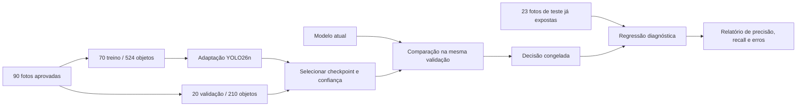

> Lote aprovado pelo usuário: “Aprovo o lote e o treino local”. Dataset auditado:70treino/20validação/23teste,524/210/66objetos; treino iniciado com teste adiado. Experimento concluído:33+67épocas; candidatos sem ganho útil, modelo ativo preservado.

# Expansão de Vision — 70 fotos para treino

Pacote local pronto: **70 treino + 20 validação**, cobrindo as mesmas12classes, com mínimo6fotografias por classe no treino e2na validação. Uma foto pode conter várias classes; não são70por classe. Classes comuns ainda têm mais exemplos.

Hash: `29569624253781bd7fb1dd4154efc33df6a8d13656e381d89cc058da77fcf918`.

Revisão com oito folhas: `vision/data/public-review-train70-v2-20261117/REVIEW.md`.85fotos novas e5já aprovadas, preservando seus splits originais. Créditos/licenças/hashes e caixas vinculados ao lote. As fotos ficam locais.

Inspeção técnica removeu cinco cenas inadequadas: colagens, ônibus de brinquedo e cena de avião. Há pessoa distante na foto86, já presente no lote original. Ausência de anotação de pessoa nas demais não certifica privacidade. Revisão humana do lote foi aprovada pelo usuário após apresentação. O agente não foi registrado como revisor humano. Não foram usadas as23fotos de teste para selecionar imagens ou treinar. Sem duplicação binária entre pacote e os30testes históricos, nem dentro do pacote. Similaridade visual ainda exige revisão, além dos hashes.

Procedimento executado após a aprovação deste lote:

1. Autorização registrada com o hash. Dataset preparado e auditado: 70 treino, 20 validação e 23 teste. Relatórios e pesos anteriores preservados.
2. YOLO26n adaptado a partir dos pesos originais, com 33 épocas livres e 67 congelando 22 camadas: 100 no total, resolução 640, batch 2, CPU, workers 0 e seed 42. Não houve alteração de drivers. Teste adiado nas duas configurações.
3. Modelos comparados na mesma validação. Nenhum candidato cumpriu a regra de promoção; o ativo foi preservado. Precisão e recall avaliados juntos, sem afirmar alcance de 70% nas duas métricas.
4. Como não houve promoção, as 23 fotos não foram avaliadas novamente. Continuam reservadas exclusivamente para regressão diagnóstica; ainda falta um novo teste sem exposição para avaliação independente futura.
5. Evidências, PRDs e relatório/PDF atualizados com os resultados medidos. Demonstração do modelo preservado conferida pela API.

A aprovação específica desta rodada foi registrada, sem reutilizar a autorização anterior dos lotes de 40 e 23 fotos. Inventário público sem pixels: `vision/reports/expansion70-proposal.json`.

Fontes técnicas: [COCO](https://cocodataset.org/#download) e [Ultralytics](https://docs.ultralytics.com/guides/model-training-tips/). Fonte limitou requisições; a aquisição parou e o lote final foi fechado com o cache de créditos já verificados.

## Separação entre treino, validação e teste

Configuração livre encerrada após33épocas por estagnação na validação; melhor checkpoint na época1. F1 micro na nova validação:0,5086, contra0,5355 do modelo atual recalibrado na mesma validação. Configuração congelando22camadas recebeu as67épocas restantes, respeitando limite total100. Nenhuma avaliação das23fotos foi executada para tomar essa decisão. Calibração concluída; nenhum limiar dos candidatos cumpriu o critério de promoção.

## Resultado final medido

Mesmas20fotos/210objetos na validação, correspondência por classe/IoU0,5 e confiança escolhida sem teste:

| Modelo | Confiança | TP | FP | FN | Precisão | Recall | F1 |
|---|---:|---:|---:|---:|---:|---:|---:|
| Ativo anterior, configuração da aplicação |0,15|98|62|112|61,3%|46,7%|0,5297|
| Ativo anterior, maior F1 da grade |0,10|113|99|97|53,3%|53,8%|0,5355|
| Novo, camadas livres,33épocas |0,15|103|92|107|52,8%|49,0%|0,5086|
| Novo,22camadas congeladas,67épocas |0,15|99|68|111|59,3%|47,1%|0,5252|

**Decisão: manter o modelo anterior.** Regra registrada antes da comparação final: melhorar precisão e recall contra o ativo na mesma validação, com ganho mínimo0,02de F1, escolhendo confiança na grade de validação. Nenhum limiar dos novos candidatos passou. Não se escolheu modelo pelo conjunto23 e ele não foi executado novamente nesta rodada. Meta70%/70% não atingida; a regressão histórica do modelo ativo permanece60,7%/51,5% nas23fotos.

Aumentar de97para524anotações de treino não assegurou generalização. Na nova validação,95/210objetos têm área menor que32x32pixels ao ajustar a foto para640. Cozinhas com muitos objetos e classes comuns ainda dominam; uma foto contar em várias classes não torna o lote equilibrado. A análise é descritiva, não prova causal. A próxima melhoria exige cenas com objetos maiores, próximos do uso educativo, mais variedade nas classes raras e teste novo reservado; simplesmente aumentar épocas não é sustentado por esta rodada.

Evidências: vision/reports/expansion70-decision.json, expansion70-selection-protocol.json, expansion70-*-val20.json, expansion70-object-sizes.json. Reconstrução offline113fotos auditada com fingerprint680186e4…, pixels/rótulos23inalterados.100épocas concluídas dentro da autorização; não houve publicação de fotos nem alteração dos pesos ativos. Candidatos locais preservados para inspeção. Nenhum resultado semântico ou pedagógico foi validado com crianças.
