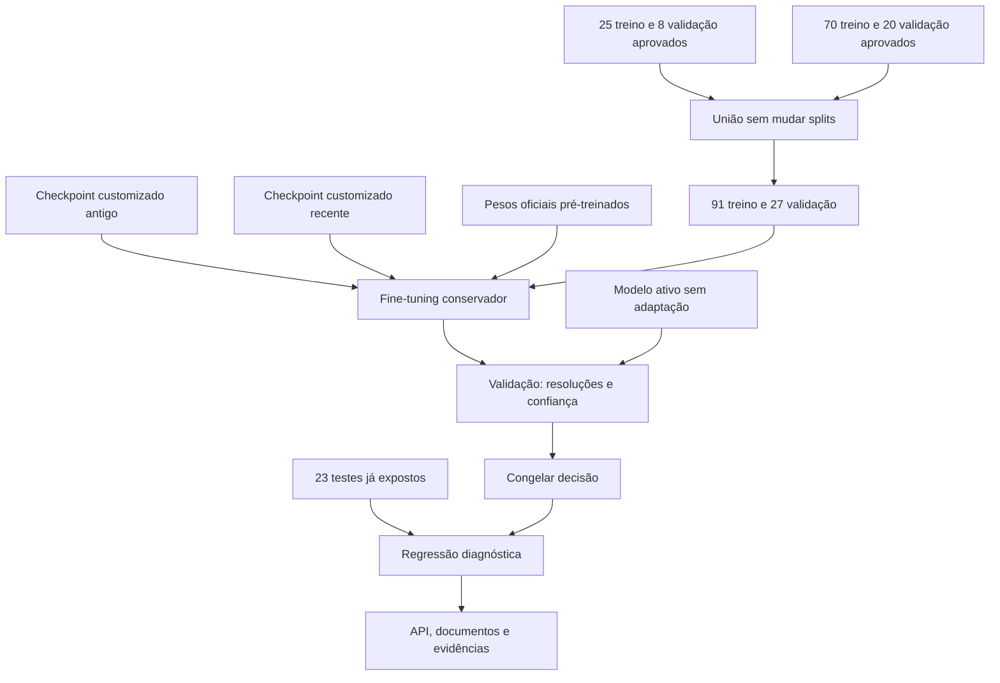
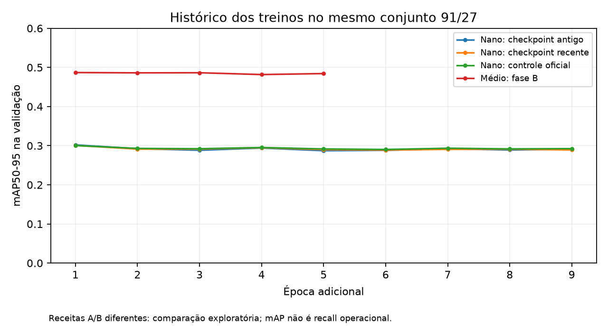
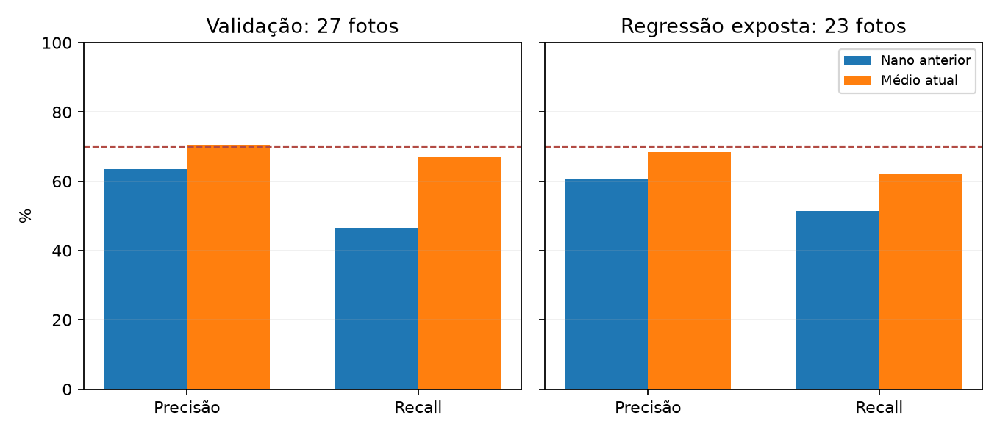
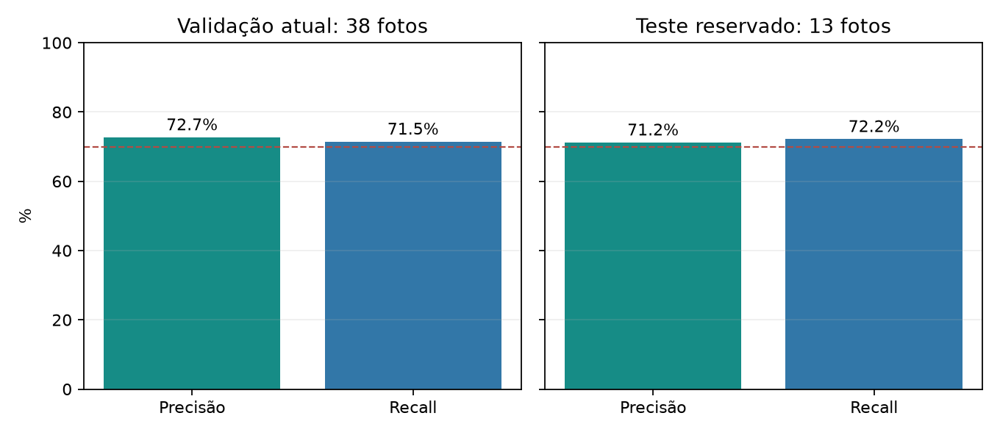

# Vision: plano de fine-tuning e validação comparável

## Objetivo e critério de conclusão

Buscar pelo menos 70% de precisão e 70% de recall na configuração efetiva da aplicação, sem trocar o modelo por um candidato que regresse as duas métricas de referência. É uma meta do protótipo, não uma garantia de qualidade ou exigência numérica do PDF. Somente testes medidos podem demonstrar o ganho. Não declarar o produto sem erros.

## O que mudou nesta rodada

As rodadas anteriores já faziam transferência de aprendizado dos pesos oficiais pré-treinados. A comparação que faltava era continuar a adaptação dos checkpoints customizados existentes, com a mesma base de dados e os mesmos parâmetros. O modelo ativo veio de uma execução com orçamento de 80 épocas; o candidato recente, de uma execução de 67. Seus arquivos best.pt são checkpoints escolhidos pela validação e podem ser anteriores à última época.

Reunimos os conjuntos aprovados, mantendo o split de cada imagem. Cinco IDs repetidos foram comparados por pixels e rótulos antes da deduplicação. Resultado: 91 fotos de treino com 613 objetos, 27 de validação com 247 objetos e as 23 fotos históricas de teste com 66 objetos. Não houve novas fotos nem nova aprovação necessária. Os sete testes antigos continuam fora do treino. Fingerprint: abb33444…; reconstrução em reproduction-union91.json.

Não há conteúdo binário duplicado entre splits. dHash64, distância até quatro e diferença de proporção abaixo de 5%, não apontou pares suspeitos. Isso é uma triagem heurística e não comprova ausência de cenas semelhantes. Fotos, pesos e logs de execução permanecem locais.

## Experimento registrado antes da comparação

| Comparador | Origem dos pesos | Dados e ajustes |
|---|---|---|
| Referência | Checkpoint ativo sem treinamento adicional | Validação em 640 / 960 / 1280 |
| Continuação do antigo | Checkpoint customizado da execução de 80 épocas | Mesmo conjunto de 91/27, AdamW explícito |
| Continuação do recente | Checkpoint customizado da execução com 70 fotos | Mesmo conjunto de 91/27, mesmos parâmetros |
| Controle | YOLO26n oficial pré-treinado | Mesmo conjunto de 91/27, mesmos parâmetros |

Cada adaptação tem máximo de 30 épocas e parada após oito sem melhora da validação; freeze 10, AdamW, taxa inicial 0,00005, fração final 0,1, warmup de uma época, warmup_bias_lr 0, mosaic 0, entrada 640, batch 2, workers 0, seed 42 e CPU. Essa rodada compara conjuntos iniciais de pesos sob uma receita comum; não isola o efeito de cada hiperparâmetro em relação às rodadas antigas.

O código instalado e os logs confirmaram que optimizer=auto ignorava a taxa manual e escolhia 0,000625 anteriormente. Agora a taxa é explícita. O aquecimento dos vieses também é explícito para não introduzir um salto inicial de aprendizado. São hipóteses de adaptação mais conservadora, não causas comprovadas para todas as falhas anteriores.

São novas execuções iniciadas em pesos conhecidos, com resume=False. Isso reaproveita o aprendizado, mas reinicia o otimizador; não é retomada de uma execução interrompida. Hash, modelo e ordem das 12 classes do checkpoint-pai são verificados antes do carregamento. A versão instalada também remapeia saídas da cabeça por nome de classe ao transferir dos pesos oficiais: não atribuímos problemas anteriores a uma reinicialização completa sem evidência.

## Seleção, teste e publicação

Apenas a validação participa da escolha. Resoluções registradas: 640, 960 e 1280. Grade de confiança: 0,05; 0,10; 0,15; 0,20; 0,25; 0,35; 0,50; 0,65; 0,80. A resolução de inferência pode diferir da de treino; isso fica registrado no manifesto.

A referência é o ativo em confiança 0,15 e resolução 640, sobre as mesmas 27 fotos. Um ponto candidato precisa manter ou melhorar precisão e recall, aumentar F1 micro em pelo menos 0,02 e não criar classe com recall zero que tinha acertos na referência. Entre elegíveis, priorizar os que alcançarem as duas metas de 70%; depois maior F1, precisão e menor resolução. Publicar também macrorecall e resultados por classe, porque a micro média favorece classes frequentes. Aprovar implantação não equivale a certificar qualidade para uso infantil.

Antes de abrir qualquer novo resultado das 23 fotos, congelar modelo, confiança e resolução. Essas fotos já foram examinadas em rodadas anteriores: qualquer resultado é regressão diagnóstica, sem alegação de teste independente. Não ajustar após examinar essa regressão. A origem COCO também limita a independência em relação ao desenvolvimento dos pesos-base. Uma avaliação final independente ainda precisa de novas cenas reservadas.

A promoção mantém cópia dos pesos ativos, verifica hashes e classes, mede a latência local e repete as duas imagens do roteiro pela API. O teste automatizado precisa passar; fotos e checkpoints não serão enviados ao GitHub. Atualizar PRDs, relatório/PDF, manifesto e guia com a configuração realmente implantada.

## Fontes e evidências

- Receita consultada e adaptada ao hardware/dados locais: [guia oficial de fine-tuning](https://docs.ultralytics.com/guides/finetuning-guide/) e [parâmetros de treinamento](https://docs.ultralytics.com/modes/train/).
- Código: vision/train.py, vision/merge_approved.py, vision/calibrate.py.
- Registro prévio: vision/reports/finetune91-protocol.json; triagem de duplicatas: union91-perceptual-audit.json.
- Rodada concluída e modelo M implantado; resultados abaixo. O nano anterior permanece em cópia local.

## Fase B: hipótese de capacidade

Depois das comparações nano, referências pré-treinadas adicionais foram medidas apenas na mesma validação: YOLO26s e YOLO26m, em 960 e 1280. O modelo M apresentou maior F1 de referência (0,688 em 960, contra cerca de 0,54 do ativo). Isso justificou uma adaptação adicional; pesos pré-treinados sozinhos não atendem à evidência de treinamento customizado.

A fase B foi registrada separadamente, após observar a fase A e antes de treinar o modelo M. Usa as mesmas 91/27 fotos, base YOLO26m, máximo 12 épocas, patience 4, freeze 22, AdamW com taxa 0,00001, aquecimento de uma época e vieses com taxa inicial zero, mosaic 0, resolução de treino 640 e mesmas resoluções/grade de validação. São receita e capacidade diferentes; não atribuir eventual ganho exclusivamente ao tamanho do modelo. O log confirmou remapeamento das 12 saídas de classificação por nome.

O checkpoint oficial tem cerca de 22 milhões de parâmetros na arquitetura completa de treino e 44 MB de pesos. É maior que o nano e continua muito menor que a LLM de 3 bilhões de parâmetros, que não foi alterada. O custo real da inferência em CPU deve ser medido após o treino. O teste de 23 fotos ainda não participa dessa escolha.

Evidências da fase B: ft91-larger-pretrained-references.json e ft91-capacity-protocol.json. Fonte do modelo: https://docs.ultralytics.com/models/yolo26/.

## Resultado final da rodada

As três adaptações nano concluíram nove épocas cada; o M concluiu cinco. Os CSVs e ft91-training-history.png registram a evolução por época. O orçamento máximo de 30 ou 12 não deve ser apresentado como épocas efetivamente concluídas. Na fase A, o perfil nano com melhor média em 960 perdeu os acertos de semáforo da referência e não foi promovido.

A comparação do M no desenvolvimento revelou um perfil P80/R63 com maior F1, e outro P70,3/R67,2 mais próximo da meta conjunta. A regra foi emendada depois de examinar desenvolvimento para priorizar o menor entre precisão e recall, mantendo os critérios de não regressão, ganho de F1 e ausência de nova classe zerada. Essa escolha exploratória foi registrada antes da regressão23 e não estava no pré-registro inicial. Fonte: ft91-balanced-objective-amendment.json.

Perfil implantado: YOLO26m customizado, confiança 0,25, inferência 960 e treino 640. A decisão finetune91-decision.json antecede a avaliação ft91-medium-regression23.json; hashes coincidem. Checkpoint anterior em vision/artifacts-yolo26n-before-ft91. quality_validated continua falso.

| Comparação | Precisão | Recall | F1 | Macrorecall |
|---|---:|---:|---:|---:|
| Nano anterior, validação 27 |63,5%|46,6%|0,5374|43,9%|
| M atual, mesma validação |70,3%|67,2%|0,6874|63,1%|
| Nano anterior, regressão 23 |60,7%|51,5%|0,5574|62.0%|
| M atual, mesma regressão |68,3%|62,1%|0,6508|65,5%|

A regressão atual teve41TP/19FP/25FN, frente a34TP/22FP/32FN. Algumas classes regrediram em recall; tabela completa no relatório. A meta de70%nas duas métricas ainda não foi atingida. Não alteramos os parâmetros após ler esse resultado.

HTTP real reconheceu ônibus e três utensílios do roteiro. Cinco repetições da foto do ônibus, incluindo carregamento/verificações, tiveram mediana0,955s e máximo0,983s. É uma amostra local pequena. GenAI continuou respondendo com fonte, sem alterações do seu modelo.

## Preparação do lote50, antes da aprovação

Foi preparado um lote distinto de50fotografias, após seleção técnica e remoção conservadora de cenas ambíguas ou relacionadas. São26treino/11validação/13teste, com holdout reservado antes de qualquer inferência sobre essas imagens. Nenhuma entrou no M atual. Isso permitiria117treino/38validação, com teste novo para ajuste fino. Aprovação específica recebida; a rodada de expansão foi concluída.

Critérios de triagem: no máximo três classes-ALVO (não três objetos totais), nenhuma pessoa ANOTADA, e objetos primários com lado maior de128pixels e menor de16pixels na imagem ajustada para640. Isso não garante ausência de pessoas nem substitui inspeção visual. As quotas contam apenas alvos primários grandes; o resumo também mantém contagens de todos os objetos-alvo.

A fonte retornou HTTP429 e a coleta parou. A proposta inicial de48treino/12validação e duas fotos primárias por classe no teste não foi alcançada; as quantidades finais e a cobertura são as registradas em simple-next-proposal.json. O lote foi fechado apenas com direitos/créditos verificados em cache, sem contornar limite. Uma dupla de ônibus relacionada foi agrupada na validação; outras cenas ambíguas foram removidas. Mesmo os novos IDs COCO podem ter participado do pré-treino: isso não é avaliação independente de toda a origem dos pesos.

Revisão local: vision/data/public-review-simple-next-v2-20261117/REVIEW.md. Hash d6e54fb4421462f619227e537c320234f0b4af3524f1c8724a2b87d205825d22. A aprovação concreta foi recebida e a rodadaDabaixo foi executada; a regressão23não foi reutilizada para seleção ou teste.

Validação de implementação: 122 testes automatizados Python passaram após as alterações. Inferência e GenAI foram verificados por HTTP real. As oito páginas do PDF final foram renderizadas e inspecionadas. A utilização do lote aprovado e os resultados finais estão registrados abaixo.

## Encerramento da rodada D

O usuário aprovou as 50 fotos e o treino local. A união auditada tem 117 treino / 38 validação / 13 teste, com 691 / 291 / 72 objetos. As 23 fotos antigas estão ausentes do conjunto. Metadados agregados foram corrigidos para registrar aprovações por origem, sem tratar o hash de 50 fotos como aprovação de 168.

A reconstrução offline do pacote reproduction-union117.json foi executada com cache verificado e reproduziu o fingerprint c1163a81…, sem duplicatas binárias. Isso verifica a reconstrução dos dados e rótulos; não repete a inferência de teste.

O fine-tuning do M91 concluiu sete épocas de máximo 12. A validação38 comparou ambos os checkpoints em 640/960/1280 e grade de confiança 0,01. O perfil equilibrado do candidato117 foi 960/0,26, P71,5%/R71,5%, F10,7148. O M91 ativo em960/0,25 teve P72,7%/R71,5%, F10,7210. Nenhum candidato passou a regra de promoção; o M91 permaneceu ativo.

Antes de avaliar13, congelou-se a decisão em finetune117-decision.json. Como referência e escolhido são o mesmo checkpoint/perfil, houve apenas UMA inferência de teste:52TP/21FP/20FN, precisão71,2%,recall72,2%,F10,7172,macrorecall86,0%. A meta70/70 foi observada nesse lote básico reservado. Não foi ganho causado pelo fine-tuning117: os pesos atuais continuam treinados em91fotos. Não houve reajuste após o teste.

As13fotos são amostra pequena, selecionada para objetos mais visíveis e podem ter participado do pré-treinoCOCO. Não comprovam desempenho geral. Nas23complexas anteriores permanecem68,3%P/62,1%R, sem nova avaliação nesta rodada. A diferença entre conjuntos não é melhora direta do modelo. A métrica suplementar12/13imagens com um alvo primário correto não é precisão/recall nem acurácia global. Permanecem falsos positivos, objetos perdidos e necessidade de revisão pedagógica.

Relatórios finais: finetune117-summary.json, ft117-reserved13.json, protocolo, decisão e históricoCSV. Perfil da aplicação:YOLO26m91,960,confiança0,25; mesmo hash3eff4c91…. Nenhuma foto ou peso foi publicado. Documentos, PDF e guias atualizados; vídeos e Teams ainda dependem da equipe.
