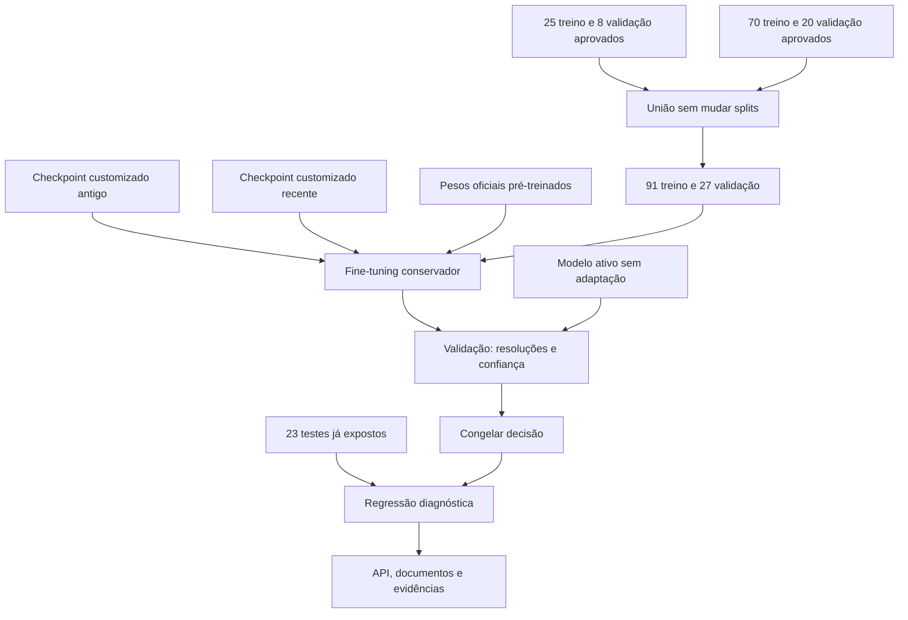

# Vision: plano de fine-tuning e validação comparável

## Objetivo e critério de conclusão

Buscar pelo menos 70% de precisão e 70% de recall na configuração efetiva da aplicação, sem trocar o modelo por um candidato que regresse as duas métricas de referência. É uma meta do protótipo, não uma garantia de qualidade ou exigência numérica do PDF. Somente testes medidos podem demonstrar o ganho. Não declarar o produto sem erros.

## O que mudou nesta rodada

As rodadas anteriores já faziam transferência de aprendizado dos pesos oficiais pré-treinados. A comparação que faltava era continuar a adaptação dos checkpoints customizados existentes, com a mesma base de dados e os mesmos parâmetros. O modelo ativo veio de uma execução com orçamento de 80 épocas; o candidato recente, de uma execução de 67. Seus arquivos best.pt são checkpoints escolhidos pela validação e podem ser anteriores à última época.

Reunimos os conjuntos aprovados, mantendo o split de cada imagem. Cinco IDs repetidos foram comparados por pixels e rótulos antes da deduplicação. Resultado: 91 fotos de treino com 613 objetos, 27 de validação com 247 objetos e as 23 fotos históricas de teste com 66 objetos. Não houve novas fotos nem nova aprovação necessária. Os sete testes antigos continuam fora do treino. Fingerprint: abb33444…; reconstrução em reproduction-union91.json.

Não há conteúdo binário duplicado entre splits. dHash64, distância até quatro e diferença de proporção abaixo de 5%, não apontou pares suspeitos. Isso é uma triagem heurística e não comprova ausência de cenas semelhantes. Fotos, pesos e logs de execução permanecem locais.

## Experimento registrado antes da comparação

| Comparador | Origem dos pesos | Dados e ajustes |
|---|---|---|
| Referência | Checkpoint ativo sem treinamento adicional | Validação em 640 / 960 / 1280 |
| Continuação do antigo | Checkpoint customizado da execução de 80 épocas | Mesmo conjunto de 91/27, AdamW explícito |
| Continuação do recente | Checkpoint customizado da execução com 70 fotos | Mesmo conjunto de 91/27, mesmos parâmetros |
| Controle | YOLO26n oficial pré-treinado | Mesmo conjunto de 91/27, mesmos parâmetros |

Cada adaptação tem máximo de 30 épocas e parada após oito sem melhora da validação; freeze 10, AdamW, taxa inicial 0,00005, fração final 0,1, warmup de uma época, warmup_bias_lr 0, mosaic 0, entrada 640, batch 2, workers 0, seed 42 e CPU. Essa rodada compara conjuntos iniciais de pesos sob uma receita comum; não isola o efeito de cada hiperparâmetro em relação às rodadas antigas.

O código instalado e os logs confirmaram que optimizer=auto ignorava a taxa manual e escolhia 0,000625 anteriormente. Agora a taxa é explícita. O aquecimento dos vieses também é explícito para não introduzir um salto inicial de aprendizado. São hipóteses de adaptação mais conservadora, não causas comprovadas para todas as falhas anteriores.

São novas execuções iniciadas em pesos conhecidos, com resume=False. Isso reaproveita o aprendizado, mas reinicia o otimizador; não é retomada de uma execução interrompida. Hash, modelo e ordem das 12 classes do checkpoint-pai são verificados antes do carregamento. A versão instalada também remapeia saídas da cabeça por nome de classe ao transferir dos pesos oficiais: não atribuímos problemas anteriores a uma reinicialização completa sem evidência.

## Seleção, teste e publicação

Apenas a validação participa da escolha. Resoluções registradas: 640, 960 e 1280. Grade de confiança: 0,05; 0,10; 0,15; 0,20; 0,25; 0,35; 0,50; 0,65; 0,80. A resolução de inferência pode diferir da de treino; isso fica registrado no manifesto.

A referência é o ativo em confiança 0,15 e resolução 640, sobre as mesmas 27 fotos. Um ponto candidato precisa manter ou melhorar precisão e recall, aumentar F1 micro em pelo menos 0,02 e não criar classe com recall zero que tinha acertos na referência. Entre elegíveis, priorizar os que alcançarem as duas metas de 70%; depois maior F1, precisão e menor resolução. Publicar também macrorecall e resultados por classe, porque a micro média favorece classes frequentes. Aprovar implantação não equivale a certificar qualidade para uso infantil.

Antes de abrir qualquer novo resultado das 23 fotos, congelar modelo, confiança e resolução. Essas fotos já foram examinadas em rodadas anteriores: qualquer resultado é regressão diagnóstica, sem alegação de teste independente. Não ajustar após examinar essa regressão. A origem COCO também limita a independência em relação ao desenvolvimento dos pesos-base. Uma avaliação final independente ainda precisa de novas cenas reservadas.

A promoção mantém cópia dos pesos ativos, verifica hashes e classes, mede a latência local e repete as duas imagens do roteiro pela API. O teste automatizado precisa passar; fotos e checkpoints não serão enviados ao GitHub. Atualizar PRDs, relatório/PDF, manifesto e guia com a configuração realmente implantada.

## Fontes e evidências

- Receita consultada e adaptada ao hardware/dados locais: [guia oficial de fine-tuning](https://docs.ultralytics.com/guides/finetuning-guide/) e [parâmetros de treinamento](https://docs.ultralytics.com/modes/train/).
- Código: vision/train.py, vision/merge_approved.py, vision/calibrate.py.
- Registro prévio: vision/reports/finetune91-protocol.json; triagem de duplicatas: union91-perceptual-audit.json.
- Resultados desta rodada serão acrescentados após concluir os comparadores. O aplicativo ainda usa o checkpoint anterior enquanto a seleção não termina.

## Fase B: hipótese de capacidade

Depois das comparações nano, referências pré-treinadas adicionais foram medidas apenas na mesma validação: YOLO26s e YOLO26m, em 960 e 1280. O modelo M apresentou maior F1 de referência (0,688 em 960, contra cerca de 0,54 do ativo). Isso justificou uma adaptação adicional; pesos pré-treinados sozinhos não atendem à evidência de treinamento customizado.

A fase B foi registrada separadamente, após observar a fase A e antes de treinar o modelo M. Usa as mesmas 91/27 fotos, base YOLO26m, máximo 12 épocas, patience 4, freeze 22, AdamW com taxa 0,00001, aquecimento de uma época e vieses com taxa inicial zero, mosaic 0, resolução de treino 640 e mesmas resoluções/grade de validação. São receita e capacidade diferentes; não atribuir eventual ganho exclusivamente ao tamanho do modelo. O log confirmou remapeamento das 12 saídas de classificação por nome.

O checkpoint oficial tem cerca de 22 milhões de parâmetros na arquitetura completa de treino e 44 MB de pesos. É maior que o nano e continua muito menor que a LLM de 3 bilhões de parâmetros, que não foi alterada. O custo real da inferência em CPU deve ser medido após o treino. O teste de 23 fotos ainda não participa dessa escolha.

Evidências da fase B: ft91-larger-pretrained-references.json e ft91-capacity-protocol.json. Fonte do modelo: https://docs.ultralytics.com/models/yolo26/.
