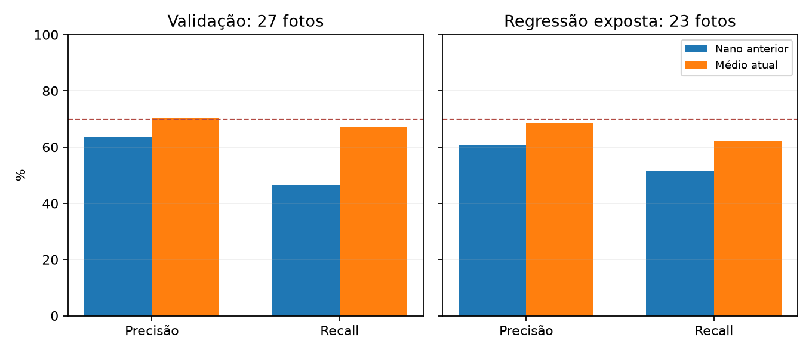
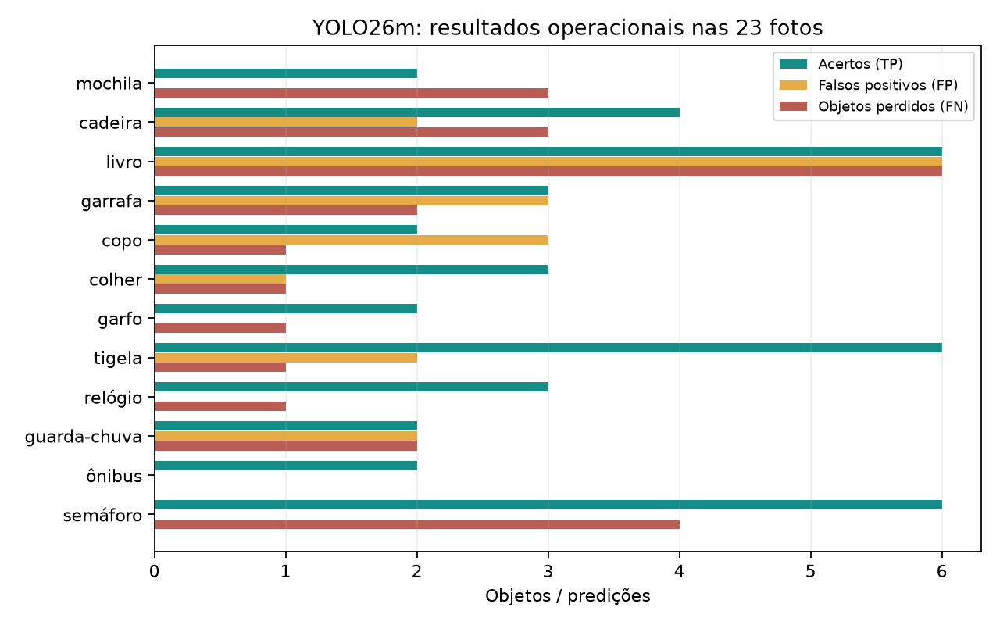

# Acolhe: reconhecimento de objetos para acolhimento linguístico

## Estado desta versão

YOLO26m ativo, treinado com 91 fotos; inferência 960 e confiança 0,25. A continuação com 117 fotos foi testada e não justificou a troca. Na validação ampliada de 38 fotos, o perfil retido teve precisão 72,7% e recall 71,5%. No novo teste básico reservado de 13 fotos, atingiu 71,2% e 72,2%: a meta de 70%/70% foi observada nesse lote. Isso não comprova desempenho geral. Nas 23 fotos complexas anteriores, o diagnóstico permanece em 68,3%/62,1%. Conjuntos distintos não medem evolução diretamente. quality_validated continua falso; vídeo e envio são pendências da equipe.

## Integrantes

- Tomáz Versolato Carballo - RM 551417
- Rony Ken Nagai - RM 551549
- Aksel Viktor Caminha Rae - RM 99011
- Ian Xavier Kuraoka - RM 98860

## Resumo

O Acolhe é um protótipo acadêmico de acolhimento linguístico que associa objetos cotidianos a vocabulário em português e espanhol. Uma pessoa adulta seleciona a fotografia e recebe nomes, caixas e confiança, sem armazenamento do upload. O trabalho implementou dados rastreáveis, treinamento customizado, comparação de checkpoints e integração ao aplicativo. Foram comparadas continuações de modelos antigos e recentes, um controle nano e uma adaptação YOLO26m. O modelo ativo foi treinado com noventa e uma fotografias; concluiu cinco épocas e manteve o checkpoint escolhido pela validação. Uma continuação com cento e dezessete fotos concluiu sete épocas, mas não superou a referência na mesma validação e não foi implantada. O conjunto ampliado contém trinta e oito imagens de validação e treze reservadas para teste, com aprovação humana e separação dos conjuntos anteriores. O perfil preservado usa resolução novecentos e sessenta e confiança de vinte e cinco centésimos. Na validação atual, precisão e recall foram setenta e dois vírgula sete e setenta e um vírgula cinco por cento. No teste reservado, houve cinquenta e dois acertos, vinte e um falsos positivos e vinte objetos perdidos, correspondendo a precisão de setenta e um vírgula dois por cento e recall de setenta e dois vírgula dois. A meta foi observada nesse pequeno lote básico, sem comprovar desempenho geral. Nas fotografias complexas anteriores, persistem resultados menores e falhas por classe. Imagens COCO podem ter participado do pré-treino. O relatório preserva procedimentos, erros e limitações, incluindo ausência de avaliação pedagógica independente com crianças. O protótipo ainda apresenta erros.

## Introdução

O Acolhe propõe atividades de português e espanhol acompanhadas por uma pessoa adulta. A interação por imagem apresenta vocabulário dos objetos encontrados, sem interpretar semáforos como autorização de travessia. O componente não identifica pessoas nem substitui supervisão. A entrega de Applied Computer Vision pede treinamento customizado, código e documentação, relatório PDF e vídeo funcionando; não fixa recall mínimo. A meta de 70% nas duas métricas foi definida para este protótipo.

## Objetivo

Desenvolver e avaliar localmente um detector compacto de objetos cotidianos integrado ao Acolhe, apresentando vocabulário em português e espanhol. Preparar dados rastreáveis, realizar treinamento customizado e medir desempenho em teste separado, preservando privacidade, explicitando limitações e oferecendo uma demonstração reproduzível, supervisionada por adultos, sem interpretar imagens como autorização para travessia.

## Ferramentas e arquitetura

Ultralytics 8.4.215 e PyTorch 2.15.0+cpu foram usados localmente. YOLO26m tem 21.791.392 parâmetros na arquitetura do checkpoint customizado e 44.036.761 bytes de pesos. Contagens antes e depois de fusão/remoção de ramos podem diferir das tabelas oficiais. A inferência utiliza CPU, sem alteração de drivers AMD. A GPU do Ollama pertence à execução de GenAI e não foi apresentada como treinamento YOLO em GPU. A licença Ultralytics é AGPL 3.0/Enterprise; não se presumiu isenção acadêmica.

O fluxo é: adulto seleciona JPEG/PNG de até 8 MiB; a API confere o arquivo e o limite de pixels; o serviço valida hash, classes e parâmetros do checkpoint; o detector retorna caixas, confiança e vocabulário PT/ES. Não grava o upload. As 12 classes são mochila, cadeira, livro, garrafa, copo, colher, garfo, tigela, relógio, guarda-chuva, ônibus e semáforo. O manifesto usa confiança 0,25 e resolução 960; a resolução de treino foi 640.

## Metodologia

1. O lote inicial de 40 fotos e o lote posterior de 90 foram aprovados pelo usuário. A união mantém os splits de cada imagem; cinco IDs repetidos tiveram pixels e rótulos comparados antes de deduplicar. Resultado: 91 fotos de treino, 27 de validação e as 23 de teste aprovadas exclusivamente para esse uso. Os sete testes antigos não entraram no treino. São 613, 247 e 66 objetos, respectivamente. Fingerprint abb33444…. A reconstrução offline foi auditada.
2. URLs, autores, licenças e hashes acompanham os arquivos. Fotos COCO têm direitos individuais; anotações são CC-BY 4.0. Aprovação de uso não equivale a revisão pedagógica ou parecer jurídico. Caixas foram auditadas geometricamente; não se afirma revisão especialista de cada anotação. Não há duplicatas binárias entre splits. Uma triagem dHash64 não encontrou pares no limite de distância quatro e proporção semelhante; isso não comprova ausência de cenas relacionadas.
3. Compararam-se três adaptações nano na mesma base: continuação do checkpoint da execução antiga de 80 épocas, continuação do checkpoint recente e controle oficial pré-treinado. Cada uma tinha máximo de 30 épocas, patience 8, freeze 10, AdamW explícito com taxa 0,00005, warmup de uma época, warmup_bias_lr zero, mosaic zero, batch 2, workers 0, seed 42 e CPU. As três pararam após nove épocas. Foram novas execuções a partir dos pesos, sem retomar estado do otimizador. O hash do checkpoint-pai foi registrado.
4. A referência de modelos S/M maiores foi medida apenas na validação. O modelo M apresentou ganho que justificou uma fase adicional registrada separadamente: máximo de 12 épocas, patience 4, freeze 22 e taxa AdamW 0,00001; os outros parâmetros permaneceram documentados. Concluiu cinco épocas e manteve o checkpoint da primeira época como melhor. O log confirmou remapeamento das 12 saídas por nome de classe. Isso é treinamento customizado, além da referência pré-treinada; as fases têm receitas diferentes e não isolam causalmente apenas capacidade.
5. Resoluções 640, 960 e 1280 e a grade de confiança 0,05 a 0,80 foram comparadas na validação. Os candidatos precisavam não regredir precisão e recall do ativo, aumentar F1 em pelo menos 0,02 e não introduzir classe com recall zero. Após observar desenvolvimento, uma emenda passou a priorizar o menor entre precisão e recall, alinhando a escolha à meta conjunta. Essa emenda não estava no registro inicial; foi gravada antes de abrir o resultado atual das 23 fotos.
6. Modelo, confiança e resolução foram congelados antes da regressão. Nenhum parâmetro mudou após ler esse resultado. Como as 23 fotos já foram examinadas, não se trata de novo teste cego; a origem COCO também limita independência em relação ao pré-treino. São necessárias novas cenas reservadas para avaliar generalização.

## Resultados anteriores: validação 27 e regressão 23

Na mesma validação de 27 fotos, a configuração antiga da aplicação teve precisão de 63,5%, recall de 46,6% e F1 de 0,5374. O perfil escolhido atingiu 70,3%, 67,2% e F1 de 0,6874. Macrorecall, média sem ponderar as classes, subiu de 43,9% para 63,1%. Nenhuma classe com acertos na referência ficou zerada na nova validação.

| Configuração / conjunto | TP | FP | FN | Precisão | Recall |
|---|---:|---:|---:|---:|---:|
| Nano anterior / validação 27 |115|66|132|63,5%|46,6%|
| Médio atual / validação 27 |166|70|81|70,3%|67,2%|
| Nano anterior / regressão 23 |34|22|32|60,7%|51,5%|
| Médio atual / regressão 23 |41|19|25|68,3%|62,1%|

Acertos exigem classe correta, IoU pelo menos 0,5 e correspondência um para um. As duas linhas de regressão usam as mesmas 23 fotos e 66 objetos. F1 atual: 0,6508; macrorecall: 65,5%. São sete acertos adicionais, três falsos positivos a menos e sete objetos perdidos a menos. A melhora agregada não ocorre em todas as classes: há regressões de recall em mochila, cadeira, copo e colher. A meta não foi atingida nesse conjunto de 23 fotos; o teste básico diferente, descrito abaixo, atingiu os dois limites. quality_validated permanece falso.

| Classe | TP | FP | FN | Precisão | Recall |
|---|---:|---:|---:|---:|---:|
| mochila |2|0|3|100.0%|40.0%|
| cadeira |4|2|3|66.7%|57.1%|
| livro |6|6|6|50.0%|50.0%|
| garrafa |3|3|2|50.0%|60.0%|
| copo |2|3|1|40.0%|66.7%|
| colher |3|1|1|75.0%|75.0%|
| garfo |2|0|1|100.0%|66.7%|
| tigela |6|2|1|75.0%|85.7%|
| relógio |3|0|1|100.0%|75.0%|
| guarda-chuva |2|2|2|50.0%|50.0%|
| ônibus |2|0|0|100.0%|100.0%|
| semáforo |6|0|4|100.0%|60.0%|

A API real reconheceu ônibus com confiança 0,8735 e os três utensílios do roteiro: tigela, colher e garfo. Cinco repetições HTTP da foto do ônibus, incluindo carregamento e hash, tiveram mediana de 0,955 segundo e máximo de 0,983. É uma pequena amostra local, não benchmark geral. O teste funcional de GenAI também continuou respondendo com fonte. As fotos do roteiro são ensaios, não substituem a avaliação agregada.

## Cinco erros reais e limites

| Imagem | Objeto perdido | Maior IoU de candidata da mesma classe | Confiança dessa candidata |
|---|---|---:|---:|
| 182417 | copo |0.1078|0.0384|
| 30213 | garrafa |0.9550|0.2456|
| 533206 | garfo |0.8590|0.1555|
| 17182 | livro |0.6949|0.1542|
| 313130 | cadeira |0.8464|0.0856|

No primeiro caso a localização está abaixo de IoU 0,5; nos seguintes existe candidata próxima com confiança abaixo de 0,25. Uma candidata também pode estar associada a outro objeto. Isso descreve observações, não comprova causas. Não reduzimos o limiar após observar esses erros. As 25 perdas e as predições brutas estão em ft91-medium-regression23.json.

O conjunto continua pequeno, desbalanceado e com objetos diminutos; a validação teve participação repetida no desenvolvimento. A rodada posterior usou um lote aprovado de objetos maiores e menos classes-alvo por cena, com teste reservado antes do treino. A coleta foi interrompida por HTTP 429; somente arquivos verificados foram incorporados. O modelo ativo continua sendo o M91, sem incorporar as fotos do novo treino. Não houve avaliação pedagógica com crianças nem certificação de qualidade para uso real.

## Rodada final: expansão 117 e teste básico reservado

O usuário aprovou 50 fotos novas, hash d6e54fb4…. A inspeção retirou oito cenas ambíguas ou relacionadas e agrupou uma dupla de ônibus na validação. Os critérios de seleção foram anteriores às inferências: até três classes-alvo por cena, ausência de pessoa anotada e alvos primários com lados de pelo menos 128 e 16 pixels no ajuste para 640. Isso não garante ausência de pessoas ou de outros objetos. A fonte limitou requisições e não se contornou HTTP 429.

O lote acrescentou 26 fotos ao treino e 11 à validação, reservando 13 para teste. O conjunto de expansão tem 117 / 38 / 13 imagens, com 691 / 291 / 72 objetos. IDs e pixels dos 23 testes antigos estão ausentes de todo esse conjunto. Aprovações são registradas por origem e por imagem, sem atribuir o hash do lote de 50 a todas as 168 imagens. Reconstrução e auditoria: fingerprint c1163a81….

O candidato partiu do M91 já aprendido, com otimizador reiniciado, máximo de 12 épocas, patience 4, freeze 22, AdamW 0,00001, warmup_bias_lr zero, mosaic zero e treino 640 em CPU. Concluiu sete épocas. Resoluções 640/960/1280 e confiança em passos de 0,01 foram avaliadas somente na validação; o refinamento da grade foi registrado antes do teste.

| Modelo na mesma validação 38 | Confiança | Precisão | Recall | F1 |
|---|---:|---:|---:|---:|
| M91 retido, 960 pixels |0,25|72,7%|71,5%|0,7210|
| Continuação M117, perfil equilibrado 960 |0,26|71,5%|71,5%|0,7148|

O candidato não passou a regra de promoção; nenhum perfil trouxe o ganho exigido sem regredir as métricas. Preservou-se o M91 em 960/0,25. A decisão foi congelada antes da primeira inferência no teste reservado. Como referência e escolhido são idênticos, executou-se uma única avaliação, sem apresentar resultados duplicados como evidência independente. Nenhum ajuste ocorreu após essa medição.

| Novo teste reservado | TP | FP | FN | Precisão | Recall |
|---|---:|---:|---:|---:|---:|
| M91, 13 fotos e 72 objetos |52|21|20|71,2%|72,2%|

F1 de 0,7172; macrorecall de 86,0%. A meta conjunta de 70% foi observada nesse pequeno conjunto básico. Ele é distinto das 23 fotos complexas anteriores, portanto não se deve atribuir a diferença de pontuação a novo aprendizado. O resultado foi obtido pelo M91, não pelo candidato M117. Fonte COCO pode sobrepor o pré-treino; o teste é reservado ao ajuste fino da equipe, sem independência de toda a origem dos pesos.

| Classe no teste 13 | TP | FP | FN | Precisão | Recall |
|---|---:|---:|---:|---:|---:|
| mochila |1|0|0|100.0%|100.0%|
| cadeira |2|0|2|100.0%|50.0%|
| livro |12|6|13|66.7%|48.0%|
| garrafa |2|0|0|100.0%|100.0%|
| copo |5|4|0|55.6%|100.0%|
| colher |2|1|1|66.7%|66.7%|
| garfo |2|1|0|66.7%|100.0%|
| tigela |4|0|0|100.0%|100.0%|
| relógio |2|2|0|50.0%|100.0%|
| guarda-chuva |1|0|0|100.0%|100.0%|
| ônibus |9|0|1|100.0%|90.0%|
| semáforo |10|7|3|58.8%|76.9%|

A métrica suplementar da atividade encontrou ao menos um objeto primário correto em 12 das 13 imagens. Foi definida antes do teste e não substitui precisão/recall sobre os 72 objetos: não deve ser apresentada como acurácia global de 92,3%. Ainda há 21 falsos positivos e 20 perdas; livros e cadeiras são exemplos de cobertura limitada. Não houve validação pedagógica com crianças. Os dados são pequenos, selecionados e não comprovam desempenho geral.

Evidências: finetune117-protocol.json, finetune117-decision.json, ft117-reserved13.json, finetune117-summary.json e reproduction-union117.json. O treino adicional e as comparações estão preservados, mesmo sem promoção. Os datasets completos e os pesos experimentais não integram a distribuição; o checkpoint escolhido e três exemplos acompanham a entrega descrita a seguir.

## Arquivos para testar após clonar

A branch feat/genai-vision inclui o mesmo checkpoint customizado avaliado em vision/release/best.pt, com 44.036.761 bytes e SHA-256 3eff4c911170b189d5904b52adde2390f877f0d105a95c092a4b3496653c3bd5. Manifesto e licença AGPL-3.0 acompanham o arquivo. O serviço carrega essa versão e verifica hash, classes e perfil de inferência; não é necessário treinar novamente para usá-la.

As três fotos de demonstração estão em vision/examples: 01-onibus.jpg, 02-mesa-garfo-tigela.jpg e 03-copo-cadeira.jpg. Autoria, fontes, licenças e hashes acompanham as imagens. São exemplos já examinados, não um novo teste independente. Datasets completos e checkpoints experimentais permanecem locais. Para instalar dependências e abrir o portal, seguir scripts/preparar-demo.ps1, scripts/iniciar-demo.ps1 e o guia COMO_USAR_E_GRAVAR.md.

## Conclusão

Foram comparados checkpoints, continuação de treinamento, controle de taxa e resolução, com decisão anterior ao teste. O YOLO26m91 permanece ativo porque a continuação com 117 fotos não trouxe ganho suficiente na mesma validação. O perfil atende à meta conjunta no novo lote básico reservado, mas mantém desempenho inferior no conjunto complexo anterior e erros por classe. O produto está integrado, com resposta de cerca de um segundo nos ensaios locais, sem promessa de ausência de erros. A próxima avaliação deve usar novas cenas reais de uso, sem reajustar os limiares a partir deste teste.

## Repositório, vídeo e reprodução

- Código: https://github.com/Acolhe-Projeto/Acolhe---GS8/tree/feat/genai-vision
- Vídeo: gravação, revisão e publicação pela equipe ainda pendentes.
- Reprodução: vision/README.md e vision/reports/reproduction-union91.json.
- Decisão e emenda: finetune91-decision.json e ft91-balanced-objective-amendment.json.
- Regressão e HTTP: ft91-medium-regression23.json e docs/evidencias/finetune91-http.json.
- Planejamento e fases: docs/entregas/VISION_FINETUNING.md. Histórico das rodadas anteriores preservado no Git e nos relatórios.

## Referências

- Desafio FIAP GS CitizenTech, página 44; prazo e links na página 24.
- COCO: https://cocodataset.org/ e direitos individuais registrados no inventário.
- Fine-tuning Ultralytics: https://docs.ultralytics.com/guides/finetuning-guide/
- Modelo YOLO26 e licença: https://docs.ultralytics.com/models/yolo26/
- Parâmetros: https://docs.ultralytics.com/modes/train/
