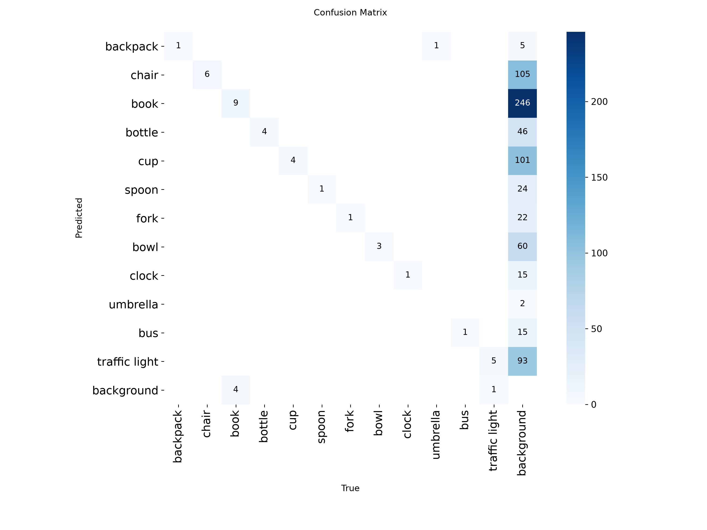

# Acolhe: reconhecimento de objetos para acolhimento linguístico

## Estado desta versão

Versão ativa: YOLO11n80 épocas com resolução 640, confiança 0,10 selecionada pela validação. O modelo de 20 épocas com resolução 320 foi preservado como baseline. Teste histórico reavaliado; novo teste23 fotos aguarda revisão humana. A qualidade não está validada para uso real com crianças. Fotografias e pesos permanecem locais; os metadados, métricas e instruções de reprodução acompanham o código. Vídeo e envio acadêmico ainda exigem a etapa final da equipe.

## Integrantes

- Tomáz Versolato Carballo - RM 551417
- Rony Ken Nagai - RM 551549
- Aksel Viktor Caminha Rae - RM 99011
- Ian Xavier Kuraoka - RM 98860

## Resumo

O Acolhe é um protótipo acadêmico de acolhimento linguístico que apresenta vocabulário em português e espanhol por meio de atividades. Seu componente de visão computacional reconhece objetos cotidianos em fotografias selecionadas por uma pessoa adulta e apresenta os nomes nos dois idiomas. Este trabalho implementou preparação rastreável dos dados, treinamento customizado e integração ao aplicativo. Foram utilizadas quarenta fotografias públicas, com autoria, licença e integridade registradas, distribuídas em vinte e cinco imagens de treinamento, oito de validação e sete de teste. A revisão humana do lote e da anotação adicional de um ônibus foi autorizada antes da execução. O modelo YOLO11n recebeu transferência de aprendizado durante oitenta épocas, com imagens de seiscentos e quarenta pixels, batch dois e seed quarenta e dois. A execução ocorreu em CPU e terminou em aproximadamente onze minutos, incluindo avaliação e preparação de artefatos. No teste histórico, com quarenta e dois objetos anotados, a precisão nativa foi 0,643, o recall 0,547, o mAP50 0,621 e o mAP50 a 95 foi 0,462. A API local reconheceu um ônibus do teste e retornou vocabulário bilíngue, caixas e confiança, sem armazenar o upload. Entretanto, diversas classes apresentaram baixa cobertura e falhas reais de detecção. O conjunto pequeno, com poucas imagens em classes raras, não permite afirmar generalização ou qualidade pedagógica. O relatório apresenta metodologia, métricas por classe, erros observados e medidas propostas. Semáforos são tratados apenas como objetos, sem autorização de travessia. O resultado comprova um piloto treinado e integrado, sujeito a expansão dos dados e revisão independente.

## Introdução

Crianças migrantes podem encontrar dificuldades para associar palavras em português aos objetos presentes na escola e no trajeto cotidiano. O Acolhe propõe atividades bilíngues acompanhadas por um adulto. A visão acrescenta uma interação por imagem: o adulto seleciona uma fotografia e recebe os nomes dos objetos detectados em português e espanhol.

A atividade de Applied Computer Vision exige treinamento customizado, código/documentação, demonstração em vídeo e relatório PDF. A rubrica oficial está na página 44 do desafio CitizenTech. Ela não estabelece quantidade mínima de classes, imagens, épocas ou mAP; tais parâmetros são decisões de engenharia que precisam ser justificados pelas evidências.

## Objetivo

Desenvolver e avaliar localmente um detector compacto de objetos cotidianos integrado ao Acolhe, apresentando vocabulário em português e espanhol. Preparar dados rastreáveis, realizar treinamento customizado e medir desempenho em teste separado, preservando privacidade, explicitando limitações e oferecendo uma demonstração reproduzível, supervisionada por adultos, sem interpretar imagens como autorização para travessia.

## Explicação técnica das ferramentas

YOLO11n é a arquitetura nano de detecção mantida na base do projeto. O treinamento usa Ultralytics e PyTorch em ambiente Python isolado. Nesta máquina, o treino foi executado em CPU; a GPU AMD empregada pelo Ollama não equivale a suporte CUDA no PyTorch. A configuração inicial usou320 pixels; a versão ativa usa640 pixels, batch 2 e zero workers. A confiança 0,10 foi escolhida por F1 micro na validação, sem escolher limiar pelo teste. O piloto mediu o custo e identificou a necessidade de ampliar os dados antes de afirmar qualidade.

O formato YOLO registra classe e caixa normalizada. As classes, nessa ordem, são backpack, chair, book, bottle, cup, spoon, fork, bowl, clock, umbrella, bus e traffic light. Os rótulos exibidos vêm de vision/service.py e incluem tradução PT/ES.

As fotografias candidatas são públicas, com procedência individual; a licença das anotações COCO não substitui a licença de cada imagem. O inventário deve preservar autor, URL, licença, ID original, split e SHA-256. A aprovação humana permanece vinculada aos bytes revisados.

## Metodologia

1. Selecionaram-se 39 fotografias COCO com CC-BY 2.0 verificada na fonte e uma fotografia de ônibus do Wikimedia Commons, autor Znns, CC-BY 4.0. A imagem de bonde anotada como ônibus foi substituída antes do treino.
2. O usuário aprovou explicitamente o lote v2 e a caixa de ônibus proposta pelo agente. Hash do pacote: a7f3630698fd57102ea6d1f4f20afabba80c13e35cb96ecf28ac67450b345a71.
3. Separaram-se 25/8/7 fotografias em treino/validação/teste antes de transformações. A auditoria verificou 97/48/42 objetos, doze classes em cada split e nenhuma duplicata binária. Similaridade perceptual não foi avaliada.
4. As caixas foram convertidas para YOLO. O fingerprint dos pixels e labels é 807dcc346068ebc6f63c7bb687c0b114a9a63347cf10c26915ba4759065df923. A reprodução a partir do cache aprovado foi auditada com o mesmo fingerprint.
5. O baseline executou YOLO11n por20 épocas; a melhoria executou80 épocas, CPU, imgsz640, batch 2, workers 0, seed 42 e transferência de pesos oficiais. PyTorch 2.15.0+cpu e Ultralytics 8.4.215 foram registrados. A GPU AMD foi usada pelo tutor Ollama via Vulkan; não foi alegado treino PyTorch em GPU.
6. O baseline durou179,789s e teve picoRSS~737MiB. A rodada80 épocas levou aproximadamente11 minutos; picoRAM dessa rodada não foi medido. Preservaram-se as mesmas fotos/splits aprovados. O teste antigo já havia sido examinado; por isso, os novos resultados são comparação histórica, não teste independente novo. Checkpoint e confiança foram escolhidos pela validação. Novo lote de 23 fotos aguarda revisão humana.
7. O manifesto, hash, classes e parâmetros de inferência foram verificados pelo serviço. A nova requisição HTTP real reconheceu o ônibus com confiança0,9522. O aplicativo devolveu nomes PT/ES e não gravou a fotografia enviada.

## Exemplos de resultados e avaliação

Métricas nativas Ultralytics no teste histórico de sete fotos e42 objetos: precisão de 0,6426; recall de 0,5465; mAP50 de 0,6212; mAP50-95 de 0,4622. O baseline20 épocas tinha recall0,2943 e mAP500,3878. O avaliador COCO opcional não foi executado; são métricas nativas. A melhora é deste conjunto pequeno já examinado, sem prova de generalização.

| Classe | Precisão | Recall | mAP50 | mAP50-95 |
|---|---:|---:|---:|---:|
| backpack | 1.000 | 0.000 | 0.166 | 0.066 |
| chair | 0.448 | 0.667 | 0.621 | 0.358 |
| book | 0.300 | 0.308 | 0.256 | 0.042 |
| bottle | 0.467 | 0.667 | 0.546 | 0.488 |
| cup | 0.630 | 0.750 | 0.754 | 0.585 |
| spoon | 0.593 | 1.000 | 0.995 | 0.895 |
| fork | 0.513 | 1.000 | 0.995 | 0.796 |
| bowl | 0.541 | 0.667 | 0.585 | 0.498 |
| clock | 1.000 | 0.000 | 0.995 | 0.697 |
| umbrella | 1.000 | 0.000 | 0.000 | 0.000 |
| bus | 0.565 | 1.000 | 0.995 | 0.895 |
| traffic light | 0.653 | 0.500 | 0.547 | 0.226 |

No aplicativo, o limiar escolhido foi0,10, com resolução 640 e IoU 0,5 para medir acerto. A regra maximiza F1 micro na validação e desempata por precisão/confiança. O candidato teve F1 de validação de 0,3488 versus0,3056 do baseline calibrado, e foi promovido por essa regra. A versão antiga e seu manifesto permanecem em backup local.

| Versão / confiança | TP | FP | FN | Precisão | Recall |
|---|---:|---:|---:|---:|---:|
| Inicial320 /0,50 fixo | 4 | 1 | 38 | 80,0% | 9,5% |
| Inicial320 /0,10 pela validação | 11 | 17 | 31 | 39,3% | 26,2% |
| Ativa640 /0,10 pela validação | 22 | 21 | 20 | 51,2% | 52,4% |

As contagens são agregadas por objeto, com correspondência1para1 entre classe/caixa eIoU≥0,5. Não são o recall médio por classe do resumo nativo. Diminuir confiança sozinho recuperou objetos e aumentou falsos positivos; resolução/treino melhoraram ambos frente ao baseline calibrado. A meta proposta80%/80% não foi atingida.

A API reconheceu o ônibus da imagem900000001 com confiança0,9522 e retornou ônibus/autobús, sem gravar upload. Evidência real: vision/reports/inference-http-improved.json. Esse caso não representa as demais classes.

Persistem falhas concretas no limiar ativo: mochila0/1, relógio0/1 e guarda-chuva0/1; livros4/13, garrafas2/4 e semáforos3/6. São pelo menos cinco categorias com erros reais preservados em calibration-improved-640-80.json. Não se inferiu ausência de erro a partir de precisão1 em classe sem detecções. As hipóteses são escassez de exemplos, objetos pequenos, ambiguidade e localização; precisam de novos dados para serem verificadas.

A próxima rodada deve ampliar e equilibrar treino/validação e usar o novo teste somente após aprovação, sem ajustar configuração a partir dele. A preparação encontrou23 fotos novas elegíveis, porém não conseguiu os mínimos inicialmente planejados por classe devido a ônibus com licença confirmada. O lote foi apresentado para revisão como teste, não como expansão do treino já executada.

## Conclusão

O piloto executou treinamento customizado, avaliação rastreável e inferência integrada ao Acolhe. Reconhecer o ônibus demonstra o percurso técnico, com melhora real após80 épocas com resolução 640, mas precisão/recall operacionais ainda abaixo da meta e erros por classe impedem afirmar qualidade geral. A próxima etapa é ampliar dados adequados ao cotidiano escolar e avaliar em novo conjunto independente. O aplicativo não identifica pessoas, não guarda uploads e não decide travessias. Validação pedagógica e revisão da equipe continuam necessárias.

## Repositório, vídeo e reprodutibilidade

- Repositório de destino: https://github.com/Acolhe-Projeto/Acolhe---GS8
- Código desta implementação: https://github.com/Acolhe-Projeto/Acolhe---GS8/tree/feat/genai-vision
- Vídeo de demonstração: gravação e publicação pela equipe ainda pendentes; o detector já executou treino e inferência reais.
- Preparação e auditoria: vision/prepare.py e vision/audit.py.
- Treinamento: vision/train.py; orientação completa em vision/README.md.
- Serviço e integração: vision/service.py, app/server.py e app/static/vision.js.

## Referências

- Desafio FIAP GS CitizenTech, página 44: requisitos de Applied Computer Vision; página 24: prazo, envio e links públicos.
- COCO: https://cocodataset.org/ e condições/licenças de cada fotografia registrada no inventário.
- Ultralytics YOLO11: https://docs.ultralytics.com/models/yolo11/
- Treinamento e validação: https://docs.ultralytics.com/modes/train/ e https://docs.ultralytics.com/modes/val/
- Licenciamento Ultralytics: https://www.ultralytics.com/license
