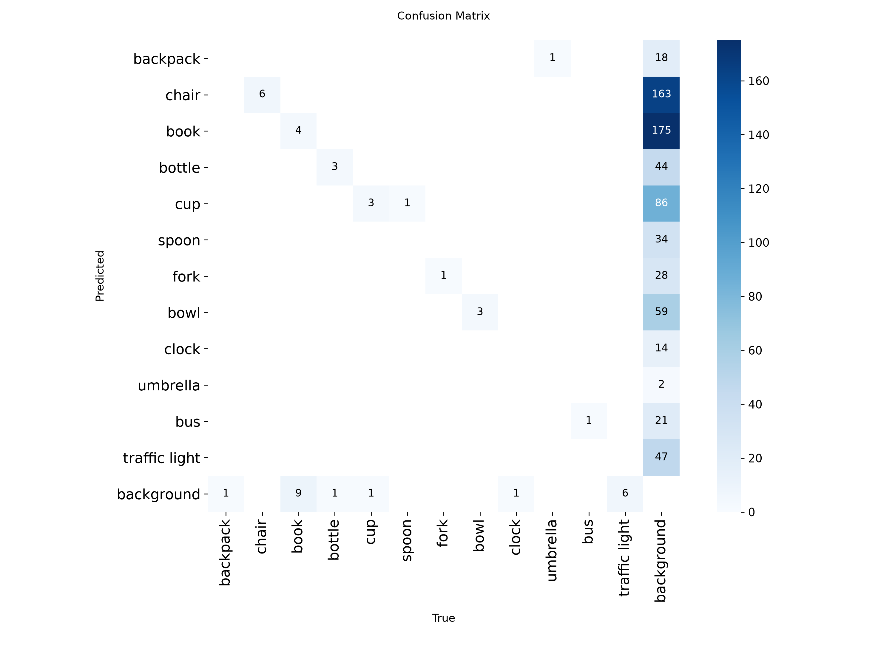

# Acolhe: reconhecimento de objetos para acolhimento linguístico

## Estado desta versão

Experimento piloto real concluído: 20 épocas e teste reservado executados. A qualidade não está validada para uso real com crianças. Fotografias e pesos permanecem locais; os metadados, métricas e instruções de reprodução acompanham o código. Vídeo e envio acadêmico ainda exigem a etapa final da equipe.

## Integrantes

- Tomáz Versolato Carballo - RM 551417
- Rony Ken Nagai - RM 551549
- Aksel Viktor Caminha Rae - RM 99011
- Ian Xavier Kuraoka - RM 98860

## Resumo

O Acolhe é um protótipo acadêmico de acolhimento linguístico que apresenta vocabulário em português e espanhol por meio de atividades. Seu componente de visão computacional reconhece objetos cotidianos em fotografias selecionadas por uma pessoa adulta e apresenta os nomes nos dois idiomas. Este trabalho implementou preparação rastreável dos dados, treinamento customizado e integração ao aplicativo. Foram utilizadas quarenta fotografias públicas, com autoria, licença e integridade registradas, distribuídas em vinte e cinco imagens de treinamento, oito de validação e sete de teste. A revisão humana do lote e da anotação adicional de um ônibus foi autorizada antes da execução. O modelo YOLO11n recebeu transferência de aprendizado durante vinte épocas, com imagens de trezentos e vinte pixels, batch dois e seed quarenta e dois. A execução ocorreu em CPU e terminou em aproximadamente três minutos, incluindo avaliação e preparação de artefatos. No teste reservado, com quarenta e dois objetos anotados, a precisão nativa foi 0,726, o recall 0,294, o mAP50 0,388 e o mAP50 a 95 foi 0,296. A API local reconheceu um ônibus do teste e retornou vocabulário bilíngue, caixas e confiança, sem armazenar o upload. Entretanto, diversas classes apresentaram baixa cobertura e falhas reais de detecção. O conjunto pequeno, com poucas imagens em classes raras, não permite afirmar generalização ou qualidade pedagógica. O relatório apresenta metodologia, métricas por classe, erros observados e medidas propostas. Semáforos são tratados apenas como objetos, sem autorização de travessia. O resultado comprova um piloto treinado e integrado, sujeito a expansão dos dados e revisão independente.

## Introdução

Crianças migrantes podem encontrar dificuldades para associar palavras em português aos objetos presentes na escola e no trajeto cotidiano. O Acolhe propõe atividades bilíngues acompanhadas por um adulto. A visão acrescenta uma interação por imagem: o adulto seleciona uma fotografia e recebe os nomes dos objetos detectados em português e espanhol.

A atividade de Applied Computer Vision exige treinamento customizado, código/documentação, demonstração em vídeo e relatório PDF. A rubrica oficial está na página 44 do desafio CitizenTech. Ela não estabelece quantidade mínima de classes, imagens, épocas ou mAP; tais parâmetros são decisões de engenharia que precisam ser justificados pelas evidências.

## Objetivo

Desenvolver e avaliar localmente um detector compacto de objetos cotidianos integrado ao Acolhe, apresentando vocabulário em português e espanhol. Preparar dados rastreáveis, realizar treinamento customizado e medir desempenho em teste separado, preservando privacidade, explicitando limitações e oferecendo uma demonstração reproduzível, supervisionada por adultos, sem interpretar imagens como autorização para travessia.

## Explicação técnica das ferramentas

YOLO11n é a arquitetura nano de detecção mantida na base do projeto. O treinamento usa Ultralytics e PyTorch em ambiente Python isolado. Nesta máquina, o treino foi executado em CPU; a GPU AMD empregada pelo Ollama não equivale a suporte CUDA no PyTorch. A configuração inicial usa imagens de 320 pixels, batch 2 e zero workers. O piloto mediu o custo e identificou a necessidade de ampliar os dados antes de afirmar qualidade.

O formato YOLO registra classe e caixa normalizada. As classes, nessa ordem, são backpack, chair, book, bottle, cup, spoon, fork, bowl, clock, umbrella, bus e traffic light. Os rótulos exibidos vêm de vision/service.py e incluem tradução PT/ES.

As fotografias candidatas são públicas, com procedência individual; a licença das anotações COCO não substitui a licença de cada imagem. O inventário deve preservar autor, URL, licença, ID original, split e SHA-256. A aprovação humana permanece vinculada aos bytes revisados.

## Metodologia

1. Selecionaram-se 39 fotografias COCO com CC-BY 2.0 verificada na fonte e uma fotografia de ônibus do Wikimedia Commons, autor Znns, CC-BY 4.0. A imagem de bonde anotada como ônibus foi substituída antes do treino.
2. O usuário aprovou explicitamente o lote v2 e a caixa de ônibus proposta pelo agente. Hash do pacote: a7f3630698fd57102ea6d1f4f20afabba80c13e35cb96ecf28ac67450b345a71.
3. Separaram-se 25/8/7 fotografias em treino/validação/teste antes de transformações. A auditoria verificou 97/48/42 objetos, doze classes em cada split e nenhuma duplicata binária. Similaridade perceptual não foi avaliada.
4. As caixas foram convertidas para YOLO. O fingerprint dos pixels e labels é 807dcc346068ebc6f63c7bb687c0b114a9a63347cf10c26915ba4759065df923. A reprodução a partir do cache aprovado foi auditada com o mesmo fingerprint.
5. Executou-se YOLO11n por 20 épocas, CPU, imgsz 320, batch 2, workers 0, seed 42 e transferência de pesos oficiais. PyTorch 2.15.0+cpu e Ultralytics 8.4.215 foram registrados. A GPU AMD foi usada pelo tutor Ollama via Vulkan; não foi alegado treino PyTorch em GPU.
6. Selecionou-se o checkpoint pela validação e avaliou-se no teste reservado ao final, sem ajustes posteriores motivados por esse teste. A duração total registrada foi 179,789 segundos; pico RSS do processo de aproximadamente 737 MiB.
7. O manifesto, hash e classes foram verificados pelo serviço. Uma requisição HTTP real reconheceu o ônibus com confiança 0,9326. O aplicativo devolveu nomes PT/ES e não gravou a fotografia enviada.

## Exemplos de resultados e avaliação

Métricas nativas Ultralytics no teste de sete fotos e 42 objetos: precisão 0,7258; recall 0,2943; mAP50 0,3878; mAP50-95 0,2964. O avaliador COCO opcional faster-coco-eval não executou por dependência ausente; estas são as métricas nativas concluídas, não resultados desse avaliador opcional.

| Classe | Precisão | Recall | mAP50 | mAP50-95 |
|---|---:|---:|---:|---:|
| backpack | 1.000 | 0.000 | 0.000 | 0.000 |
| chair | 0.627 | 0.333 | 0.475 | 0.294 |
| book | 0.000 | 0.000 | 0.087 | 0.009 |
| bottle | 0.410 | 0.365 | 0.341 | 0.118 |
| cup | 0.583 | 0.500 | 0.645 | 0.488 |
| spoon | 1.000 | 0.000 | 0.000 | 0.000 |
| fork | 0.892 | 1.000 | 0.995 | 0.895 |
| bowl | 0.713 | 0.333 | 0.617 | 0.508 |
| clock | 1.000 | 0.000 | 0.000 | 0.000 |
| umbrella | 1.000 | 0.000 | 0.497 | 0.348 |
| bus | 0.484 | 1.000 | 0.995 | 0.895 |
| traffic light | 1.000 | 0.000 | 0.000 | 0.000 |

Precisão igual a 1 em classes com recall zero não comprova bom desempenho: nessas classes não houve recuperação útil. A amostra é pequena e desbalanceada.

A API real reconheceu o ônibus da imagem 900000001 com confiança 0,9326 e caixa aproximada [852, 1036, 4124, 2319], retornando ônibus/autobús. Esse exemplo não representa o desempenho das outras classes. O resultado JSON completo está em vision/reports/inference-http-20261116.json.

No ponto operacional confiança 0,5 e IoU 0,5, houve quatro verdadeiros positivos, um falso positivo e 38 objetos não reconhecidos. Essas contagens usam outro ponto operacional e não substituem o mAP calculado por varredura de confiança.

Cinco erros reais analisados: garrafa, guarda-chuva, cadeira e copo na imagem 20553, e colher na imagem 248314. As caixas, confidências e hipóteses estão em vision/reports/error_analysis.json e ERROR_ANALYSIS.md. Exemplos indicam baixa confiança, localização imprecisa, objetos pequenos e escassez de exemplos; são hipóteses, não causas experimentalmente comprovadas. A ação proposta é ampliar treino/validação e reservar novo teste, sem ajustar o detector para este conjunto já observado.

## Conclusão

O piloto executou treinamento customizado, avaliação rastreável e inferência integrada ao Acolhe. Reconhecer o ônibus demonstra o percurso técnico, mas o baixo recall e os erros nas demais classes impedem afirmar qualidade geral. A próxima etapa é ampliar dados adequados ao cotidiano escolar e avaliar em novo conjunto independente. O aplicativo não identifica pessoas, não guarda uploads e não decide travessias. Validação pedagógica e revisão da equipe continuam necessárias.

## Repositório, vídeo e reprodutibilidade

- Repositório de destino: https://github.com/Acolhe-Projeto/Acolhe---GS8
- Código desta implementação: https://github.com/Acolhe-Projeto/Acolhe---GS8/tree/feat/genai-vision
- Vídeo de demonstração: gravação e publicação pela equipe ainda pendentes; o detector já executou treino e inferência reais.
- Preparação e auditoria: vision/prepare.py e vision/audit.py.
- Treinamento: vision/train.py; orientação completa em vision/README.md.
- Serviço e integração: vision/service.py, app/server.py e app/static/vision.js.

## Referências

- Desafio FIAP GS CitizenTech, página 44: requisitos de Applied Computer Vision; página 24: prazo, envio e links públicos.
- COCO: https://cocodataset.org/ e condições/licenças de cada fotografia registrada no inventário.
- Ultralytics YOLO11: https://docs.ultralytics.com/models/yolo11/
- Treinamento e validação: https://docs.ultralytics.com/modes/train/ e https://docs.ultralytics.com/modes/val/
- Licenciamento Ultralytics: https://www.ultralytics.com/license
