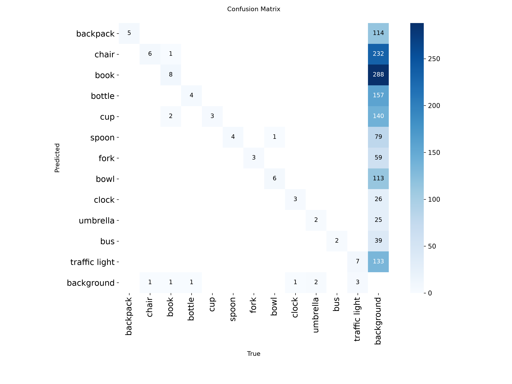

# Acolhe: reconhecimento de objetos para acolhimento linguístico

## Estado desta versão

Versão ativa: YOLO26n customizado por 80 épocas em CPU, resolução 640, confiança 0,15 escolhida pela validação. As versões YOLO11n foram preservadas. O lote 23 foi aprovado para teste local; sua avaliação posterior à escolha da nova arquitetura é regressão diagnóstica em conjunto já exposto, sem alegação de novo teste cego. A meta70%/70% ainda não foi atingida. Fotografias e pesos permanecem locais; vídeo e envio acadêmico ainda dependem da equipe.

Resumo e métricas principais abaixo descrevem a versão ativa preservada. A ampliação posterior para70treino/20validação foi concluída e comparada; veja a seção específica antes da conclusão.

## Integrantes

- Tomáz Versolato Carballo - RM 551417
- Rony Ken Nagai - RM 551549
- Aksel Viktor Caminha Rae - RM 99011
- Ian Xavier Kuraoka - RM 98860

## Resumo

O Acolhe é um protótipo acadêmico de acolhimento linguístico que apresenta vocabulário em português e espanhol por meio de atividades. Seu componente de visão computacional reconhece objetos cotidianos em fotografias selecionadas por uma pessoa adulta e apresenta os nomes nos dois idiomas. Este trabalho implementou preparação rastreável dos dados, treinamento customizado e integração ao aplicativo. Foram utilizadas 56 fotografias públicas, com autoria, licença e integridade registradas, distribuídas em vinte e cinco imagens de treinamento, oito de validação e 23 de teste. A revisão humana do lote e da anotação adicional de um ônibus foi autorizada antes da execução. O modelo YOLO26n recebeu transferência de aprendizado durante oitenta épocas, com imagens de seiscentos e quarenta pixels, batch dois e seed quarenta e dois. A execução ocorreu em CPU e terminou em aproximadamente doze minutos, incluindo avaliação e preparação de artefatos. No teste diagnóstico, com sessenta e seis objetos anotados, a precisão nativa foi 0,783, o recall 0,535, o mAP50 0,664 e o mAP50 a 95 foi 0,507. A API local reconheceu um ônibus na demonstração e retornou vocabulário bilíngue, caixas e confiança, sem armazenar o upload. Entretanto, diversas classes apresentaram baixa cobertura e falhas reais de detecção. O conjunto pequeno, com poucas imagens em classes raras, não permite afirmar generalização ou qualidade pedagógica. O relatório apresenta metodologia, métricas por classe, erros observados e medidas propostas. Semáforos são tratados apenas como objetos, sem autorização de travessia. O resultado comprova um piloto treinado e integrado, sujeito a expansão dos dados e revisão independente.

## Introdução

Crianças migrantes podem encontrar dificuldades para associar palavras em português aos objetos presentes na escola e no trajeto cotidiano. O Acolhe propõe atividades bilíngues acompanhadas por um adulto. A visão acrescenta uma interação por imagem: o adulto seleciona uma fotografia e recebe os nomes dos objetos detectados em português e espanhol.

A atividade de Applied Computer Vision exige treinamento customizado, código/documentação, demonstração em vídeo e relatório PDF. A rubrica oficial está na página 44 do desafio CitizenTech. Ela não estabelece quantidade mínima de classes, imagens, épocas ou mAP; tais parâmetros são decisões de engenharia que precisam ser justificados pelas evidências.

## Objetivo

Desenvolver e avaliar localmente um detector compacto de objetos cotidianos integrado ao Acolhe, apresentando vocabulário em português e espanhol. Preparar dados rastreáveis, realizar treinamento customizado e medir desempenho em teste separado, preservando privacidade, explicitando limitações e oferecendo uma demonstração reproduzível, supervisionada por adultos, sem interpretar imagens como autorização para travessia.

## Explicação técnica das ferramentas

YOLO26n é a base nano escolhida após comparar YOLO11n, YOLOv8n e YOLO26n na mesma validação. O módulo pré-treinado carregado tem 2,57 M parâmetros e 5,54 MB de pesos; contagens de implantação/fusão podem diferir. O treinamento customizado usa Ultralytics 8.4.215 e PyTorch 2.15.0+cpu. A nova arquitetura manteve a mesma stack de inferência. Os pesos/código são disponibilizados sob AGPL3.0 e opçãoEnterprise; não se presumiu isenção acadêmica e os pesos não são redistribuídos.

O treino e a detecção usaramCPU. A GPUAMD usada pelo Ollama é outra stack e não foi apresentada como treino PyTorch em GPU. O formatoYOLO contém classe e caixa normalizada. Mantidas 12 classes com nomesPT/ES: mochila, cadeira, livro, garrafa, copo, colher, garfo, tigela, relógio, guarda-chuva, ônibus e semáforo. Semáforo significa nome de objeto, sem interpretar sua cor ou autorizar travessia.

## Metodologia

1. Preparou-se o lote inicial de 40:39 fotografias COCO com CC-BY 2.0 verificada na fonte e uma de ônibus Commons, autor Znns, CC-BY 4.0. O bonde inicialmente anotado como ônibus foi substituído antes do treino. O usuário aprovou lote/anotação; hash a7f36306…. O inventário preserva URLs, créditos, licença e hashes.
2. Separaram-se25/8/7 fotos e 97/48/42 objetos em treino/validação/teste antes de transformações. Executaram-seYOLO11n 20 épocas320 e 80 épocas640. O primeiro durou~3 min e teve picoRSS~737 MiB; os demais picosRAM não foram medidos. A auditoria verificou bytes/IDs/caixas; não mede similaridade perceptual nem substitui revisão humana.
3. O usuário aprovou23 fotos novas exclusivamente para teste local, hash 099377b4…. O conjunto final56 tem25 treino/8val/23 teste e 97/48/66 objetos. Pixels, caixas e splits de treino/validação ficaram inalterados; não há IDs/bytes em comum entre as 40 iniciais e 23 novas. O novo fingerprint é4b18ed3a…. Reconstrução offline foi auditada.
4. A primeira avaliação23 foi congelada paraYOLO11n no commitccdd7d7 e preservada em independent23-frozen.json. Após observar esse teste, a comparação de novas arquiteturas usa somente as 8 de validação para seleção. Qualquer medição posterior no23 é regressão em teste exposto, não nova evidência cega. A origemCOCO também impede alegar independência de todo desenvolvimento dos pesos-base.
5. Três bases oficiais pré-treinadas foram comparadas em CPU com resolução 640 na validação, com remapeamento por nome para12 classes. YOLO26n teve F1 micro de 0,4667, contra 0,3636/0,4286 das outras bases. Essa referência não substitui treinamento customizado. RF-DETRNano foi pesquisado, sem instalação/benchmark nesta rodada; detalhes e fontes em docs/MODELOS_VISION.md.
6. Treinou-seYOLO26n customizado por 80 épocas,640, batch 2, workers 0, seed 42, CPU, transferindo pesos oficiais, sobre as 25 fotos aprovadas. Duração de treino registrada:0,199 h (~12 min). Checkpoint selecionado pela validação. Grade de confiança 0,05–0,80 escolheu0,15 por maior F1 micro, desempate por precisão e maior confiança; resultado0,4675 versus0,3488 do YOLO11n 80. A promoção foi registrada antes da regressão em yolo26n-custom-decision.json. Naquela rodada, não houve ajustes após os resultados23.
7. Manifesto, hash, classes e parâmetros foram conferidos pela API. Checkpoint007a199a…. A requisiçãoHTTP real de demonstração reconheceu ônibus/autobús com confiança 0,9479, sem gravar a imagem; evidência em inference-http-yolo26n.json. Essa foto de demonstração é histórica e não substitui a avaliação agregada.

## Exemplos de resultados e avaliação

Mesmas 23 fotos/66 objetos, com parâmetros selecionados anteriormente em validação. YOLO26n é a versão ativa; suas métricas abaixo são diagnóstico posterior em conjunto já examinado. Resultados originaisYOLO11n continuam preservados.

| Versão / confiança | TP | FP | FN | Precisão | Recall |
|---|---:|---:|---:|---:|---:|
| YOLO11n 20 épocas /0,10 | 30 | 19 | 36 | 61,2% | 45,5% |
| YOLO11n 80 épocas /0,10 | 35 | 37 | 31 | 48,6% | 53,0% |
| YOLO26n 80 épocas /0,15 | 34 | 22 | 32 | 60,7% | 51,5% |

Acertos exigem classe correta, IoU ≥ 0,5 e correspondência 1 para 1. F1 micro do YOLO26n:0,5574, frente a 0,5072 do YOLO11n 80 e 0,5217 do inicial20. A nova base melhorou o equilíbrio precisão/recall frente ao YOLO11n 80, com pequena perda de recall. A escolha foi por validação, sem selecionar modelo/limiar a partir desse diagnóstico.

Meta principal aprovada pelo usuário: **recall ≥ 70% e precisão ≥ 70%**, no limiar efetivo da aplicação. É uma meta do protótipo, não número da rubrica. **Ainda não foi atingida.** Qualidade para uso real com crianças continua sem validação.

Métricas nativas YOLO26n nas 23: precisão de 0,7833, recall de 0,5347, mAP50 de 0,6642 e mAP50-95 de 0,5073. São agregações por classe/varredura, diferentes dos60,7%/51,5% operacionais. Não usar a precisão nativa mais alta para declarar a meta operacional cumprida. AvaliadorCOCO opcional não executado; resultados nativos Ultralytics.

| Classe | TP | FP | FN | Precisão | Recall |
|---|---:|---:|---:|---:|---:|
| backpack | 3 | 1 | 2 | 75.0% | 60.0% |
| chair | 5 | 7 | 2 | 41.7% | 71.4% |
| book | 1 | 0 | 11 | 100.0% | 8.3% |
| bottle | 2 | 1 | 3 | 66.7% | 40.0% |
| cup | 3 | 2 | 0 | 60.0% | 100.0% |
| spoon | 4 | 3 | 0 | 57.1% | 100.0% |
| fork | 1 | 1 | 2 | 50.0% | 33.3% |
| bowl | 6 | 3 | 1 | 66.7% | 85.7% |
| clock | 3 | 0 | 1 | 100.0% | 75.0% |
| umbrella | 2 | 2 | 2 | 50.0% | 50.0% |
| bus | 2 | 0 | 0 | 100.0% | 100.0% |
| traffic light | 2 | 2 | 8 | 50.0% | 20.0% |

Cinco erros reais do modelo ativo:

| Imagem | Objeto perdido | Maior IoU mesma classe | Confiança correspondente |
|---|---|---:|---:|
| 182417 | bowl | 0.9217 | 0.0952 |
| 520871 | fork | 0.6822 | 0.0155 |
| 30213 | bottle | 0.7255 | 0.0269 |
| 17182 | book | 0.9241 | 0.0108 |
| 313130 | chair | 0.7995 | 0.1134 |

As 32 falhas e as predições por imagem estão em vision/reports/yolo26n-regression23.json. Esses casos têm caixas candidatas próximas, mas confiança abaixo do limiar. Escassez de exemplos variados, escala e calibração são hipóteses, não causas comprovadas. A próxima rodada deve ampliar treino e reservar outro teste final; não ajustar com este conjunto já examinado. O lote de 23 fotos foi autorizado somente para teste local, sem treino/publicação de fotos.

## Ampliação posterior: 70 imagens de treino e 20 de validação

Após aprovação explícita do pacote 29569624…, preparou-se um conjunto com 70 imagens de treino, 20 de validação e as 23 de teste históricas, com 524, 210 e 66 objetos anotados, respectivamente. São 85 fotos novas e cinco já aprovadas, com seus splits preservados. Os pixels e rótulos das 23 fotos continuaram inalterados. Elas não foram usadas para treinar nem escolher parâmetros. Direitos, autorias, caixas e hashes foram registrados. A reconstrução offline foi auditada, com fingerprint 680186e4….

A adaptação com todas as camadas livres foi encerrada após 33 épocas por estagnação na validação; seu checkpoint escolhido foi o da época 1. Outra adaptação congelou 22 camadas por 67 épocas. As duas somaram 100 épocas em CPU, resolução 640, batch 2, workers 0 e seed 42. O teste foi adiado em ambas. Checkpoints e confiança foram escolhidos na validação. A regra de implantação, registrada antes da comparação final, exigia não regredir precisão nem recall do ativo e aumentar F1 em pelo menos 0,02. Nenhum limiar dos novos candidatos passou.

| Configuração na mesma validação de 20 fotos | Precisão | Recall | F1 |
|---|---:|---:|---:|
| Ativo, confiança 0,15 |61,3%|46,7%|0,5297|
| Ativo, maior F1 da grade, confiança 0,10 |53,3%|53,8%|0,5355|
| Novo, camadas livres, 33 épocas, confiança 0,15 |52,8%|49,0%|0,5086|
| Novo, 22 camadas congeladas, 67 épocas, confiança 0,15 |59,3%|47,1%|0,5252|

O modelo anterior foi mantido. Não houve nova avaliação das 23 fotos para esses candidatos. Na validação, 95 dos 210 objetos ficam menores que 32 x 32 pixels ao ajustar as fotos para 640. Cenas com muitos objetos e classes comuns predominam. Isso descreve uma dificuldade, sem comprovar causalidade. Mais anotações não demonstraram ganho nesta rodada. A próxima expansão deve melhorar escala e diversidade, reforçar classes raras e reservar um novo teste sem exposição. A meta de 70% nas duas métricas segue pendente.

Relatórios: expansion70-decision.json, expansion70-*-val20.json e expansion70-object-sizes.json. Reprodução: reproduction-train70.json. Fotografias e pesos permanecem locais.

## Conclusão

Foram executados treinamento customizado, comparação de bases leves, seleção pela validação e inferência integrada. YOLO26n melhorou precisão/F1 frente ao YOLO11n 80 nesta regressão, sem atingir70% nas duas métricas. Os poucos exemplos de treino e a avaliação já exposta limitam a conclusão. A prioridade seguinte é ampliar dados próximos do uso educativo, revisar caixas e reservar outro teste final. O aplicativo não identifica pessoas, não grava uploads e não decide travessias. Revisão pedagógica, vídeo e envio continuam pendentes.

## Repositório, vídeo e reprodutibilidade

- Repositório de destino: https://github.com/Acolhe-Projeto/Acolhe---GS8
- Código desta implementação: https://github.com/Acolhe-Projeto/Acolhe---GS8/tree/feat/genai-vision
- Vídeo de demonstração: gravação e publicação pela equipe ainda pendentes; o detector já executou treino e inferência reais.
- Preparação e auditoria: vision/prepare.py e vision/audit.py.
- Treinamento: vision/train.py; orientação completa em vision/README.md.
- Serviço e integração: vision/service.py, app/server.py e app/static/vision.js.

## Referências

- Desafio FIAP GS CitizenTech, página 44: requisitos de Applied Computer Vision; página 24: prazo, envio e links públicos.
- COCO: https://cocodataset.org/ e condições/licenças de cada fotografia registrada no inventário.
- Ultralytics YOLO26: https://docs.ultralytics.com/models/yolo26/
- Treinamento e validação: https://docs.ultralytics.com/modes/train/ e https://docs.ultralytics.com/modes/val/
- Licenciamento Ultralytics: https://www.ultralytics.com/license
