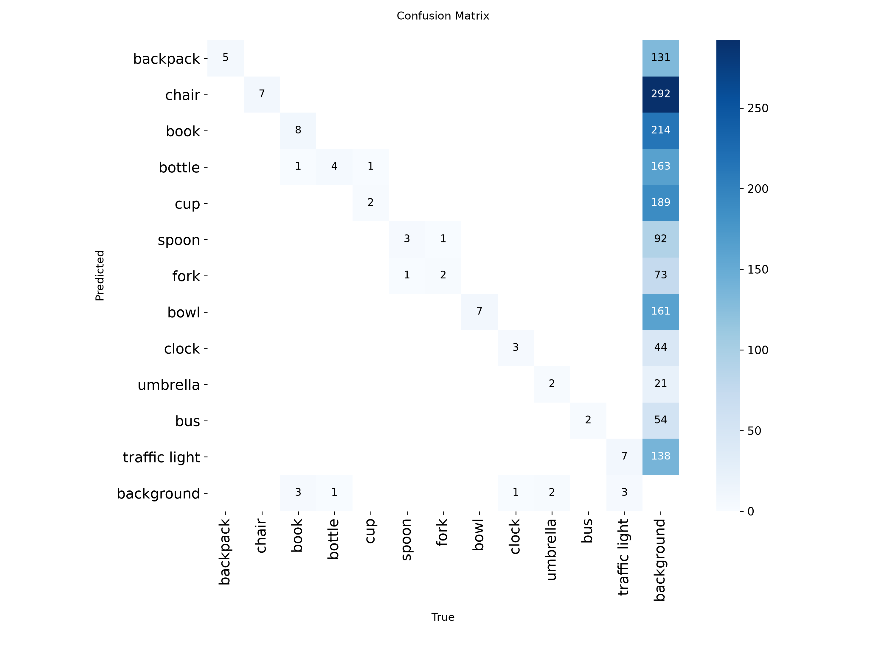

# Acolhe: reconhecimento de objetos para acolhimento linguístico

## Estado desta versão

Versão ativa: YOLO11n80 épocas com resolução 640, confiança 0,10 selecionada pela validação. O modelo de 20 épocas com resolução 320 foi preservado como baseline. Teste histórico reavaliado e teste novo de 23 fotos aprovado pelo usuário e executado com configuração congelada antes da avaliação. A qualidade não está validada para uso real com crianças. Fotografias e pesos permanecem locais; os metadados, métricas e instruções de reprodução acompanham o código. Vídeo e envio acadêmico ainda exigem a etapa final da equipe.

## Integrantes

- Tomáz Versolato Carballo - RM 551417
- Rony Ken Nagai - RM 551549
- Aksel Viktor Caminha Rae - RM 99011
- Ian Xavier Kuraoka - RM 98860

## Resumo

O Acolhe é um protótipo acadêmico de acolhimento linguístico que apresenta vocabulário em português e espanhol por meio de atividades. Seu componente de visão computacional reconhece objetos cotidianos em fotografias selecionadas por uma pessoa adulta e apresenta os nomes nos dois idiomas. Este trabalho implementou preparação rastreável dos dados, treinamento customizado e integração ao aplicativo. Foram utilizadas 56 fotografias públicas, com autoria, licença e integridade registradas, distribuídas em vinte e cinco imagens de treinamento, oito de validação e 23 de teste. A revisão humana do lote e da anotação adicional de um ônibus foi autorizada antes da execução. O modelo YOLO11n recebeu transferência de aprendizado durante oitenta épocas, com imagens de seiscentos e quarenta pixels, batch dois e seed quarenta e dois. A execução ocorreu em CPU e terminou em aproximadamente onze minutos, incluindo avaliação e preparação de artefatos. No teste novo, com sessenta e seis objetos anotados, a precisão nativa foi 0,672, o recall 0,500, o mAP50 0,599 e o mAP50 a 95 foi 0,462. A API local reconheceu um ônibus do teste e retornou vocabulário bilíngue, caixas e confiança, sem armazenar o upload. Entretanto, diversas classes apresentaram baixa cobertura e falhas reais de detecção. O conjunto pequeno, com poucas imagens em classes raras, não permite afirmar generalização ou qualidade pedagógica. O relatório apresenta metodologia, métricas por classe, erros observados e medidas propostas. Semáforos são tratados apenas como objetos, sem autorização de travessia. O resultado comprova um piloto treinado e integrado, sujeito a expansão dos dados e revisão independente.

## Introdução

Crianças migrantes podem encontrar dificuldades para associar palavras em português aos objetos presentes na escola e no trajeto cotidiano. O Acolhe propõe atividades bilíngues acompanhadas por um adulto. A visão acrescenta uma interação por imagem: o adulto seleciona uma fotografia e recebe os nomes dos objetos detectados em português e espanhol.

A atividade de Applied Computer Vision exige treinamento customizado, código/documentação, demonstração em vídeo e relatório PDF. A rubrica oficial está na página 44 do desafio CitizenTech. Ela não estabelece quantidade mínima de classes, imagens, épocas ou mAP; tais parâmetros são decisões de engenharia que precisam ser justificados pelas evidências.

## Objetivo

Desenvolver e avaliar localmente um detector compacto de objetos cotidianos integrado ao Acolhe, apresentando vocabulário em português e espanhol. Preparar dados rastreáveis, realizar treinamento customizado e medir desempenho em teste separado, preservando privacidade, explicitando limitações e oferecendo uma demonstração reproduzível, supervisionada por adultos, sem interpretar imagens como autorização para travessia.

## Explicação técnica das ferramentas

YOLO11n é a arquitetura nano de detecção mantida na base do projeto. O treinamento usa Ultralytics e PyTorch em ambiente Python isolado. Nesta máquina, o treino foi executado em CPU; a GPU AMD empregada pelo Ollama não equivale a suporte CUDA no PyTorch. A configuração inicial usou320 pixels; a versão ativa usa640 pixels, batch 2 e zero workers. A confiança 0,10 foi escolhida por F1 micro na validação, sem escolher limiar pelo teste. O piloto mediu o custo e identificou a necessidade de ampliar os dados antes de afirmar qualidade.

O formato YOLO registra classe e caixa normalizada. As classes, nessa ordem, são backpack, chair, book, bottle, cup, spoon, fork, bowl, clock, umbrella, bus e traffic light. Os rótulos exibidos vêm de vision/service.py e incluem tradução PT/ES.

As fotografias candidatas são públicas, com procedência individual; a licença das anotações COCO não substitui a licença de cada imagem. O inventário deve preservar autor, URL, licença, ID original, split e SHA-256. A aprovação humana permanece vinculada aos bytes revisados.

## Metodologia

1. Selecionaram-se 39 fotografias COCO com CC-BY 2.0 verificada na fonte e uma fotografia de ônibus do Wikimedia Commons, autor Znns, CC-BY 4.0. A imagem de bonde anotada como ônibus foi substituída antes do treino.
2. O usuário aprovou explicitamente o lote v2 e a caixa de ônibus proposta pelo agente. Hash do pacote: a7f3630698fd57102ea6d1f4f20afabba80c13e35cb96ecf28ac67450b345a71.
3. Separaram-se 25/8/7 fotografias em treino/validação/teste antes de transformações. A auditoria verificou 97/48/42 objetos, doze classes em cada split e nenhuma duplicata binária. Similaridade perceptual não foi avaliada.
4. As caixas foram convertidas para YOLO. O fingerprint dos pixels e labels é 807dcc346068ebc6f63c7bb687c0b114a9a63347cf10c26915ba4759065df923. A reprodução a partir do cache aprovado foi auditada com o mesmo fingerprint.
5. O baseline executou YOLO11n por20 épocas; a melhoria executou80 épocas, CPU, imgsz640, batch 2, workers 0, seed 42 e transferência de pesos oficiais. PyTorch 2.15.0+cpu e Ultralytics 8.4.215 foram registrados. A GPU AMD foi usada pelo tutor Ollama via Vulkan; não foi alegado treino PyTorch em GPU.
6. O baseline durou179,789s e teve picoRSS~737MiB. A rodada80 épocas levou aproximadamente11 minutos; picoRAM dessa rodada não foi medido. Preservaram-se as mesmas fotos/splits aprovados. O teste antigo já havia sido examinado; por isso, os novos resultados são comparação histórica, não teste independente novo. Checkpoint e confiança foram escolhidos pela validação. O usuário aprovou as 23 fotos para teste local após ver as folhas; foram incorporadas mantendo pixels, caixas e splits de treino/validação inalterados.
7. O manifesto, hash, classes e parâmetros de inferência foram verificados pelo serviço. A nova requisição HTTP real reconheceu o ônibus com confiança 0,9522. O aplicativo devolveu nomes PT/ES e não gravou a fotografia enviada.

## Exemplos de resultados e avaliação

O modelo e a confiança 0,10 foram congelados antes de avaliar as 23 fotos novas, conforme commit ccdd7d7. O usuário aprovou o lote 099377b4… para teste local. Não há sobreposição de IDs ou bytes com as 40 fotos iniciais. Os25 exemplos de treino e 8 de validação mantiveram pixels, caixas e splits inalterados; o novo teste contém66 objetos em23 fotos. Independência refere-se à seleção/treino local, sem alegar independência de toda a origemCOCO ou desenvolvimento dos pesos pré-treinados.

| Conjunto / versão calibrada | TP | FP | FN | Precisão | Recall |
|---|---:|---:|---:|---:|---:|
| Histórico7fotos / inicial20épocas | 11 | 17 | 31 | 39,3% | 26,2% |
| Histórico7fotos / ativa80épocas | 22 | 21 | 20 | 51,2% | 52,4% |
| Novo23 fotos / inicial20épocas | 30 | 19 | 36 | 61,2% | 45,5% |
| Novo23 fotos / ativa80épocas | 35 | 37 | 31 | 48,6% | 53,0% |

As duas versões usam confiança 0,10 escolhida anteriormente pela validação, com resoluções 320/640 respectivas. Acertos exigem mesma classe, IoU ≥ 0,5 e correspondência 1 para 1. Recall é calculado por objeto. No teste novo, a versão ativa recupera mais objetos, mas erra mais: F1 micro caiu de 0,5217 para 0,5072. Portanto, não houve superioridade uniforme. Mantém-se a versão escolhida pela validação, sem escolher outro modelo ou limiar a partir desse teste.

Meta revisada por solicitação do usuário: **recall≥70% e precisão≥70%**, no limiar da aplicação e em teste separado. É uma meta de engenharia para o protótipo, não número imposto pela rubrica nem qualidade já alcançada. A meta ainda não foi atingida.

Métricas nativas da versão ativa nas 23 fotos: precisão de 0,6724, recall de 0,5001, mAP50 de 0,5986 e mAP50-95 de 0,4617. Esses resumos usam agregação por classe/varredura de confiança e não representam o ponto 0,10 do aplicativo. O avaliador COCO opcional não foi executado; são métricas nativas Ultralytics. Não escolher o número mais alto de uma agregação diferente para declarar a meta operacional cumprida.

| Classe | TP | FP | FN | Precisão | Recall |
|---|---:|---:|---:|---:|---:|
| backpack | 3 | 3 | 2 | 50.0% | 60.0% |
| chair | 6 | 8 | 1 | 42.9% | 85.7% |
| book | 3 | 2 | 9 | 60.0% | 25.0% |
| bottle | 2 | 3 | 3 | 40.0% | 40.0% |
| cup | 2 | 4 | 1 | 33.3% | 66.7% |
| spoon | 3 | 3 | 1 | 50.0% | 75.0% |
| fork | 0 | 2 | 3 | 0.0% | 0.0% |
| bowl | 6 | 9 | 1 | 40.0% | 85.7% |
| clock | 3 | 0 | 1 | 100.0% | 75.0% |
| umbrella | 2 | 2 | 2 | 50.0% | 50.0% |
| bus | 2 | 0 | 0 | 100.0% | 100.0% |
| traffic light | 3 | 1 | 7 | 75.0% | 30.0% |

A inferênciaHTTP local da versão ativa reconheceu o ônibus de demonstração com confiança 0,9522 e retornou ônibus/autobús sem gravar upload. Esse exemplo pertence ao conjunto histórico; não é usado como substituto das 23 fotos novas. Evidência: vision/reports/inference-http-improved.json.

Cinco erros reais do modelo ativo no teste novo:

| Imagem nova | Objeto não encontrado | Maior IoU da mesma classe | Confiança correspondente |
|---|---|---:|---:|
| 182417 | cup | 0.9499 | 0.0021 |
| 182417 | bowl | 0.9117 | 0.0292 |
| 520871 | fork | 0.8797 | 0.0271 |
| 30213 | bottle | 0.5875 | 0.0036 |
| 17182 | book | 0.775 | 0.0012 |

Os 31 objetos perdidos e todas as predições estão em vision/reports/independent23-frozen.json. Confiança baixa, localização imprecisa, objetos pequenos e pouco treino são hipóteses; não causas comprovadas. Há classes com recall alto sustentado por poucos objetos: ônibus 2/2 não demonstra generalização. Garfos 0/3, livros 3/12 e semáforos 3/10 exigem atenção.

Próxima etapa: ampliar e equilibrar os dados de treinamento, revisar caixas e testar em outro conjunto reservado antes de novos ajustes. O lote de 23foi autorizado somente para teste, não treino ou publicação de fotos. Reproduzir dados por URLs, rótulos, créditos e hashes em reproduction-newtest23.json; reconstrução offline auditada com fingerprint4b18ed3a…. Fotografias e pesos não são publicados.

## Conclusão

O piloto executou treinamento customizado, avaliação rastreável e inferência integrada ao Acolhe. Reconhecer o ônibus demonstra o percurso técnico, com melhora real após80 épocas com resolução 640, mas precisão/recall operacionais ainda abaixo da meta e erros por classe impedem afirmar qualidade geral. A próxima etapa é ampliar os dados de treino adequados ao cotidiano escolar e reservar outra avaliação independente, pois o teste23 já foi examinado e não deve guiar ajustes. O aplicativo não identifica pessoas, não guarda uploads e não decide travessias. Validação pedagógica e revisão da equipe continuam necessárias.

## Repositório, vídeo e reprodutibilidade

- Repositório de destino: https://github.com/Acolhe-Projeto/Acolhe---GS8
- Código desta implementação: https://github.com/Acolhe-Projeto/Acolhe---GS8/tree/feat/genai-vision
- Vídeo de demonstração: gravação e publicação pela equipe ainda pendentes; o detector já executou treino e inferência reais.
- Preparação e auditoria: vision/prepare.py e vision/audit.py.
- Treinamento: vision/train.py; orientação completa em vision/README.md.
- Serviço e integração: vision/service.py, app/server.py e app/static/vision.js.

## Referências

- Desafio FIAP GS CitizenTech, página 44: requisitos de Applied Computer Vision; página 24: prazo, envio e links públicos.
- COCO: https://cocodataset.org/ e condições/licenças de cada fotografia registrada no inventário.
- Ultralytics YOLO11: https://docs.ultralytics.com/models/yolo11/
- Treinamento e validação: https://docs.ultralytics.com/modes/train/ e https://docs.ultralytics.com/modes/val/
- Licenciamento Ultralytics: https://www.ultralytics.com/license
