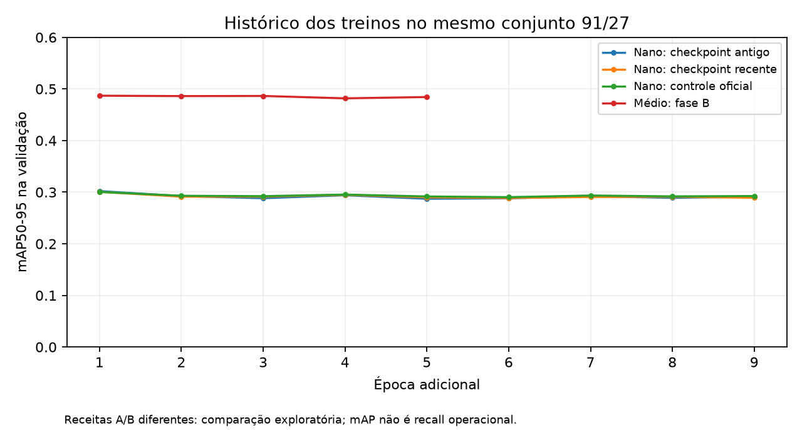
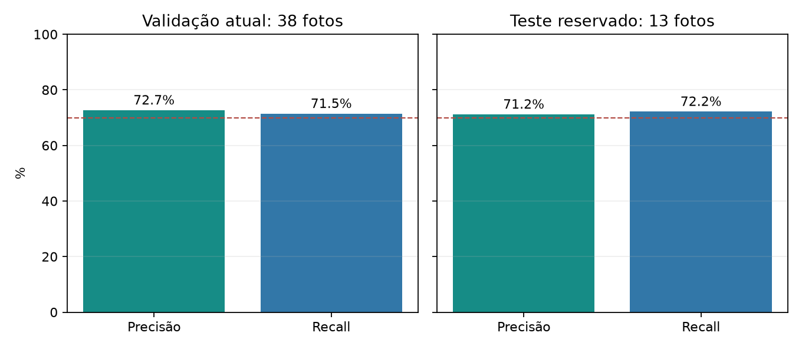

# Acolhe - Applied Computer Vision

## Integrantes

- Tomáz Versolato Carballo - RM 551417
- Rony Ken Nagai - RM 551549
- Aksel Viktor Caminha Rae - RM 99011
- Ian Xavier Kuraoka - RM 98860

## Resumo

O Acolhe é um protótipo acadêmico de acolhimento linguístico que relaciona objetos cotidianos a palavras em português e espanhol. Este trabalho desenvolveu seu módulo de visão computacional: uma pessoa adulta seleciona uma fotografia e recebe nomes, caixas de localização e confiança das detecções. A implementação utiliza transferência de aprendizado com YOLO26m, integrada a uma aplicação web local. O modelo entregue foi adaptado com 91 imagens de treinamento, utilizando 27 imagens para validação e um conjunto anterior de 23 imagens para diagnóstico. Foram concluídas cinco épocas, com seleção do checkpoint pela validação. Também foram comparadas continuações de checkpoints nano e uma expansão para 117 imagens de treino. Essa expansão acrescentou 11 imagens à validação e reservou 13 imagens novas para teste. O candidato ampliado concluiu sete épocas, mas não superou o modelo anterior na mesma validação, que foi mantido. No teste reservado, contendo 72 objetos, o modelo reconheceu corretamente 52, produziu 21 falsos positivos e deixou de detectar 20. A precisão foi 71,2% e o recall, 72,2%, atendendo à meta local de 70% nesse conjunto básico. Nas 23 imagens anteriores, mais complexas, os resultados foram 68,3% e 62,1%, respectivamente. A diferença entre conjuntos não representa evolução direta do modelo. O repositório inclui o checkpoint avaliado, três fotografias públicas creditadas, código e resultados reproduzíveis. A amostra é pequena, algumas classes apresentam falhas e imagens COCO podem ter participado do pré-treinamento. Não houve avaliação pedagógica com crianças. O módulo apoia atividades educativas supervisionadas e não interpreta imagens como autorização para atravessar uma rua.

## Introdução

O módulo de visão do Acolhe apresenta vocabulário em português e espanhol a partir de objetos cotidianos. A pessoa adulta envia uma fotografia e acompanha a atividade. O trabalho reúne preparação dos dados, treinamento customizado, comparação de ajustes finos e integração do detector à aplicação. A meta local adotada foi alcançar pelo menos 70% de precisão e recall no perfil utilizado pelo produto.

## Objetivo

Desenvolver e avaliar localmente um detector compacto de objetos cotidianos integrado ao Acolhe, apresentando vocabulário em português e espanhol. Preparar dados rastreáveis, realizar treinamento customizado e medir desempenho em teste separado, preservando privacidade, explicitando limitações e oferecendo uma demonstração reproduzível, supervisionada por adultos, sem interpretar imagens como autorização para travessia.

## Arquitetura e ferramentas

A interface envia JPEG ou PNG de até 8 MiB à API Python. O serviço valida o arquivo, o hash do checkpoint, a ordem das classes e os parâmetros de inferência. O YOLO retorna caixas e confiança; a aplicação acrescenta os nomes PT/ES. O upload não é salvo.

Foi utilizado Ultralytics 8.4.215 com PyTorch 2.15.0+cpu. O checkpoint YOLO26m customizado possui 21.791.392 parâmetros e ocupa 44.036.761 bytes. Treino e inferência Vision foram executados em CPU. A inferência usa resolução 960 e confiança 0,25; o treino foi feito em 640. As 12 classes são mochila, cadeira, livro, garrafa, copo, colher, garfo, tigela, relógio, guarda-chuva, ônibus e semáforo.

## Dados e separação dos conjuntos

Foram usadas fotografias públicas do COCO e uma fotografia de ônibus do Wikimedia Commons, com fontes, autores, licenças e hashes registrados. As anotações foram convertidas para YOLO e auditadas quanto a caixas, classes, integridade e duplicatas. A composição preservou a separação entre treino e validação; o teste reservado final não entrou no ajuste fino.

| Conjunto | Treino | Validação | Teste | Objetos em treino / validação / teste |
|---|---:|---:|---:|---:|
| Base do modelo entregue | 91 | 27 | 23 | 613 / 247 / 66 |
| Expansão do experimento | 117 | 38 | 13 | 691 / 291 / 72 |

A expansão acrescentou 26 fotos ao treino e 11 à validação, reservando 13 fotos novas para teste. IDs e hashes das 23 imagens anteriores não aparecem no conjunto ampliado. Cinco duplicatas idênticas foram removidas na união inicial. A triagem perceptual foi heurística e não garante ausência de cenas relacionadas. Os pacotes de reprodução conservam os metadados e rótulos necessários à reconstrução.

## Treinamento e comparação de checkpoints

A transferência de aprendizado foi comparada em duas etapas. Primeiro, três modelos nano partiram de pesos diferentes, usando os mesmos dados e receita. Depois foi adaptado o YOLO26m, seguido de uma continuação com o conjunto ampliado.

| Experimento | Pesos iniciais | Imagens de treino | Épocas concluídas | Papel na comparação |
|---|---|---:|---:|---|
| Nano A | Checkpoint customizado da execução antiga de 80 épocas | 91 | 9 | Comparador |
| Nano B | Checkpoint customizado da execução anterior com 70 fotos | 91 | 9 | Comparador |
| Nano C | YOLO26n oficial pré-treinado | 91 | 9 | Controle |
| Médio M91 | YOLO26m oficial pré-treinado | 91 | 5 | Modelo selecionado |
| Médio M117 | Checkpoint M91 | 117 | 7 | Continuação avaliada, sem promoção |

Os nanos usaram AdamW com taxa 0,00005, freeze 10, máximo de 30 épocas e parada após oito sem melhora. O M91 usou AdamW 0,00001, freeze 22, máximo de 12 épocas e patience 4. O checkpoint selecionado do M91 foi o da primeira época. A continuação M117 reaproveitou seus pesos, reiniciando o otimizador, com a mesma taxa e máximo de 12 épocas. As execuções usaram batch 2, seed 42, mosaic zero e CPU. O código verifica hash, arquitetura e classes dos pesos iniciais antes do ajuste fino.

A taxa de aprendizado foi definida explicitamente porque optimizer=auto ignorava o valor manual em execuções anteriores. Warmup dos vieses foi fixado em zero. Como as fases nano e médio utilizaram receitas e capacidades diferentes, seus resultados não isolam o efeito do tamanho do modelo.

## Seleção do modelo

Resolução e confiança foram escolhidas pela validação, considerando precisão, recall, F1 e falhas por classe. O critério de equilíbrio foi emendado após observar desenvolvimento e registrado antes da regressão das 23 fotos. Essa alteração faz parte do método e não é apresentada como pré-registro original.

Na expansão, ambos os modelos foram comparados nas mesmas 38 fotos de validação. A continuação só seria promovida se não regredisse precisão e recall, melhorasse F1 em pelo menos 0,02 e não criasse classe com recall zero que antes tinha acertos. O candidato não passou essa regra. A decisão e o perfil do M91 foram congelados antes da primeira inferência no teste de 13 fotos; não houve ajustes após seus resultados.

## Resultados

| Modelo na validação de 38 fotos | Resolução / confiança | Precisão | Recall | F1 |
|---|---|---:|---:|---:|
| M91 mantido | 960 / 0,25 | 72,7% | 71,5% | 0,7210 |
| M117, perfil equilibrado | 960 / 0,26 | 71,5% | 71,5% | 0,7148 |

O aumento do conjunto de treino não produziu ganho suficiente para trocar os pesos. O modelo entregue continua sendo o M91, treinado nas 91 fotos iniciais.

| Avaliação do modelo entregue | TP | FP | FN | Precisão | Recall |
|---|---:|---:|---:|---:|---:|
| Teste básico reservado: 13 fotos, 72 objetos | 52 | 21 | 20 | 71,2% | 72,2% |
| Diagnóstico anterior: 23 fotos, 66 objetos | 41 | 19 | 25 | 68,3% | 62,1% |

Um acerto exige classe correta, IoU de pelo menos 0,5 e associação um a um com a anotação. No teste reservado, F1 foi 0,7172 e macrorecall, 86,0%. A meta de 70% nas duas métricas foi observada nesse lote básico. As 23 fotos anteriores são mais complexas e já haviam sido examinadas; a diferença entre os dois conjuntos não demonstra ganho causado pelo novo treino.

Na comparação anterior sobre as mesmas 23 fotos, o nano registrou 34 TP, 22 FP e 32 FN, com precisão 60,7% e recall 51,5%. O M91 obteve sete acertos adicionais, três falsos positivos a menos e sete objetos perdidos a menos. Houve, porém, regressões em algumas classes.

## Resultados por classe no teste reservado

| Classe | TP | FP | FN | Precisão | Recall |
|---|---:|---:|---:|---:|---:|
| mochila | 1 | 0 | 0 | 100,0% | 100,0% |
| cadeira | 2 | 0 | 2 | 100,0% | 50,0% |
| livro | 12 | 6 | 13 | 66,7% | 48,0% |
| garrafa | 2 | 0 | 0 | 100,0% | 100,0% |
| copo | 5 | 4 | 0 | 55,6% | 100,0% |
| colher | 2 | 1 | 1 | 66,7% | 66,7% |
| garfo | 2 | 1 | 0 | 66,7% | 100,0% |
| tigela | 4 | 0 | 0 | 100,0% | 100,0% |
| relógio | 2 | 2 | 0 | 50,0% | 100,0% |
| guarda-chuva | 1 | 0 | 0 | 100,0% | 100,0% |
| ônibus | 9 | 0 | 1 | 100,0% | 90,0% |
| semáforo | 10 | 7 | 3 | 58,8% | 76,9% |

Livros tiveram recall de 48,0% e cadeiras, 50,0%; são pontos claros de melhoria. Copos e semáforos também produziram falsos positivos. O resultado agregado não elimina essas diferenças entre classes.

## Análise de cinco erros

A análise abaixo usa predições reais do diagnóstico de 23 fotos. Ela descreve a localização e a confiança das candidatas; não determina, sozinha, a causa do erro.

| Imagem | Objeto perdido | Maior IoU de candidata da mesma classe | Confiança |
|---|---|---:|---:|
| 182417 | copo | 0,1078 | 0,0384 |
| 30213 | garrafa | 0,9550 | 0,2456 |
| 533206 | garfo | 0,8590 | 0,1555 |
| 17182 | livro | 0,6949 | 0,1542 |
| 313130 | cadeira | 0,8464 | 0,0856 |

No primeiro caso, a localização não alcançou IoU 0,5. Nos demais, havia candidata próxima com confiança inferior ao limiar 0,25; ela também poderia estar associada a outro objeto. O limiar não foi reduzido a partir dessas observações. As predições completas estão em vision/reports/ft91-medium-regression23.json.

## Integração e reprodução

O mesmo checkpoint avaliado está em vision/release/best.pt, acompanhado de manifesto e licença AGPL-3.0. Seu SHA-256 é 3eff4c911170b189d5904b52adde2390f877f0d105a95c092a4b3496653c3bd5. A instalação está no README da raiz; não é necessário refazer o treinamento para usar a entrega.

As três fotos de vision/examples reconheceram ônibus, utensílios e cadeiras no ensaio HTTP. Uma nova clonagem conferiu o checkpoint e os exemplos.

As evidências principais são finetune117-summary.json, finetune117-decision.json, ft117-reserved13.json e reproduction-union91.json, em vision/reports. O pacote reproduction-union117.json reconstrói os dados do experimento ampliado. O ensaio da aplicação está em docs/evidencias/release-delivery-http.json. Os dados completos e checkpoints experimentais não acompanham o clone.

## Limitações e conclusão

O modelo atende à meta no pequeno teste básico reservado, mas mantém objetos perdidos e falsos positivos, especialmente em cenas complexas. A fonte COCO pode ter participado do pré-treinamento e a validação teve uso repetido no desenvolvimento; os números não caracterizam um benchmark independente. São necessários novos cenários de uso e revisão pedagógica antes de aplicação com crianças. O detector apresenta vocabulário, sem identificar rostos ou autorizar travessias.

O resultado da comparação foi manter o M91: mais imagens e épocas não foram suficientes para justificar o candidato M117. A entrega reúne treinamento customizado, comparação de ajustes finos, avaliação por objeto e integração reproduzível. A gravação/publicação do vídeo demonstrativo e o envio acadêmico permanecem pendentes.

## Referências

- Desafio FIAP GS CitizenTech 4ES: Applied Computer Vision, página 44; entrega, página 24.
- Ultralytics YOLO26: https://docs.ultralytics.com/models/yolo26/
- Ajuste fino: https://docs.ultralytics.com/guides/model-fine-tuning/
- COCO e direitos das imagens: https://cocodataset.org/ e https://cocodataset.org/dataset/termsofuse.htm
- Repositório: https://github.com/Acolhe-Projeto/Acolhe---GS8/tree/feat/genai-vision
