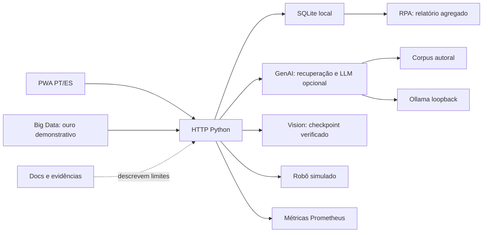

> Atualização final: grafo reconstruído com1.014 nós,1.591 arestas e133 comunidades; HTML e vault Obsidian regenerados. Cobertura distingue semântica revisada de estrutura literal, com duas anotações antigas excluídas por hash alterado. Há referências AST não resolvidas/relações colapsadas; ver relatório, sem usar ausência de aresta como prova. O enunciado oficial foi localizado em Downloads e auditado em docs/ENTREGA_CHECKLIST.md. As descrições “na base” abaixo são históricas; resultados atuais constam dos relatórios GenAI/Vision.

# Mapa de conhecimento do Acolhe

Mapa gerado nesta branch com **Graphify 0.9.111**, a partir do clone de `Acolhe-Projeto/Acolhe---GS8`, base `4a2d00f34c3eb570c90cc7b56822eea5f028fc3b`. O mapa acompanha também as alterações da árvore de trabalho durante a implementação: o commit-base sozinho não identifica todos os arquivos analisados. Os hashes de cobertura e os caminhos de origem permitem revisar cada anotação.

## Abrir e consultar

- [Relatório gerado](../../graphify-out/GRAPH_REPORT.md): comunidades, coesão, nós centrais, conexões e perguntas.
- [Grafo interativo HTML](../../graphify-out/graph.html): abrir diretamente no navegador.
- [Grafo JSON](../../graphify-out/graph.json): consultas programáticas.
- [Vault Obsidian](../../graphify-out/obsidian/): abrir essa pasta como vault existente no Obsidian. `graph.canvas` reúne a visualização; notas `_COMMUNITY_*` orientam a navegação por tema.
- [Cobertura auditável](coverage.json): fontes, hashes, quantidade de nós/arestas e diagnóstico de integridade.

Na raiz do repositório:

```powershell
graphify query "GenAI baseline RAG agente" --budget 2000
graphify query "Vision treino classes manifesto" --budget 2000
graphify explain "answer()"
```

Uma consulta ampla pode ser truncada; a ferramenta informa esse limite. Aumente `--budget` ou use termos específicos. Os nomes de função podem ser ambíguos: nesse caso, use o identificador do nó retornado pelo grafo, em vez de escolher silenciosamente uma função com o mesmo nome.

## O que foi conhecido na base

| Área | Conhecimento rastreado | Limite da base |
|---|---|---|
| Aplicação | PWA bilíngue; HTTP stdlib; SQLite; sessão pseudônima; cinco lições; tentativa idempotente e idioma por atividade | Testes locais não validam experiência infantil, navegador ou produção |
| GenAI | Oito microlições, recuperação lexical, recusas, formato e fontes; adaptador opcional Ollama; comparação baseline/RAG/agente | Na base não há LLM executada; cinco erros históricos são de recuperação |
| Vision | Doze objetos com nomes PT/ES; treino YOLO nano; hash/manifesto/classes verificados antes da inferência | Sem dataset curado ou checkpoint customizado no clone |
| Big Data | CSVs sintéticos; bronze/prata/ouro; cinco consultas; roteiros Airflow/Databricks; coletor IBGE/OBMigra separado | Runtime externo, harmonização de bases reais e dois dias de coleta exigem evidência própria |
| RPA | SQLite somente leitura; relatório agregado JSON/Markdown e log; BPMN descritivo | Não envia e-mail e não tem scheduler ativado |
| Robô | Reações e presença simuladas; firmware de referência com motores desabilitados | ACK não prova movimento, PIR e bancada não validados |
| DevSecOps | CI/scanners, imagem Alpine, IaC Azure, Prometheus e dashboard | Registro histórico de run não valida novo commit; deploy não executado nesta branch |
| BI/documentação | Definições de indicadores, hipóteses comerciais, manual e roteiros | Sessão não é pessoa, acerto não prova aprendizagem, roteiro não é vídeo |

O [PRD GenAI/Vision](../PRD_GENAI_VISION.md) e os planos dos módulos descrevem os incrementos desta branch. Os documentos históricos continuam identificados como históricos.



## Método e cobertura

A primeira detecção, antes das implementações, encontrou **82 arquivos suportados e cerca de 24.511 palavras**: 58 de código/configuração, 21 documentos, um PDF e duas imagens. O corpus cabe em um contexto; o grafo foi construído porque foi solicitado como conhecimento persistente, não por necessidade de tamanho. A contagem final varia com os novos arquivos e está em `coverage.json`.

1. **Estrutura:** extração AST local do Graphify, incluindo Python, JavaScript, JSON/YAML e Terraform. Extras SQL/Terraform/PDF foram instalados isoladamente no ambiente da ferramenta. O parser SQL ainda não produziu símbolos para as cinco consultas de `big_data/queries.sql`; esse arquivo fica representado como documento, com sua anotação revisada.
2. **Semântica:** a sessão leu os documentos completos, notebooks de base, o texto das dez páginas do manual PDF, fontes complementares e inspecionou o logo. [semantic.json](semantic.json) registra conceitos, descrições, origem, confiança e hashes das fontes. Semântica histórica não se reaplica automaticamente a fontes alteradas.
3. **Complemento literal:** títulos Markdown, links e referências de caminho indexam também novos documentos. Arquivos não classificados pelo detector (notebooks, CSS, firmware, BPMN, CSVs, Dockerfiles e inicializador Windows) recebem nós de documento. Isso distingue indexação estrutural de revisão semântica; não afirma compreensão automática completa de cada formato.
4. **Construção:** Graphify mescla estrutura e conceitos, agrupa comunidades, mede coesão e exporta JSON, relatório, HTML e Obsidian. `EXTRACTED` representa evidência explícita; `INFERRED` continua sendo inferência. Os números de comunidade desambiguam hubs de mesmo tema no vault.

Os PDFs institucionais e arquivos de proposta citados como `../Desafio-FIAP-GS-CitizenTech 4ES.pdf`, `../GSFinal.md` e `../prompt-inicial.txt` **não estão neste clone**. O mapa usa os relatos do manual; não substitui a conferência do enunciado oficial. Fotografias/datasets, pesos, bancos de uso e credenciais não estão incluídos no conhecimento compartilhável.

## Integridade e custo

O diagnóstico do Graphify encontra endpoints não declarados e pares de arestas repetidos na extração; a projeção não direcionada pode colapsar relações. Isso ocorre especialmente em chaves YAML repetidas e na resolução de referências. Os totais atuais ficam no relatório e em `coverage.json`, e a extração bruta é preservada localmente em `.graphify_extract.json`. **Ausência de vínculo no grafo não prova ausência de dependência.**

Na exportação final para Obsidian no Windows, o exportador preservou duas notas preexistentes ligadas a `setup`/`setUp` de testes, por colisão de nomes que diferem em maiúsculas/minúsculas. Foram exportadas 927 notas; essas duas notas podem não representar a revisão mais recente. Não foram apagadas nem sobrescritas para contornar a proteção. HTML e JSON preservam todos os 864 nós do grafo; use-os para conferir esses dois símbolos.

O build não chama provedor de modelo nem precisa de chave de API. A extração semântica foi feita pela sessão de agente. A ferramenta não expôs seus contadores de tokens; o uso é registrado como **não disponível**, e os zeros internos que a API do relatório exige são placeholders. Não são evidência de custo zero nem de economia medida de tokens.

## Atualizar

Com o Python do ambiente isolado Graphify no Windows atual:

```powershell
& "$env:APPDATA\uv\tools\graphifyy\Scripts\python.exe" docs/knowledge/build_graph.py
graphify export html
graphify export obsidian
```

Em outra máquina, instale `graphifyy[pdf,sql,terraform]` em ambiente isolado e execute o mesmo script com seu Python. `--force` só deve ser usado depois de revisar uma redução intencional do grafo. O build falha se IDs de nós se repetirem ou endpoints estiverem vazios. A proteção de encolhimento do Graphify continua ativa.

Se uma fonte anotada mudar, o script retira suas antigas anotações e lista a revisão pendente. Leia a nova versão inteira, atualize o conceito e o hash em `semantic.json`, e só então reconstrua. Uma simples atualização de hash sem leitura não é revisão. Títulos e links novos continuam indexados, com `extraction_method` literal no nó.

`graphify update .` é uma alternativa rápida para renovar estrutura de código; para preservar o procedimento de cobertura semântica deste mapa, prefira o script acima. Não foi instalado hook, watcher, backend remoto ou política global no projeto.

O vault e HTML são derivados e podem gerar centenas de arquivos. Versione somente os artefatos que a equipe deseja compartilhar; não publique caches, caminhos locais privados nem dados de execução sensíveis. O mapa serve para orientar navegação e manutenção, não como comprovação de treinamento, qualidade ou conclusão acadêmica.
