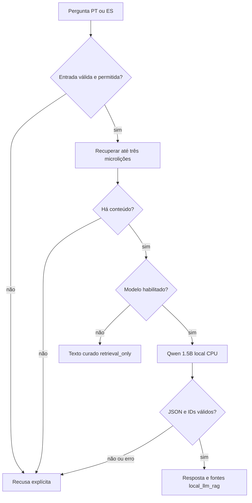
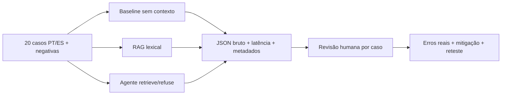

> **Atualização de fechamento:** este documento preserva o planejamento e os registros iniciais. O estado atual e a rubrica oficial estão em docs/ENTREGA_CHECKLIST.md; resultados finais estão em docs/entregas/GENAI_RELATORIO.md e VISION_RELATORIO.md. GenAI final é Qwen2.5 3B com comparação real dev20/holdoutC12 em GPU; Vision treinou20 épocas em CPU sobre40 fotos aprovadas e tem PDF final. Referências abaixo a1.5B, rubrica ausente ou treino pendente são históricas e foram superadas. Revisão humana, vídeos e Teams permanecem pendentes.

# PRD e plano de execução — GenAI

## Objetivo e escopo

Tutor bilíngue para explicar vocabulário e orientações educativas já presentes no corpus Acolhe, com citações e recusa segura. Usuário da demonstração: adulto representando aluno PT/ES, acompanhado por avaliador. Funciona localmente em CPU. Não inclui coleta de dados pessoais, decisões de travessia, tradução geral, treinamento de LLM nem expansão das demais disciplinas.

## Base auditada e lacunas

| Item | Base recebida | Esta branch | Aceite / evidência restante |
|---|---|---|---|
| Corpus e busca | 8 microlições, 16 questões, busca lexical | Preservados para comparação histórica | Revisão pedagógica e novos casos independentes |
| Inferência | Cliente Ollama sem perfil definido | Qwen2.5 1.5B Instruct final, CPU; 0.5B histórico preservado | Executado localmente; qualidade PT/ES ainda crítica |
| Experimentos | Uma pergunta por CLI, sem relatório | 20 casos idênticos nas três variantes, relatório JSON e ficha humana | 20 casos em 0.5B, quatro casos em 1.5B; falta conjunto completo final |
| Rastreabilidade | Relatórios da recuperação | Modelo, corpus, parâmetros, idioma, rastro e latência registrados | Medir RAM máxima na máquina da apresentação |
| Qualidade | Cinco erros do recuperador | Revisão humana estruturada sem inventar avaliação | Cinco erros reais LLM com mitigação/reteste |
| Integração | `/api/assistant` chama `answer` | Mesmo contrato; ativação explícita por variável | Verificar UI PT/ES com Ollama real |

## Fluxo do produto

## Experimento e critérios

RF1: respeitar idioma e recusar perguntas fora do material no fluxo do produto. RF2: indicar origem da resposta e nunca chamar recuperação de LLM. RF3: modelo local opcional, sem endpoint externo. RF4: comparar mesmas entradas nas três variantes. RF5: falhas de transporte e plano/JSON inválido são visíveis. RF6: preservar relatórios anteriores. O status `completed` representa conclusão da execução, não aceitação de qualidade; planos/outputs inválidos permanecem visíveis e exigem revisão.

RNF1: sem GPU; limitar contexto em 2048 e saída em 256 tokens. RNF2: geração tem timeout de 60 segundos por chamada, adequado para experimento e sujeito a ajuste medido; agente pode fazer duas chamadas. RNF3: inferência não grava perguntas da UI; experimento grava apenas questões fictícias. RNF4: testes padrão não exigem Ollama nem pesos. Meta de memória/latência e limiar de qualidade dependem de medição e revisão, não são declarados atingidos.

## Ordem de execução

1. **Concluído:** auditar corpus, cliente, avaliação e notebooks; escolher modelo e limitar recursos.
2. **Concluído:** implementar diagnóstico e relatório reprodutível; testar CPU, idioma, referências inválidas, transporte e bloqueio sem serviço.
3. **Concluído:** Ollama com 0.5B histórico (398 MB) e modelo final `qwen2.5:1.5b-instruct` (986 MB Q4_K_M), digest `65ec06548149b04c096a120e4a6da9d4017ea809c91734ea5631e89f96ddc57b`. Ambos CPU, sem GPU.
4. **Parcial:** duas comparações completas de 20 casos em 0.5B; subconjunto pareado q01–q04 em 1.5B. Modelo final: baseline 2/4 JSON, RAG 4/4 JSON sem fontes, agente 4/4 recusas indevidas. Seleção final se apoia no smoke de produto, não na aprovação do experimento. Falta conjunto completo 1.5B e medição de RAM máxima.
5. **Pendente de revisão:** revisar 20 casos; preencher avaliação humana, registrar cinco erros observados e melhorias; retestar em conjunto novo após mudanças. Uma revisão técnica feita pelo agente deve ser identificada separadamente e não substitui avaliação humana.
6. **Parcial:** smoke real `service.answer` PT/ES em ambos modelos e notebook 02 com saída real do relatório 1.5B/quatro casos. PT deixou de ecoar pergunta com 1.5B, ES manteve orientação com fonte mas há erro ortográfico. Falta revisão humana, navegador e vídeo após mitigações. Revalidar teste integral depois de integrar Vision.

## Riscos e decisões

O tamanho de pesos não representa RAM total. CPU e descarregamento imediato reduzem residência, mas aumentam latência. Um modelo pequeno pode não seguir ferramenta/JSON ou responder corretamente; a avaliação mede esse limite antes de adotar modelo maior. As fontes validam pertencimento ao corpus, não entailment. Recuperação lexical tem cinco falhas históricas conhecidas; não se introduz um segundo modelo de embeddings sem demonstrar necessidade. Não existe checkpoint/fine-tuning novo a entregar: a solução usa RAG e modelo público local, com origem/licença do modelo a registrar na apresentação.

## Decisão de modelo final

O 0.5B foi tentado para minimizar recursos, mas falhou qualitativamente. O 1.5B permanece abaixo de 1 GB em pesos quantizados e executou o fluxo de produto em aproximadamente seis segundos por resposta na CPU testada, com ganho funcional em PT. Isso justifica a escolha experimental para demonstração supervisionada, sem GPU ou treinamento. Não comprova qualidade geral: quatro casos no comparador não substituem os 20 casos nem avaliação humana, e o agente recusou perguntas válidas. As instruções do experimento precisam de nova iteração em fontes/roteamento, sem promover resultados de smoke a benchmark.
