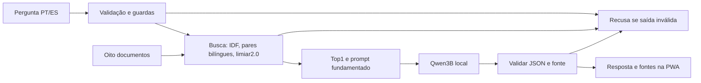

> Atualização 17/11: GenAI ativo v6/corpus v3; D16 RAG/agente 14/16 na revisão técnica exploratória, revisão humana pendente. Vision: quatro treinos adicionais não sustentaram promoção; modelo ativo e PDF preservados, meta 70%/70% ainda não atingida. Detalhes em [RESULTADOS_NOTURNOS](../docs/entregas/RESULTADOS_NOTURNOS.md). Este adendo substitui o perfil GenAI v4 como configuração atual; placares anteriores são históricos.

# PRD — GenAI

Versão 3, 17/11/2026. Escopo: orientação educativa de mobilidade e vocabulário PT/ES, acompanhada por adulto. Requisitos oficiais nas páginas 29–31; critérios ponderados em docs/ENTREGA_CHECKLIST.md. Modelos0.5B/1.5B são histórico, não a configuração atual.

## Produto e arquitetura

Modelo Qwen2.5:3b-instruct,3,09B,Q4_K_M,~1,9GB, abaixo do teto4B solicitado. Licença Qwen Research. Ollama local; GPU automática explícita e CPU alternativa. Corpus autoral de oito microlições bilíngues, com fonte e licença declarada; revisão pedagógica pendente.

## Critérios de aceite e evidências

| Item | Resultado atual | Falta/limite |
|---|---|---|
| Tarefa e teste rotulado | dev20 + holdoutC12 com gabarito e negativas | Revisão humana dos julgamentos |
| Base e fontes | genai/data/corpus.json; base/ com snapshot/CSV/manifesto | Conteúdo pedagógico não certificado |
| Busca | Recall@1/@3=16/16 no desenvolvimento; limiar2.0 justificado | Não generalizar100% para novas perguntas |
| Geração | API e HTTP real PT/ES; JSON/fontes/recusa | Idioma, intenção e omissão ainda podem falhar |
| Especialização | Agente LLM retrieve/refuse com ferramenta e rastro | É variante comparativa; UI usa RAG |
| Placar | Mesmo3B em baseline/RAG/agente, GPU confirmada | Revisão exploratória não é acurácia humana |
| Erros e reprodução | Cinco ou mais erros reais; READMEs e notebooks com outputs | Vídeo e revisão da equipe pendentes |

Dev:5/20,16/20,16/20 acertos na revisão técnica; holdoutC12:4/12,8/12,9/12. Contexto melhora o resultado observado, mas não elimina alucinações. Não houve alteração do protocolo após observar C; novos ajustes exigem novas perguntas independentes. Os JSONs preservam saídas e os julgamentos são contestáveis.

## Operação e demonstração

Usar scripts/iniciar-demo.ps1 e docs/entregas/COMO_USAR_E_GRAVAR.md. Perguntar travessia em PT, ajuda ao se perder em ES e previsão de chuva fora da base. Mostrar fontes, recusa e placar. Aviso fixo de travessia é política curada, não geração. Sem variável de modelo, retrieval_only é texto recuperado e não LLM.

## Pendências e melhorias posteriores

Revisar idioma, intenção tradução/orientação e recusas com humanos; criar casos novos após ajustes, mantendo gabarito e distinção entre erro factual e conteúdo fora da fonte. Manter3B inicialmente: dados/prompt/intenção devem ser investigados antes de aumentar o modelo. Gravar/publicar vídeo, inserir URL real, conferir nomes/RMs e links, enviar no Teams. Relatório completo: docs/entregas/GENAI_RELATORIO.md.
