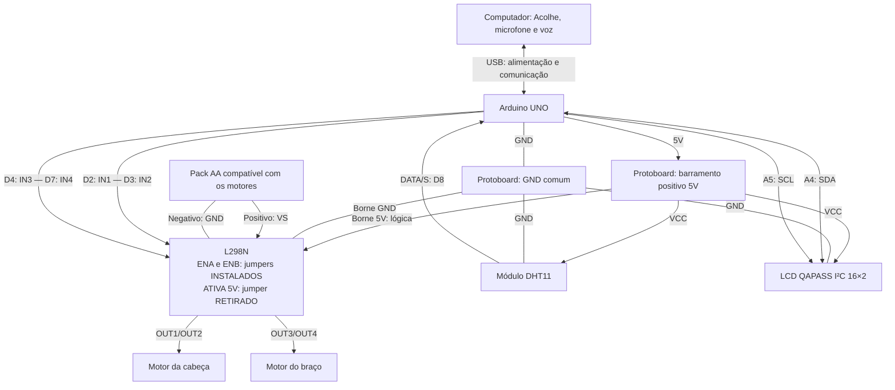

# Acolhe — Arduino Uno, LCD I²C, DHT11 e L298N

Configuração atual: **17/11/2026**. ENA/ENB ficam habilitados pelos jumpers da ponte. O Uno controla somente sentido e duração dos motores, sem PWM e sem fios nos pinos D5/D6. Esta montagem substitui o perfil anterior ESP32/PWM.

## Equipe

- Tomáz Versolato Carballo — RM 551417
- Rony Ken Nagai — RM 551549
- Aksel Viktor Caminha Rae — RM 99011
- Ian Xavier Kuraoka — RM 98860

## Ligações atuais

| Componente | Conexão |
| --- | --- |
| Cabeça, motor A | L298N OUT1/OUT2; IN1→D2, IN2→D3 |
| Braço, motor B | L298N OUT3/OUT4; IN3→D4, IN4→D7 |
| ENA/ENB | Jumpers instalados, sem fios ao Uno e sem resistores desses pinos para GND |
| DHT11 em módulo | DATA/S→D8; VCC→5 V; GND comum; seguir marcações da placa |
| LCD QAPASS 16×2 I²C | SDA→A4; SCL→A5; VCC→5 V; GND comum |
| Uno | Alimentado pelo USB do computador |
| Lógica L298N | Borne 5 V alimentado pelo Uno; jumper do regulador **ATIVA 5V retirado** |
| Potência L298N | Positivo do pack AA→VS; negativo→GND da ponte |
| GND | Uno, ponte, LCD, DHT11 e negativo das pilhas interligados |

Motores recebem energia pelo circuito de potência da ponte, não pelo Uno ou barramentos da protoboard. Confirmar tensão e corrente do pack compatíveis com os motores; o número exato de pilhas/tensão ainda não foi medido nesta sessão. A L298N apresenta queda de tensão. Fonte: [datasheet ST](https://www.st.com/resource/en/datasheet/l298.pdf).

**A imagem antiga com D5/D6, resistores em ENA/ENB e instrução para retirar três jumpers não representa mais esta montagem.** Agora apenas o jumper do regulador ATIVA 5V sai; os dois jumpers de habilitação dos motores permanecem.



## Gravar pelo Arduino IDE

1. **Desligue a alimentação dos motores antes de gravar, resetar ou trocar fios.** Mantenha o Uno pelo USB para a gravação.
2. Abra `robot/firmware/acolhe/acolhe.ino`. O arquivo atual é exclusivo para **Arduino Uno**; selecionar ESP32 gera erro de compilação intencional.
3. No gerenciador de bibliotecas instale **DHT sensor library 1.4.7**, **Adafruit Unified Sensor 1.1.15** e **hd44780 1.3.2** (Bill Perry). A classe `hd44780_I2Cexp` detecta o endereço do LCD; não presume 0x27.
4. Em Ferramentas selecione **Arduino Uno** e a porta que aparecer para ele. Não presumir COM4, que era a porta do ESP32 anterior.
5. Clique em Verificar e Carregar. Abra o Monitor Serial em **115200 baud**, linha nova. Pressione RESET se precisar repetir o cabeçalho.
6. Confirme `version:ACOLHE_V2`, `board:UNO`, `motor_control:direction_only`, `pwm_supported:false` e `lcd_enabled:true`. `lcd_ok:true` indica detecção da interface, não revisão visual do visor.
7. A cada dois segundos chegam temperatura/umidade com `valid:true` ou erro de leitura com `valid:false`. O LCD mostra estado na primeira linha e medidas na segunda; ajuste o contraste se necessário.
8. Feche o Monitor Serial antes de conectar pelo painel. A versão antiga `ACOLHE_V1` não é aceita por este backend, porque usava outro formato de comando de motores.

O operador gravou o firmware e confirmou os movimentos e gestos do treino em 17/11. O backend recebeu identificação ACOLHE_V2, leituras DHT11 válidas e detecção da interface LCD. Compilação, confirmação humana e evidências audiovisuais são registros distintos; a revisão visual do LCD ainda precisa de evidência.

## Inicialização, parada e limites

Com ENA/ENB nos jumpers, as combinações HIGH/LOW e LOW/HIGH giram em sentidos opostos. LOW/LOW, usado na parada, **freia** o motor; HIGH/HIGH também freia. Não se trata mais de deixar o motor livre por ENA/ENB em LOW. [Tabela da ST](https://www.st.com/resource/en/datasheet/l298.pdf)

O firmware coloca IN1–IN4 em LOW ao iniciar. Durante reset, gravação ou falta de alimentação do Uno, os GPIOs podem ficar sem controle: o software não garante parada nessa fase. Para manter também os sinais definidos enquanto o Uno está em reset, use quatro pull-downs de 10 kΩ, um em cada **IN1/IN2/IN3/IN4** para GND. Eles são diferentes dos resistores antigos de ENA/ENB, que não pertencem à montagem atual. Mantenha acesso ao corte da alimentação dos motores.

O primeiro teste por comando dura **100 ms em acionamento total**, sem controle de velocidade. Esse tempo foi escolhido para começar a calibração no perfil de potência total; não é promessa de ângulo ou volta completa. Limite de duração:150ms; intervalo mínimo:2s. O heartbeat é enviado pelo computador a cada0,5s e o firmware freia após2s sem comunicação, enquanto o Uno continuar alimentado e executando. O botão Parar também freia e limpa as calibrações.

TT DC sem encoder não mede posição nem garante retorno. Testar primeiro um motor de cada vez e registrar movimento observado, direção e limites mecânicos.

## Testar no Acolhe

Execute `Iniciar-Acolhe.cmd` na raiz e abra **http://127.0.0.1:8080/robo.html**. Atualize com Ctrl+F5, escolha a porta atual do Uno e conecte. A versão nova exige gravar o firmware acima.

| Frase por texto/voz ou botão rápido | Motor |
| --- | --- |
| `Acolhe, mova o braço` | Braço, OUT3/OUT4, pulso100ms/sentido1 |
| `Acolhe, mova a cabeça` | Cabeça, OUT1/OUT2, pulso100ms/sentido1 |
| `Acolhe, dê um oi` ou `Acolhe, diga sim` | Braço, mesmo pulso de teste |
| `Acolhe, diga não` | Cabeça, mesmo pulso de teste |
| Perguntas sobre temperatura, umidade ou explicações | Nenhum motor |

Os comandos de teste são pedidos explícitos do operador, reconhecidos por regra fechada; não são comandos produzidos pelo LLM. O retorno usa `mode:motor_test` e `model:null`, confirma somente envio do pulso e mantém `physical_verified:false`. Negação, frase explicativa, pergunta sobre como mover ou pedido para os dois motores não são acionamento.

Na calibração supervisionada do painel, ajuste duração (1–150ms) e sentido. O campo PWM foi removido. Somente após **observar movimento seguro** registre os mesmos parâmetros testados. Confirme os dois motores para habilitar gestos das lições: acerto→braço; nova tentativa→cabeça. Parar/reiniciar/reconectar limpa essa habilitação. Um novo pedido explícito continua sendo uma nova autorização de teste manual; desconectar ou cortar a potência impede esses testes.

### Conversa e treino de palavras

Na tela `/robo.html`, use o microfone ou digite. Exemplos: “Qual é seu nome?”, “O que você sabe fazer?”, “Como digo obrigado em espanhol?”, “Como pedir ajuda com gentileza?” e “Qual é a temperatura da sala?”. A conversa usa Qwen3 com conteúdo educativo recuperado; medidas vêm exclusivamente do sensor válido. O material inclui agradecimento e pedidos com gentileza em português/espanhol.

Diga **“Vamos praticar”** ou clique **Treinar palavras**. O treino pergunta, em ordem:

Também aceita “Acolhe, vamos praticar?”, “Vamos aprender uma palavra”, “Quero aprender uma palavra” e “Pode me ensinar uma palavra?”. A transcrição “Acole” é aceita no convite ao treino. Frases ininteligíveis recebem uma orientação para repetir ou usar o botão, sem iniciar movimento. Se até “Vamos praticar” continuar retornando a resposta antiga de escopo, reinicie o servidor Python do Acolhe; atualizar só a página não recarrega o código do backend.

| Palavra em espanhol | Resposta esperada |
| --- | --- |
| hola | olá ou oi |
| silla | cadeira |
| botella | garrafa |

Responda apenas a palavra. Acerto pede gesto do braço; uma palavra incorreta pede gesto da cabeça e oferece nova tentativa. **Os dois motores precisam estar calibrados**, conectados e fora do intervalo mínimo de dois segundos; sem isso, a atividade continua sem gesto e o painel informa. Não há garantia de ângulo, balanço ou retorno: cada pedido é um pulso único. “Diga sim” é uma convenção de gesto com o braço, sem pressupor que a cabeça consiga assentir.

“Não sei” ou “Repita a pergunta” dá dica, sem gesto. “Encerrar atividade” ou “pare” encerra o treino, sem gesto. Perguntas completas e negações não são avaliadas como erro. O botão **Parar** cancela a interação, termina o treino pendente e bloqueia os gestos automáticos. Para recomeçar, diga “Vamos praticar”. “Limpar conversa” também zera o treino.

O treino é uma sequência curada e avaliada por regra (`mode:guided_practice`, `model:null`), com voz Piper; é identificado separadamente da conversa gerada por IA. `motor_reaction.sent` confirma somente o envio do comando, nunca movimento físico. Não interpreta a resposta do LLM como comando.

## Voz, IA e sensor

O computador mantém Whisper small CPU/int8, Qwen3 4B via Ollama local e Piper em português. Gravação começa pelo botão e termina no segundo clique ou em15s. Não mantém gravações/conversas em disco; guarda as três últimas interações em memória. Perguntas sem escopo recebem recusa declarada, não geração simulada.

O DHT11 é lido a cada2s. Valores inválidos ou com mais de6s são indisponíveis. A leitura é reavaliada antes e depois da geração; números apresentados vêm de dados validados, não de inferência. Três leituras consecutivas≥30°C oferecem atividade sobre “quente”, com rearme<28°C e intervalo120s. É uma regra didática, não clínica. O sensor não detecta presença nem qualidade do ar.

Se ainda precisar preparar o computador: Python3.12x64, Ollama com `qwen3:4b` e `Preparar-Robo.cmd` na raiz. O script cria `.venv` e copia somente os modelos locais Whisper/Piper do projeto anterior, sem importar a aplicação Talos. Outra origem: `Preparar-Robo.cmd --source "C:\pasta\origem"`, contendo `modelos/whisper-small/` e `piper/` com executável/DLLs/dados espeak/modeloONNX e JSON. Pesos e binários ficam em `robot/.models/`, ignorada pelo Git. Obter arquivos nas fontes [Whisper](https://huggingface.co/Systran/faster-whisper-small), [runtime Piper testado](https://github.com/rhasspy/piper/releases/tag/2023.11.14-2) e [voz Faber](https://huggingface.co/rhasspy/piper-voices/tree/main/pt/pt_BR/faber/medium), preservando licenças/MODEL_CARD.

Configuração opcional de caminhos: `ACOLHE_WHISPER_PATH`, `ACOLHE_PIPER_EXE`, `ACOLHE_PIPER_MODEL`; modelo por `ACOLHE_ROBOT_MODEL`. Não há troca silenciosa de modelo ou de falha por texto falso. Falha na voz mantém a resposta escrita com indicação do componente.

## Preparar em outro computador (Windows x64)

1. Instale Python 3.12 x64, Git, Arduino IDE e [Ollama](https://docs.ollama.com/quickstart). O firmware e as bibliotecas Arduino estão descritos acima.
2. Clone a revisão do projeto que foi entregue e entre na pasta:

   ```powershell
   git clone https://github.com/TomazVC/Acolhe---GS8.git acolhe
   cd acolhe
   # Se a entrega estiver em outra branch, selecione-a antes dos próximos passos.
   git switch feat/acolhe-maker-voz
   ```

3. Com Ollama instalado, obtenha o modelo e confira o nome. O download exige internet; a execução usa a API local. Mantenha o aplicativo Ollama aberto. Se ele não estiver servindo a API, execute `ollama serve` em um terminal separado; não abra uma segunda instância se a porta 11434 já estiver ocupada. [CLI oficial](https://docs.ollama.com/cli).

   ```powershell
   ollama pull qwen3:4b
   ollama list
   ```

4. Prepare uma pasta externa, por exemplo `C:\Acolhe-modelos`, com a estrutura abaixo. Obtenha os arquivos do [Whisper small convertido](https://huggingface.co/Systran/faster-whisper-small), extraia o pacote Windows x64 do [runtime Piper testado](https://github.com/rhasspy/piper/releases/tag/2023.11.14-2) e coloque os dois arquivos da [voz Faber](https://huggingface.co/rhasspy/piper-voices/tree/main/pt/pt_BR/faber/medium) junto ao executável. Preserve o conteúdo completo do runtime, licenças e MODEL_CARD; não use apenas os ponteiros de arquivos grandes de um clone sem LFS.

   ```text
   C:\Acolhe-modelos\
     modelos\whisper-small\
       config.json
       model.bin
       tokenizer.json
       vocabulary.txt
     piper\
       piper.exe
       espeak-ng.dll
       onnxruntime.dll
       piper_phonemize.dll
       ...demais DLLs do pacote...
       espeak-ng-data\...dados do pacote...
       pt_BR-faber-medium.onnx
       pt_BR-faber-medium.onnx.json
   ```

5. Na raiz do projeto execute `Preparar-Robo.cmd --source "C:\Acolhe-modelos"`. Ele cria `.venv`, instala `robot/requirements.txt` e copia somente os arquivos de modelos/runtime. O Talos não é necessário quando `--source` aponta para essa pasta preparada. Arquivos incompletos são rejeitados com a lista do que falta. Os arquivos copiados ficam em `robot/.models`, ignorados pelo Git.
6. Grave o Uno, feche o Monitor Serial e execute `Iniciar-Acolhe.cmd`. Mantenha a janela aberta; acesse http://127.0.0.1:8080/robo.html. Libere o microfone quando solicitar, selecione a porta do Uno e conecte.
7. Confira DHT11/LCD, teste e registre cada motor em **Preparar gestos do treino**. Use “Vamos praticar” e uma pergunta sobre a temperatura. Diagnóstico de arquivos: `GET /api/robot/status`; verificação técnica local: `.\.venv\Scripts\python.exe -m robot.verify_local`, que não substitui o teste físico.

O runtime Piper utilizado é uma versão histórica testada, não uma afirmação sobre a versão mais recente. Pesos e runtime não são distribuídos neste repositório. Sem eles, o painel informa a indisponibilidade do componente.

## Protocolo e API

Serial115200, comandos com linha nova, respostas JSON. Handshake **ACOLHE_V2**, perfil **direction_only**. Formatos atuais:

```text
HELLO
PING
STOP
STATE READY
TEST head 100 1
TEST arm 100 -1
CONFIG head 100 1
CONFIG arm 100 1
GESTURE arm
```

TEST/CONFIG recebem motor, duração emms e direção1/-1; **nenhum argumento de velocidade**. TEST exige heartbeat recente; prefira o painel para atuação, pois envia PING continuamente. CONFIG somente registra parâmetros; GESTURE exige ambos configurados. ACK não comprova saída elétrica ou rotação.

API local: `GET /api/robot/status`; POST em `connect`, `disconnect`, `chat`, `state`, `pulse`, `calibrate`, `stop`, `clear` sob `/api/robot/`. `pulse`/`calibrate` recebem `motor`, `duration_ms`, `direction` e as confirmações de operador correspondentes. Requisições antigas com campo `pwm` são rejeitadas antes do envio: atualizar a página. Controle físico limitado ao computador local, com validação de Host/origem e endereço da conexão.

Áudio: PCM16LE/mono16kHz/0,1–15s/base64; limite de corpo1MiB só na rota `chat`. O retorno informa texto/transcrição, modelo/modo, sensor, fontes, áudioWAV, erros e duração; teste de motor inclui parâmetros efetivamente enviados, sem PWM. As lições preservam idempotência: reenvio de tentativa não repete gesto. Pedidos cancelados não disparam depois de STOP.

## Verificação e evidências

```powershell
.\.venv\Scripts\python.exe -B -m unittest discover -v
node --test tests/frontend.test.cjs tests/robot_frontend.test.cjs
node --check app/static/robot.js
.\.venv\Scripts\python.exe -m robot.verify_local
```

`verify_local` usa áudio sintetizado e leituras de teste identificadas; não testa o microfone, o som audível nem o DHT11 físico. `passed` indica fluxo técnico, não qualidade pedagógica/factual. Revisar as respostas do modelo; testes anteriores tiveram termos imperfeitos/repetição e latência acima da meta de10s. Evidências antigas de11/11 e do ESP32 são históricas, não validação desta montagem Uno sem PWM.

- [ ] Medir/conferir pack, corrente na partida, GND e jumpers.
- [x] Uno executando ACOLHE_V2; DHT11 com telemetria real válida e interface LCD detectada pelo backend.
- [ ] Registrar em vídeo/fotos o sensor, as leituras e o conteúdo visível do LCD.
- [x] Cabeça e braço testados pelo usuário em17/11; sessão registrou100ms/sentido1 em cada motor, acionamento total. Confirmação humana, sem medição de ângulo/retorno pelo sistema.
- [x] Operador confirmou gestos nas atividades após registrar cabeça e braço em 17/11.
- [ ] Fazer cinco conversas reais com microfone/voz audível e medir latência.
- [ ] Demonstrar falhas: comunicação, sensor inválido/expirado, IA indisponível e parada durante gesto.
- [ ] Fotografar montagem e gravar vídeo de até6min; inserir link real no README.

**Vídeo: pendente.** GitHub é a documentação oficial da disciplina; ZIP/PDF não substituem código, instalação, integração e vídeo. Roteiro: [docs/roteiros_videos.md](../docs/roteiros_videos.md).
