# PRD — Vision

Versão 3, 17/11/2026. Problema: apresentar nomes PT/ES de objetos em fotos selecionadas por adulto. Mantidas 12 classes: mochila, cadeira, livro, garrafa, copo, colher, garfo, tigela, relógio, guarda-chuva, ônibus e semáforo. Não inferir rosto, identidade, cor do sinal ou permissão para atravessar.

## Requisitos oficiais e estado

Página 44 exige treino customizado de arquitetura adequada, código/documentação, PDF e vídeo funcionando. Não fixa recall, quantidade de fotos, classes ou épocas. PDF vale até5pontos e vídeo até5pontos; pontuação depende do professor.

- Implementado: dadosCOCO→YOLO, auditoria, revisão vinculada a hashes, treino real, teste, manifesto/hash/classes e inferência HTTP/PWA sem gravar upload.
- Piloto inicial:40 fotos aprovadas,25/8/7,20 épocasCPU com resolução 320; métricas reais preservadas.
- Melhoria concluída:80 épocasCPU com resolução 640 sobre treino aprovado; confiança selecionada pela validação e modelo anterior preservado. Resultados e limites registrados abaixo.
- Novo teste:23 fotos distintas aprovadas e avaliadas, sem uso para treino ou escolha de configuração.

```mermaid
flowchart LR
    I[Imagens e caixas] --> R[Procedência e revisão humana]
    R --> A[Auditoria e splits]
    A --> T[TreinoYOLO11n]
    T --> V[Checkpoint por validação]
    V --> C[Calibrar confiança pela validação]
    C --> F[Congelar configuração]
    F --> E[Teste separado e erros]
    E --> M[Manifesto: hash, classes, conf e imgsz]
    M --> P[UploadPWA e vocabulárioPT/ES]
```

## Aceite técnico

| ID | Critério | Verificação |
|---|---|---|
| V01 | Dados rastreáveis | Licença/autoria/URL/hash, aprovação e caixas válidas |
| V02 | Splits sem vazamento | IDs e bytes distintos; augmentations somente no treino; similaridade perceptual ainda não auditada |
| V03 | Treino customizado | Ambiente, configuração, hash e histórico reais; não chamar pesos genéricos de treino próprio |
| V04 | Qualidade medida | Precisão/recall/mAP nativo e contagens em IoU0.5 no limiar da aplicação; resultados por classe |
| V05 | Escolha sem teste | Grade de confiança maximiza F1 micro na validação; congelar antes do teste novo |
| V06 | Serviço coerente | Validar manifesto e usar conf/imgsz medidos, PNG/JPEG≤8MiB, sem gravar fotos |
| V07 | Relatório | PDF com resumo250/objetivo50 palavras, método, resultados e limites; vídeo real ainda pendente |

Meta local proposta: recall≥70%, precisão≥70%, nenhuma classe abaixo de60%; divulgar denominadores. Não é requisito numérico da FIAP nem prova de prontidão para crianças. O teste inicial7 fotos/42 objetos é insuficiente; o novo23 fotos ainda terá classes pouco representadas.

## Plano de evolução

1. Executar o experimento80 épocas com resolução 640 sem mudar os splits aprovados.
2. Calibrar baseline e candidato somente em validação; escolher pelo F1, precisão e desempenho por classe. Preservar original e histórico.
3. Avaliar em teste novo após revisão humana; relatar ganho e perdas, sem esconder classes zeradas.
4. Se não atingir a meta, ampliar treino para100–200 objetos por classe como primeira rodada, com variedade e anotações completas; obter revisão real de cada lote. Não substituir dados por duplicação/augmentations no teste.
5. Atualizar relatório/PDF, roteiro de gravação e serviço com a versão escolhida.

CPU é a stack PyTorch instalada; OllamaGPU não implicaYOLOGPU. Não alterar drivers como atalho. Os pesos/fotos continuam locais; novo clone precisa reproduzir dados e treino. Guia para usuário: docs/entregas/COMO_USAR_E_GRAVAR.md. Evidências e configuração ativa: vision/reports/. Vídeo, revisão da equipe e Teams permanecem pendentes.

## Resultado da rodada executada

80 épocas com resolução 640 concluídas. O candidato foi promovido por F1micro de validação0,3488 versus0,3056 do modelo inicial calibrado. Versão ativa: confiança 0,10, resolução 640; checkpoint5935a4aa…. Teste histórico: recall nativo54,65%, mAP50 de 62,12%; no limiar da aplicação,22TP/21FP/20FN, recall52,38%, precisão51,16%. Baseline original no limiar0,5:4TP/1FP/38FN. Comparação justa com baseline também calibrado0,1:11TP/17FP/31FN. Meta de 70%/70% ainda não atingida. Novo teste de23 fotos aprovado e avaliado sem ajuste posterior; nenhuma imagem nova entrou no treino. Evidências em vision/reports/improvement-20261116.json e calibration-improved-640-80.json.

## Teste novo e meta revisada

Meta principal revisada pelo usuário: recall≥70% e precisão≥70%; o piso de60% por classe permanece um diagnóstico adicional, não uma exigência da rubrica. Teste novo aprovado de23 fotos/66 objetos, executado com configuração congelada no commitccdd7d7: baseline calibrado30TP/19FP/36FN (recall45,5%, precisão61,2%); versão ativa35TP/37FP/31FN (recall53,0%, precisão48,6%). O recall subiu, mas precisão e F1 caíram. Não se trocou modelo/limiar com base no teste; não se declara meta cumprida. Evidência: vision/reports/independent23-frozen.json. As imagens foram autorizadas somente para teste local. Para novos ajustes, ampliar treino e reservar outro teste, mantendo este como histórico congelado.

## Validação de bases leves

ComparaçãoCPU real de YOLO11n,YOLOv8n eYOLO26n pré-treinados nas8 fotos de validação, com remapeamento por nome para12 classes. YOLO26n teve o maior F1devalidação0,4667, contra0,3636/0,4286 das outras bases. São referências genéricas, não treino customizado. Experimento customizadoYOLO26n80épocas640 iniciado com treino25/val8 aprovados, sem usar teste23 na seleção. RF-DETRNano foi pesquisado, não executado; licençaApache2.0, footprintmaior. Decisão detalhada, licenças e fontes em docs/MODELOS_VISION.md.

## Dados da próxima rodada

Priorizar fotos de objetos próximos que representem a interação educativa prevista: diferentes exemplares, fundos e iluminações, com caixas completas e revisão de direitos/privacidade. Manter cenas difíceis separadas para diagnóstico. Não remover silenciosamente exemplos difíceis do teste atual nem apresentar um subconjunto escolhido após os resultados como prova de70%. A expansão ainda não foi treinada; as23 fotos aprovadas são exclusivamente teste.
