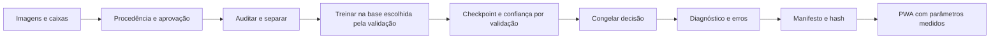

> Atualização 17/11: GenAI ativo v6/corpus v3; D16 RAG/agente 14/16 na revisão técnica exploratória, revisão humana pendente. Vision: quatro treinos adicionais não sustentaram promoção; modelo ativo e PDF preservados, meta 70%/70% ainda não atingida. Detalhes em [RESULTADOS_NOTURNOS](../docs/entregas/RESULTADOS_NOTURNOS.md). Este adendo substitui o perfil GenAI v4 como configuração atual; placares anteriores são históricos.

# PRD — Vision

Versão3,17/11/2026. Meta principal aprovada pelo usuário: **recall ≥ 70% e precisão ≥ 70%**, no limiar usado pelo aplicativo. A página44 não fixa esses números; são uma meta do protótipo. Ainda não atingida.

## Problema e jornada

Um adulto seleciona foto de objetos do cotidiano e recebe nomesPT/ES. Não há reconhecimento facial, interpretação da cor do sinal ou decisão de travessia. UploadPNG/JPEG≤8 MiB, sem câmera automática ou armazenamento. Guia de uso/gravação: docs/entregas/COMO_USAR_E_GRAVAR.md.

## Modelo ativo e decisão

YOLO26n customizado,80 épocasCPU640, batch 2, workers 0, seed 42, confiança 0,15. Base oficial leve, cerca de 5,54 MB de pesos pré-treinados; AGPL3.0/Enterprise. Ultralytics 8.4.215 fixado para reproduzir suporte à arquitetura. Três bases executadas na validação; RF-DETRNano pesquisado sem execução. Pesquisa: docs/MODELOS_VISION.md.

Após treino customizado, F1 micro de validação 0,4675 contra 0,3488 do YOLO11n 80. Essa regra determinou a promoção, antes da regressão. Checkpoint007a199a… e parâmetros constam do manifesto. Modelos20 épocas e YOLO11n 80 preservados localmente.

## Dados e avaliação

Treino25 fotos/97 objetos, validação 8/48; doze classes com nomesPT/ES. Novo lote 23 fotos/66 objetos foi aprovado exclusivamente para teste local. Preservados pixels/caixas/splits de treino/validação; sem IDs/bytes em comum com o lote 40inicial. Fingerprint4b18ed3a…. Similaridade perceptual não auditada.

Na regressão23:34TP/22FP/32FN, precisão60,7%, recall51,5%, F1 de 0,5574. YOLO11n 80 tinha48,6%/53,0%, F1 de 0,5072. Melhorou precisão/F1, com pequena perda de recall. Esse teste já foi examinado; não é novo teste cego para a troca de arquitetura. Não houve ajuste depois. Métricas nativas por classe usam outro ponto operacional e são reportadas separadamente.

## Critérios de aceite

| ID | Critério | Verificação |
|---|---|---|
| V01 | Dados rastreáveis | Autor/licença/URL/hash, revisão real e caixas válidas |
| V02 | Splits consistentes | IDs/bytes separados; transformações só no treino |
| V03 | Treino customizado | Ambiente/parâmetros/pesos/hash/métricas reais; pesos genéricos são apenas referência |
| V04 | Escolha pela validação | Grade 0,05–0,80 maximiza F1 micro; desempates por precisão/confiança |
| V05 | Inferência coerente | Hash/classes/limites conferidos; manifesto conf0,15/imgsz 640; HTTP real |
| V06 | Qualidade |70% de recall e 70% de precisão operacionais; pendente, quality_validated=false |
| V07 | Entrega | PDF com 250/50palavras; vídeo funcionando, links e Teams ainda dependem da equipe |

## Próxima rodada

Ampliar e equilibrar treino com variedades, fundos, luzes e objetos próximos da interação educativa; revisar todas as caixas.100–200 objetos/classe é início sugerido, não garantia. Não remover exemplos difíceis após ver resultados nem usar o23 como treino. Reservar outro teste final antes de ajustar novamente. Acompanhar falhas por classe; o alvo formal acordado são as duas métricas globais70%/70%.

CPU é a stack instalada; a GPUOllama não foi apresentada como treinoYOLOGPU. Fotos/pesos ficam locais, metadados/rótulos/licenças compartilháveis. Reproduzir em vision/README.md; evidências em vision/reports/yolo26n-custom-decision.json, yolo26n-regression23.json e inference-http-yolo26n.json. PDF em output/pdf/ACOLHE_VISION.pdf.
