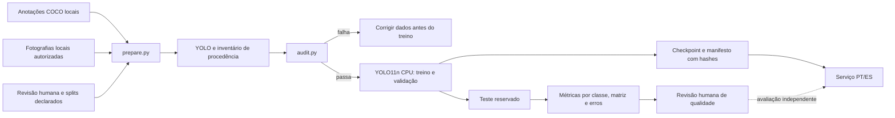
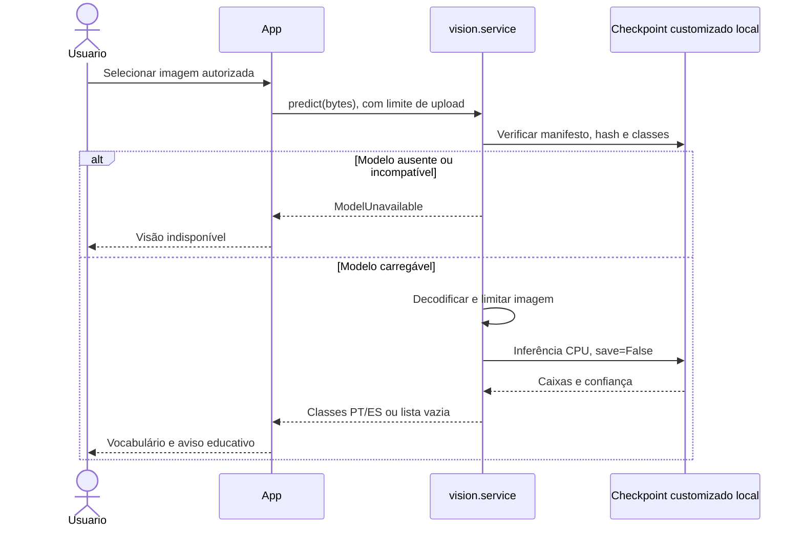

# PRD e plano de Computer Vision — 2026-11-16

## Problema e resultado esperado

Uma pessoa em acolhimento linguístico vê um objeto cotidiano e aprende seu nome em português/espanhol. O MVP detecta somente as 12 classes já estabelecidas, informa quando o modelo não existe e mantém as fotos fora do armazenamento do aplicativo. Não interpreta semáforos para autorizar travessia.

O público desta fase são adultos em demonstração acadêmica com dados autorizados. Adequação a crianças e validade pedagógica exigem avaliação independente. Nenhuma rubrica disciplinar completa foi encontrada na pasta vision; este plano cobre as pendências documentadas na base, não afirma conformidade com critérios externos não fornecidos.

## Base, lacunas e entregas

| Item | Base encontrada | Implementação nesta branch | Aceite / restante |
|---|---|---|---|
| Contrato PT/ES | 12 classes, `status()`/`predict(bytes)` | Inferência CPU 320; imagens inválidas geram erro claro; sem gravação | Testes do contrato passam; falta inferência real |
| Dados | Exemplos YAML/procedência; avaliações históricas COCO/Open Images | `prepare.py`: conversão de COCO local revisado, classes na ordem correta, saída nova | Roundtrip unitário passa; faltam fotografias licenciadas e revisadas |
| Auditoria | Nomes/YAML declarados, sem verificar conteúdo | `audit.py`: pixels legíveis, hashes, caixas, inventário, duplicação, cobertura por split | Treino só prossegue após auditoria; curadoria jurídica/visual permanece humana |
| Hardware | Treino 640 sem opções de consumo | CPU, imagem 320, batch 2, workers 0, sem cache; parâmetros explícitos | Medir memória e tempo em piloto real antes de ampliar |
| Treino | Transferência YOLO11n e cópia exclusiva de best.pt | Auditoria anterior ao runtime; YAML absoluto; configuração e fingerprint no manifesto | Executar piloto de 1 época e depois experimento final com dados adequados |
| Avaliação | Somente métricas globais | Teste reservado, métricas por classe, plots/JSON e diretório rastreável | Produzir métricas reais; não atribuir resultados de mocks ao modelo |
| Erros | Pendência descritiva | Checklist ligado à pasta real de avaliação | Analisar erros reais por classe/condição, sem ajustar no teste |
| Integração | Apenas status exposto em HTTP na base | PWA PT/ES e `POST /api/vision/predict` com imagem raw, implementados na integração da branch | Limite 8 MiB e erros explícitos; inferência real depende do checkpoint |

## Requisitos e critérios verificáveis

1. **V01 — corpus rastreável:** cada imagem tem ID original, autor, URL, licença, data de revisão, SHA-256 e declaração de revisão de privacidade. Imagens com crianças identificáveis são excluídas pela curadoria. Ausência de qualquer campo bloqueia o preparo.
2. **V02 — separação honesta:** imagens originais são atribuídas a treino/val/teste antes de qualquer transformação. As 12 classes têm caixas em cada split. Conteúdo binário repetido bloqueia o treino. Recortes/recompressões exigem comparação humana adicional.
3. **V03 — dados válidos:** dimensões da foto original batem com COCO; caixas têm dimensões positivas e ficam dentro da imagem. Nenhum path escapa da raiz; não são executados downloads do YAML.
4. **V04 — experimento reproduzível:** seed 42, opções CPU, fingerprint dos dados, hash dos pesos e caminho de avaliação ficam registrados. Arquivos anteriores não são sobrescritos.
5. **V05 — avaliação auditável:** precisão, recall e mAP50/mAP50-95 globais/por classe vêm de `val(split=test)`. A matriz de confusão e as predições acompanham o relatório. Não há meta numérica de qualidade inventada; definir metas após revisar dataset/rubrica e antes do experimento final.
6. **V06 — experiência honesta:** sem checkpoint treinado verificado, retorna indisponível. Imagens inválidas e limite de tamanho têm erro explícito. Nenhum objeto retorna uma lista vazia, sem inventar detecção.
7. **V07 — limites pedagógicos:** rótulos PT/ES consistentes; nenhum reconhecimento de identidade nem decisão de travessia; imagens de uso não são persistidas.

## Fluxo de dados e evidências

## Execução ordenada

**Concluído nesta branch:** preparação local, auditoria, parâmetros CPU, artefatos de avaliação e regressões, além do endpoint de inferência e interface PWA PT/ES integrados no app. Testes executados com dependências leves; sem dataset/pesos baixados.

**Próxima etapa dependente de dados:** selecionar um conjunto pequeno que cubra as 12 classes em todos os splits. Como planejamento inicial, buscar 20/5/5 imagens distintas por classe em treino/val/teste (uma imagem pode conter várias classes), revisar distribuição e ampliar conforme erros. Essa quantidade é um ponto de partida do piloto, não uma promessa estatística nem exigência da rubrica.

**Piloto:** instalar runtime CPU em ambiente isolado; executar uma época em `vision/artifacts-pilot-01`; medir tempo/RAM e verificar se todos os artefatos são gerados. Se o custo for alto, reduzir batch para 1, mantendo as classes/splits; não simular treinamento.

**Experimento final:** fixar critérios de qualidade e parâmetros com treino/validação; executar teste somente após a escolha. Catalogar erros reais, integrar inferência ao app e gravar demonstração com adultos e fotos autorizadas. Uma mudança motivada por erro de teste exige novo holdout para uma avaliação independente.

## Riscos e limites

CPU pode ser lenta e 320 pode perder objetos pequenos. Cobertura estrutural não garante diversidade; SHA-256 não detecta fotos recortadas e não comprova direitos autorais. Metadados de revisão são declarações humanas. O checkpoint `.pt` deve vir de fonte confiável. A licença Ultralytics precisa ser revisada antes de redistribuir. `quality_validated=false` permanece explícito até revisão de qualidade independente; este trabalho não fabricou resultados de treino.

Referências: [YOLO11](https://docs.ultralytics.com/models/yolo11/), [parâmetros de treino](https://docs.ultralytics.com/modes/train/), [validação e métricas](https://docs.ultralytics.com/modes/val/), [formato de detecção](https://docs.ultralytics.com/datasets/detect/).
